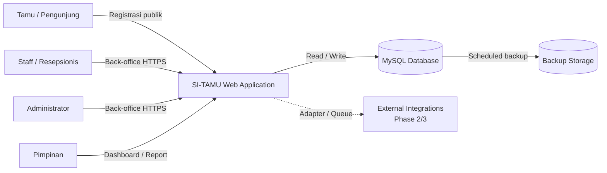
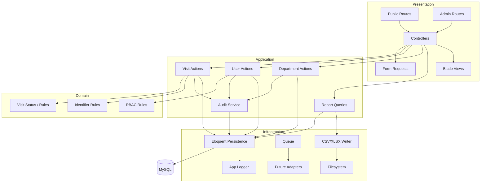
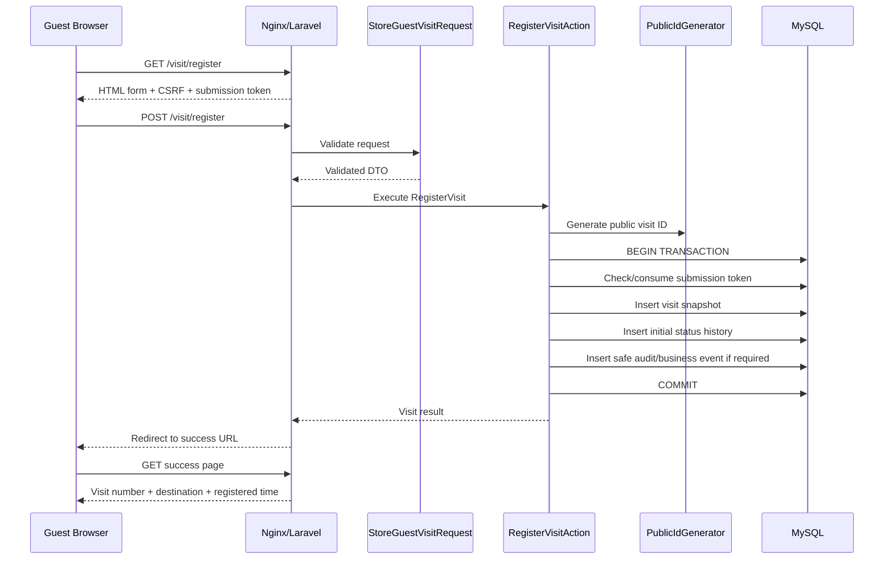
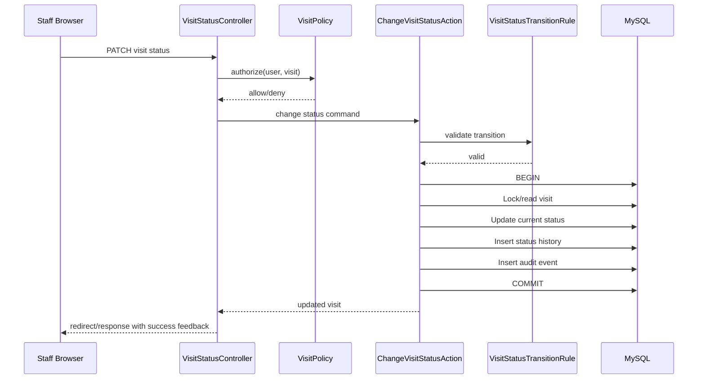
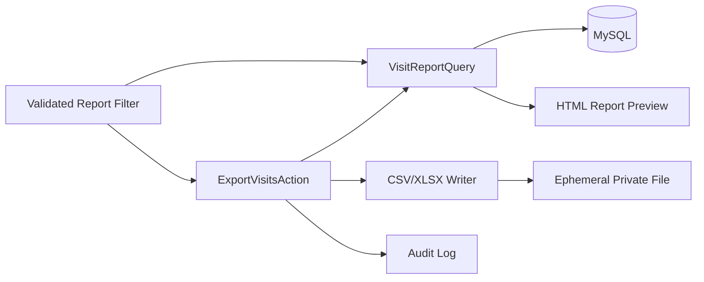
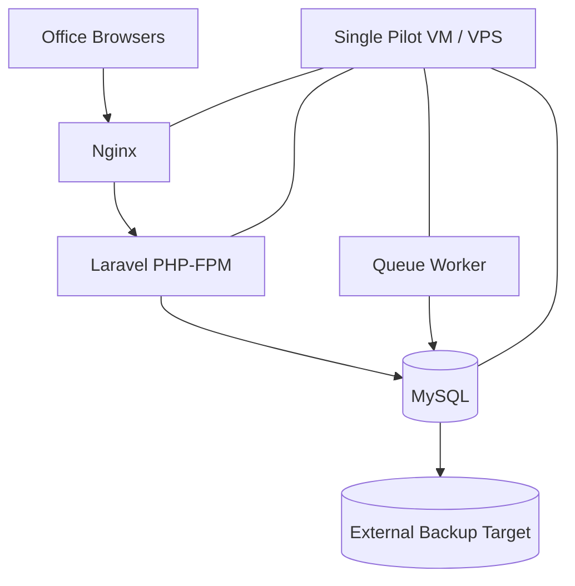
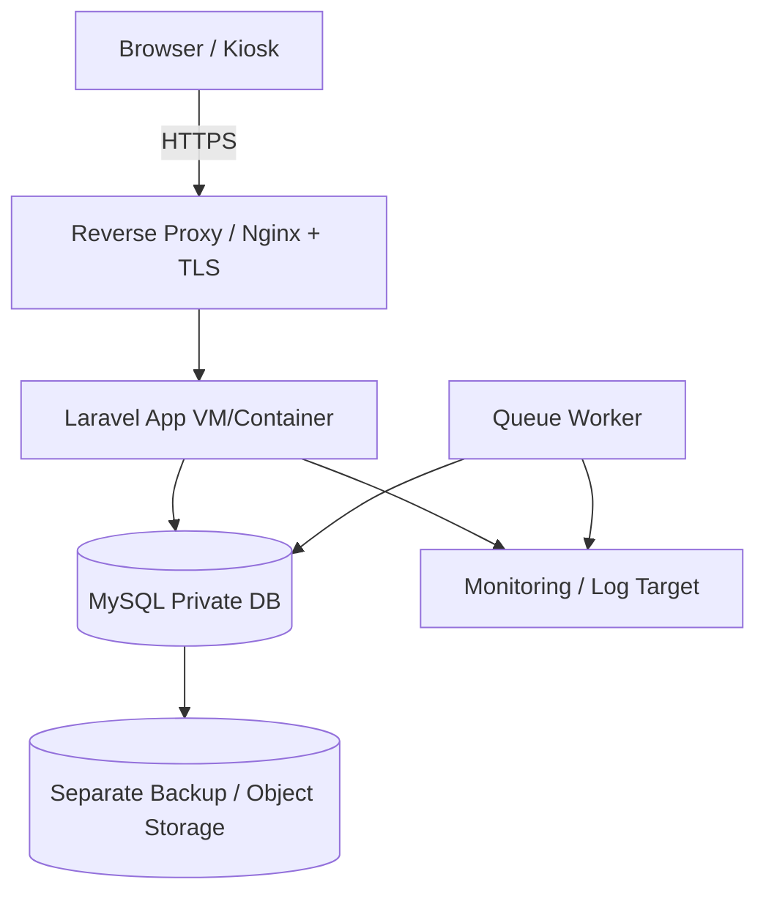

# Architecture.md — SI-TAMU

> **Software Architecture Document**  
> **Produk:** SI-TAMU — Sistem Informasi Buku Tamu Digital Berbasis Web  
> **Versi dokumen:** 0.1  
> **Status:** Draft untuk review  
> **Sumber requirement utama:** `PRD.md` v0.1  
> **Scope arsitektur:** MVP single-organization, web responsif, dengan jalur evolusi untuk Phase 2/3  
> **Dokumen berikutnya setelah arsitektur disetujui:** `Design.md`

---

## 1. Tujuan Dokumen

Dokumen ini menerjemahkan requirement produk pada `PRD.md` menjadi rancangan arsitektur perangkat lunak yang dapat langsung dijadikan dasar implementasi. Fokus utama dokumen adalah:

1. menetapkan bentuk arsitektur sistem;
2. menetapkan tech stack inti;
3. mendefinisikan batas modul/domain;
4. mendefinisikan struktur folder proyek;
5. menjelaskan data flow antar layer dan modul;
6. menetapkan strategi autentikasi, otorisasi, audit, error handling, backup, dan observability;
7. mendefinisikan deployment topology untuk development, pilot, dan production;
8. mendokumentasikan keputusan teknis beserta alasan dan konsekuensinya;
9. menjaga agar arsitektur MVP tidak menutup jalan bagi QR/barcode, WhatsApp, offline/PWA, 2FA, multi-location, dan integrasi lain pada fase berikutnya.

Dokumen ini **tidak** mendefinisikan detail visual seperti warna dan typography; hal tersebut menjadi tanggung jawab `Design.md`. Dokumen ini juga **tidak** menetapkan DDL, tipe kolom final, dan seluruh index secara preskriptif; detail tersebut menjadi tanggung jawab `Schema.md`. Coding convention dan guardrail kontribusi akan difinalkan pada `Rules.md`.

---

## 2. Ringkasan Arsitektur

SI-TAMU menggunakan pendekatan **modular monolith** berbasis Laravel dengan antarmuka web server-rendered. Seluruh fungsi MVP berjalan sebagai satu aplikasi deployable, tetapi kode dipisahkan ke dalam modul/domain dengan dependency boundary yang jelas.

Arsitektur ini dipilih karena karakter sistem pada MVP adalah dominan CRUD, transaksi relasional, pencarian, reporting, autentikasi, dan audit. Membagi sistem menjadi microservices pada tahap awal akan menambah biaya jaringan, deployment, observability, konsistensi data, dan operational overhead tanpa manfaat yang sebanding.

### 2.1 Karakteristik Utama

- **Architecture style:** Modular Monolith.
- **Interaction style:** HTTP request/response dengan server-rendered HTML; JavaScript digunakan hanya untuk progressive enhancement.
- **Backend framework:** Laravel.
- **Database:** MySQL/MariaDB-compatible relational database; MySQL direkomendasikan sebagai baseline production.
- **Authentication:** session-based authentication untuk back-office.
- **Authorization:** server-side RBAC menggunakan role + policy/gate.
- **Consistency:** transaksi database untuk operasi bisnis kritis.
- **Async processing:** queue hanya untuk pekerjaan non-kritis atau berat; registrasi utama tetap synchronous.
- **Public guest access:** form registrasi tanpa akun.
- **Primary deployment:** satu aplikasi + satu database; dapat dijalankan di intranet atau VPS/cloud.
- **External API:** tidak menjadi dependency MVP.
- **Future integration:** melalui adapter/interface, bukan pemanggilan provider langsung dari domain logic.

### 2.2 Architecture Goal

Arsitektur harus membuat alur utama berikut tetap sederhana:

`Browser -> Laravel Web App -> Application Service/Action -> Domain Rules -> MySQL -> Response`

Sementara kebutuhan sekunder seperti export besar, notifikasi, atau integrasi dapat berkembang menjadi:

`Application Service -> Domain Event / Job -> Queue -> Integration Adapter -> External Provider`

---

## 3. Architecture Drivers

Keputusan arsitektur diturunkan dari kebutuhan produk berikut.

### 3.1 Functional Drivers

MVP wajib mendukung:

- registrasi publik tanpa login;
- validasi data tamu;
- timestamp server;
- public visit ID yang unik;
- autentikasi admin/staff;
- role-based access control;
- dashboard operasional;
- perubahan status kunjungan dengan histori;
- daftar/detail kunjungan;
- pencarian dan filter;
- laporan periodik;
- export data;
- master unit/bidang;
- user management;
- audit log;
- konfigurasi organisasi.

### 3.2 Non-Functional Drivers

Arsitektur harus mendukung:

- halaman registrasi p95 sekitar <2,5 detik pada kondisi jaringan normal;
- submit valid p95 sekitar <2 detik;
- pencarian umum p95 sekitar <2 detik pada volume MVP;
- availability target awal 99,5% pada jam operasional;
- atomic transaction untuk perubahan kritis;
- browser desktop, tablet, dan mobile;
- auditability;
- data minimization;
- backup dan restore;
- deployment intranet maupun internet;
- volume puluhan hingga ratusan ribu kunjungan tanpa redesign besar.

### 3.3 Constraint Drivers

- nama instansi target belum final;
- sistem MVP hanya untuk satu organisasi;
- jaringan kantor dapat tidak stabil;
- pihak pengguna dapat non-teknis;
- WhatsApp, QR/barcode, offline mode, 2FA, dan SSO bukan dependency MVP;
- stack harus mudah dipelihara oleh tim pengembang kecil;
- organisasi dapat memilih deployment internal atau cloud.

---

## 4. Keputusan Architecture Style

### 4.1 Modular Monolith

Sistem dibangun sebagai **satu deployable Laravel application**, namun fitur dipisahkan secara konseptual ke modul berikut:

- Access;
- Visits;
- Departments;
- Reporting;
- Audit;
- Organization Settings;
- Users;
- Shared Infrastructure.

Setiap modul memiliki application services/actions, domain rule, query object, policy, dan event bila diperlukan.

### 4.2 Mengapa Bukan Microservices

Microservices tidak dipilih untuk MVP karena:

- domain belum cukup kompleks untuk membutuhkan independent service scaling;
- seluruh transaksi inti memiliki keterkaitan relasional kuat;
- single-database transaction memberi konsistensi lebih sederhana;
- operasional pemerintah/organisasi kecil lebih mudah memelihara satu aplikasi;
- debugging, backup, deployment, dan observability lebih sederhana;
- feature team belum diasumsikan terdiri dari banyak squad independen.

Microservices baru layak dipertimbangkan jika di masa depan terdapat kebutuhan seperti multi-tenant skala besar, volume sangat tinggi, integrasi intensif, atau service ownership berbeda.

### 4.3 Mengapa Server-Rendered UI, Bukan SPA

Frontend menggunakan Blade + progressive JavaScript karena:

- workflow utama berupa form, list, filter, detail, dan dashboard;
- tidak dibutuhkan offline-first pada MVP;
- tidak dibutuhkan complex client-side state;
- session auth lebih sederhana;
- payload JavaScript lebih kecil;
- akses dari perangkat kantor beragam menjadi lebih robust;
- SEO tidak penting, tetapi first-render yang cepat dan graceful degradation bermanfaat;
- satu repository mengurangi koordinasi antara frontend/backend terpisah.

SPA dapat dipertimbangkan jika Phase 3 offline mode berkembang menjadi requirement utama.

---

## 5. System Context

### 5.1 Aktor Eksternal

1. **Tamu/Pengunjung**  
   Mengakses form publik, mengisi data kunjungan, menerima nomor kunjungan.

2. **Staff/Resepsionis**  
   Login, memonitor kunjungan, mengubah status, mencari histori, melihat laporan sesuai permission.

3. **Administrator**  
   Memiliki akses staff ditambah user management, master data, konfigurasi, audit, dan export penuh sesuai kebijakan.

4. **Pimpinan/Manajemen**  
   Pada MVP dapat menerima laporan melalui akses back-office terbatas atau hasil export. Role khusus dapat ditambahkan bila diperlukan.

5. **External Provider — Future**  
   WhatsApp API, email provider, SSO, access-control, dan layanan lain tidak menjadi dependency inti MVP.

### 5.2 Context Diagram



### 5.3 Trust Boundary

- **Public zone:** route registrasi tamu, tidak membutuhkan autentikasi.
- **Authenticated zone:** dashboard dan seluruh back-office.
- **Privileged zone:** user management, konfigurasi, audit detail, export penuh.
- **Infrastructure zone:** database, queue, storage, backup; tidak boleh dapat diakses langsung dari internet publik.

---

## 6. Tech Stack

Keputusan versi exact harus dikunci pada saat bootstrap repository menggunakan `composer.lock` dan `package-lock.json`/lockfile yang dipilih. Arsitektur tidak bergantung pada versi eksperimental.

### 6.1 Backend

| Area | Pilihan | Status | Alasan |
|---|---|---|---|
| Language | PHP 8.3+ | Required | Dukungan framework modern, type system lebih baik, deployment luas |
| Framework | Laravel, stable supported release | Required | MVC, validation, ORM, migration, queue, auth, policy, scheduler, testing ecosystem |
| HTTP server | Nginx | Production baseline | Reverse proxy ringan dan umum untuk PHP-FPM |
| PHP runtime | PHP-FPM | Required | Standard production process model |
| ORM | Eloquent ORM | Required | Relational model dan prepared query integration |
| Validation | Laravel Form Request | Required | Centralized server-side validation |
| Auth | Laravel session auth | Required | Same-origin back-office, tidak membutuhkan JWT |
| Authorization | Policy/Gate + role/permission model | Required | Enforcement di server |
| Queue | Laravel queue, database driver pada baseline | Required-capable | Cukup untuk MVP dan minim dependency |
| Scheduler | Laravel Scheduler + cron | Required | Backup check, cleanup, maintenance job |
| Export | Streamed CSV + XLSX adapter bila dibutuhkan | Required/P1 | Portability dan kompatibilitas spreadsheet |
| Testing | PHPUnit/Laravel Test utilities | Required | Unit + feature/integration testing |

### 6.2 Frontend

| Area | Pilihan | Status | Alasan |
|---|---|---|---|
| Rendering | Laravel Blade | Required | Server-rendered, sederhana, satu codebase |
| CSS | Tailwind CSS | Required | Responsive utility-first, mudah membangun design system |
| JS enhancement | Alpine.js | Required-lightweight | Dropdown, modal, toggle, client interaction ringan |
| Bundler | Vite | Required | Asset bundling standar ekosistem Laravel |
| Chart | Chart.js | P1/MVP dashboard bila grafik aktif | Grafik sederhana tanpa SPA |
| Icons | SVG icon set lokal/package | Required | Tidak bergantung CDN runtime |

**Catatan:** `Design.md` akan menentukan palette, typography, spacing, dan component hierarchy. Architecture hanya menetapkan layer teknis UI.

### 6.3 Database

| Area | Pilihan |
|---|---|
| RDBMS | MySQL 8.x-compatible; MySQL 8.4 LTS preferred jika environment mendukung |
| Charset | `utf8mb4` |
| Storage engine | InnoDB |
| Migration | Laravel migration |
| Transaction | Wajib untuk write flow kritis |
| ID internal | Numeric/bigint atau equivalent internal key |
| Public identifier | ULID/UUID-like non-sequential identifier |
| Timestamp storage | UTC |
| Display timezone | Timezone organisasi |

MariaDB dapat digunakan hanya setelah compatibility test migration, index, JSON type, dan query plan dilakukan.

### 6.4 Cache dan Session

Baseline single-instance:

- session: database-backed session direkomendasikan;
- cache: file/database cache untuk konfigurasi dan master data kecil;
- rate limit storage: cache store yang sama.

Jika aplikasi menjadi multi-instance atau beban meningkat:

- pindah session/cache/rate-limit ke Redis;
- aplikasi tetap stateless terhadap local session.

Redis **bukan dependency wajib pilot**, tetapi arsitektur menyediakan jalur migrasi tanpa perubahan domain logic.

### 6.5 Queue

Queue dipakai untuk pekerjaan yang tidak boleh memperlambat request utama, misalnya:

- export XLSX besar;
- notifikasi Phase 2;
- email password reset bila asynchronous;
- cleanup file export;
- future analytics materialization.

Database queue driver cukup untuk MVP. Redis queue dapat digunakan ketika throughput meningkat.

### 6.6 Storage

- public assets: hasil build Vite / `public/`;
- logo organisasi: Laravel storage disk dengan MIME validation;
- export sementara: private temporary storage;
- backup database: storage terpisah dari host database utama;
- future object storage: S3-compatible adapter melalui Laravel filesystem.

### 6.7 Cloud / Hosting

Arsitektur **provider-neutral** agar dapat berjalan di lingkungan pemerintah yang berbeda.

Minimum production topology membutuhkan:

- Linux VM/VPS atau internal virtual machine;
- Nginx;
- PHP-FPM;
- MySQL;
- scheduled backup destination terpisah;
- TLS jika aplikasi melewati jaringan yang tidak sepenuhnya dipercaya;
- monitoring dasar resource dan process.

Provider cloud spesifik tidak di-hard-code karena requirement data residency, anggaran, dan kebijakan organisasi belum ditentukan.

### 6.8 Third-Party API

**MVP:** tidak ada third-party API yang menjadi dependency untuk registrasi, status, pencarian, laporan, dan administrasi.

Optional:

- SMTP/email service untuk password reset;
- object storage S3-compatible untuk backup/file;
- error tracking eksternal jika kebijakan mengizinkan.

Phase 2/3:

- WhatsApp Business API/provider;
- SSO/Identity Provider;
- access-control API;
- push notification provider.

Seluruh provider eksternal harus diakses melalui interface/adapter.

---

## 7. Logical Architecture

### 7.1 Layering

Aplikasi dibagi menjadi layer berikut.

#### A. Presentation Layer

Berisi:

- route;
- controller;
- Blade view;
- Form Request;
- presenter/view model sederhana;
- Alpine/JavaScript enhancement.

Presentation tidak boleh berisi business rule kompleks.

#### B. Application Layer

Berisi use-case orchestration, misalnya:

- `RegisterVisitAction`;
- `ChangeVisitStatusAction`;
- `UpdateVisitAction`;
- `GenerateVisitReportQuery`;
- `ExportVisitsAction`;
- `CreateDepartmentAction`;
- `CreateUserAction`.

Application layer menentukan transaction boundary dan memanggil domain/infrastructure service.

#### C. Domain Layer

Berisi konsep dan aturan bisnis:

- status kunjungan;
- transition rule;
- public visit identifier;
- department active rule;
- access-related domain rule;
- audit event definition.

Domain tidak boleh bergantung pada HTTP request atau view.

#### D. Infrastructure Layer

Berisi:

- ORM persistence;
- filesystem;
- queue;
- mail;
- export writer;
- logging;
- third-party adapters;
- clock/time adapter bila dibutuhkan testing.

### 7.2 Dependency Direction

Aturan dependency:

`Presentation -> Application -> Domain`

`Application -> Infrastructure contracts`

`Infrastructure -> framework / external implementation`

Untuk proyek Laravel pragmatis, model Eloquent dapat tetap menjadi bagian persistence utama, tetapi business orchestration tidak diletakkan di controller/model event yang sulit ditest.

---

## 8. Modul Sistem

### 8.1 Visits Module

Tanggung jawab:

- registrasi kunjungan;
- public visit ID;
- snapshot data pengunjung;
- destination department;
- current status;
- status history;
- koreksi data oleh user berizin;
- duplicate/idempotency guard;
- query visit detail dan list.

**Tidak bertanggung jawab terhadap:** user authentication, export file format, WhatsApp provider.

### 8.2 Access Module

Tanggung jawab:

- login/logout;
- session lifecycle;
- role/permission check;
- rate limit login;
- password reset;
- authorization policy.

Role MVP minimum:

- `ADMIN`;
- `STAFF`.

### 8.3 Users Module

Tanggung jawab:

- CRUD akun staff/admin;
- status aktif/nonaktif;
- assign role;
- metadata login terakhir;
- password reset administrative flow yang aman.

### 8.4 Departments Module

Tanggung jawab:

- master unit/bidang;
- active/inactive;
- display order;
- label yang digunakan pada registrasi;
- histori tidak rusak saat unit dinonaktifkan.

### 8.5 Reporting Module

Tanggung jawab:

- query laporan;
- aggregate dashboard;
- filter laporan;
- export CSV/XLSX;
- export audit event;
- future scheduled reports.

Reporting harus menggunakan query/read model yang efisien dan tidak menggandakan business source of truth.

### 8.6 Audit Module

Tanggung jawab:

- append-only business audit event;
- aktor;
- timestamp;
- action;
- target entity;
- safe before/after metadata untuk perubahan yang diizinkan;
- export event;
- user/role change event.

Audit log **berbeda** dari application error log.

### 8.7 Organization Settings Module

Tanggung jawab:

- nama instansi;
- logo;
- alamat/kontak;
- timezone;
- instruction text;
- field configuration yang diizinkan;
- feature flag ringan bila diperlukan.

Setting organisasi harus di-cache, tetapi source of truth tetap database.

### 8.8 Shared / Infrastructure Module

Berisi concern lintas domain:

- clock;
- identifier generator;
- pagination primitives;
- export writer contract;
- notification contract;
- filesystem abstraction;
- logging context;
- exception mapping.

---

## 9. Component Diagram



---

## 10. Struktur Folder Proyek

Struktur berikut adalah baseline. Nama file final dapat berubah, tetapi **boundary antar concern harus dipertahankan**.

```text
si-tamu/
├── app/
│   ├── Application/
│   │   ├── Access/
│   │   │   ├── Actions/
│   │   │   │   ├── AuthenticateUserAction.php
│   │   │   │   ├── LogoutUserAction.php
│   │   │   │   └── ResetPasswordAction.php
│   │   │   └── DTOs/
│   │   ├── Visits/
│   │   │   ├── Actions/
│   │   │   │   ├── RegisterVisitAction.php
│   │   │   │   ├── ChangeVisitStatusAction.php
│   │   │   │   ├── CorrectVisitDataAction.php
│   │   │   │   └── CancelVisitAction.php
│   │   │   ├── DTOs/
│   │   │   │   ├── RegisterVisitData.php
│   │   │   │   ├── ChangeVisitStatusData.php
│   │   │   │   └── CorrectVisitData.php
│   │   │   └── Queries/
│   │   │       ├── ListVisitsQuery.php
│   │   │       └── VisitDetailQuery.php
│   │   ├── Departments/
│   │   │   ├── Actions/
│   │   │   │   ├── CreateDepartmentAction.php
│   │   │   │   ├── UpdateDepartmentAction.php
│   │   │   │   └── SetDepartmentActiveStateAction.php
│   │   │   └── DTOs/
│   │   ├── Users/
│   │   │   ├── Actions/
│   │   │   │   ├── CreateUserAction.php
│   │   │   │   ├── UpdateUserAction.php
│   │   │   │   ├── SetUserActiveStateAction.php
│   │   │   │   └── AssignUserRoleAction.php
│   │   │   └── DTOs/
│   │   ├── Reporting/
│   │   │   ├── Queries/
│   │   │   │   ├── DashboardSummaryQuery.php
│   │   │   │   ├── VisitReportQuery.php
│   │   │   │   └── VisitStatisticsQuery.php
│   │   │   ├── Actions/
│   │   │   │   └── ExportVisitsAction.php
│   │   │   └── DTOs/
│   │   ├── Audit/
│   │   │   └── Actions/
│   │   │       └── RecordAuditEventAction.php
│   │   └── Settings/
│   │       ├── Actions/
│   │       │   └── UpdateOrganizationSettingsAction.php
│   │       └── Queries/
│   │           └── GetOrganizationSettingsQuery.php
│   │
│   ├── Domain/
│   │   ├── Visits/
│   │   │   ├── Enums/
│   │   │   │   └── VisitStatus.php
│   │   │   ├── Rules/
│   │   │   │   └── VisitStatusTransitionRule.php
│   │   │   ├── Events/
│   │   │   │   ├── VisitRegistered.php
│   │   │   │   └── VisitStatusChanged.php
│   │   │   └── Exceptions/
│   │   │       └── InvalidVisitStatusTransition.php
│   │   ├── Access/
│   │   │   ├── Enums/
│   │   │   │   └── RoleCode.php
│   │   │   └── Permissions/
│   │   │       └── PermissionCatalog.php
│   │   └── Shared/
│   │       ├── Contracts/
│   │       │   ├── Clock.php
│   │       │   ├── PublicIdGenerator.php
│   │       │   ├── ExportWriter.php
│   │       │   └── NotificationGateway.php
│   │       └── ValueObjects/
│   │
│   ├── Http/
│   │   ├── Controllers/
│   │   │   ├── Public/
│   │   │   │   └── GuestRegistrationController.php
│   │   │   └── Admin/
│   │   │       ├── AuthController.php
│   │   │       ├── DashboardController.php
│   │   │       ├── VisitController.php
│   │   │       ├── VisitStatusController.php
│   │   │       ├── ReportController.php
│   │   │       ├── ExportController.php
│   │   │       ├── DepartmentController.php
│   │   │       ├── UserController.php
│   │   │       ├── AuditController.php
│   │   │       └── OrganizationSettingsController.php
│   │   ├── Middleware/
│   │   │   ├── EnsureUserIsActive.php
│   │   │   ├── AddSecurityHeaders.php
│   │   │   └── AddRequestContext.php
│   │   └── Requests/
│   │       ├── Public/
│   │       │   └── StoreGuestVisitRequest.php
│   │       └── Admin/
│   │           ├── LoginRequest.php
│   │           ├── UpdateVisitStatusRequest.php
│   │           ├── VisitSearchRequest.php
│   │           ├── VisitReportRequest.php
│   │           ├── StoreDepartmentRequest.php
│   │           ├── StoreUserRequest.php
│   │           └── UpdateOrganizationSettingsRequest.php
│   │
│   ├── Infrastructure/
│   │   ├── Identifiers/
│   │   │   └── UlidPublicIdGenerator.php
│   │   ├── Time/
│   │   │   └── SystemClock.php
│   │   ├── Exports/
│   │   │   ├── CsvVisitExportWriter.php
│   │   │   └── XlsxVisitExportWriter.php
│   │   ├── Notifications/
│   │   │   ├── NullNotificationGateway.php
│   │   │   └── WhatsApp/
│   │   │       └── WhatsAppNotificationGateway.php   # Phase 2
│   │   ├── Storage/
│   │   ├── Logging/
│   │   └── Providers/
│   │
│   ├── Jobs/
│   │   ├── GenerateVisitExportJob.php
│   │   ├── CleanupExpiredExportsJob.php
│   │   └── SendVisitNotificationJob.php              # Phase 2
│   │
│   ├── Listeners/
│   │   ├── RecordVisitRegisteredAudit.php
│   │   └── RecordVisitStatusChangedAudit.php
│   │
│   ├── Models/
│   │   ├── User.php
│   │   ├── Role.php
│   │   ├── Permission.php
│   │   ├── Department.php
│   │   ├── Visit.php
│   │   ├── VisitStatusHistory.php
│   │   ├── AuditLog.php
│   │   ├── OrganizationSetting.php
│   │   └── ExportLog.php
│   │
│   ├── Policies/
│   │   ├── VisitPolicy.php
│   │   ├── ReportPolicy.php
│   │   ├── DepartmentPolicy.php
│   │   ├── UserPolicy.php
│   │   ├── AuditLogPolicy.php
│   │   └── OrganizationSettingPolicy.php
│   │
│   ├── Providers/
│   │   ├── AppServiceProvider.php
│   │   ├── DomainServiceProvider.php
│   │   └── InfrastructureServiceProvider.php
│   │
│   └── Support/
│       ├── Pagination/
│       ├── Security/
│       └── View/
│
├── bootstrap/
│   ├── app.php
│   └── providers.php
│
├── config/
│   ├── app.php
│   ├── auth.php
│   ├── cache.php
│   ├── database.php
│   ├── filesystems.php
│   ├── logging.php
│   ├── queue.php
│   ├── services.php
│   ├── session.php
│   └── sitamu.php
│
├── database/
│   ├── factories/
│   ├── migrations/
│   ├── seeders/
│   │   ├── DatabaseSeeder.php
│   │   ├── RolePermissionSeeder.php
│   │   ├── DepartmentSeeder.php
│   │   └── AdminUserSeeder.php
│   └── schema/                       # Optional schema dumps
│
├── public/
│   ├── build/
│   ├── favicon.ico
│   ├── index.php
│   └── robots.txt
│
├── resources/
│   ├── css/
│   │   └── app.css
│   ├── js/
│   │   ├── app.js
│   │   ├── charts/
│   │   └── components/
│   └── views/
│       ├── components/
│       │   ├── forms/
│       │   ├── tables/
│       │   ├── feedback/
│       │   └── navigation/
│       ├── layouts/
│       │   ├── public.blade.php
│       │   └── admin.blade.php
│       ├── public/
│       │   └── registration/
│       │       ├── create.blade.php
│       │       └── success.blade.php
│       └── admin/
│           ├── auth/
│           ├── dashboard/
│           ├── visits/
│           ├── reports/
│           ├── departments/
│           ├── users/
│           ├── audit/
│           └── settings/
│
├── routes/
│   ├── web.php
│   ├── public.php
│   ├── admin.php
│   ├── console.php
│   └── api.php                      # Reserved; minimal/unused on MVP
│
├── storage/
│   ├── app/
│   │   ├── private/
│   │   │   └── exports/
│   │   └── public/
│   │       └── branding/
│   ├── framework/
│   └── logs/
│
├── tests/
│   ├── Unit/
│   │   ├── Domain/
│   │   └── Application/
│   ├── Feature/
│   │   ├── Public/
│   │   ├── Admin/
│   │   ├── Authorization/
│   │   └── Reporting/
│   ├── Integration/
│   │   ├── Database/
│   │   └── Exports/
│   ├── Fixtures/
│   └── TestCase.php
│
├── docs/
│   ├── PRD.md
│   ├── Architecture.md
│   ├── Design.md
│   ├── Schema.md
│   ├── Rules.md
│   └── adr/
│       └── README.md
│
├── docker/
│   ├── nginx/
│   │   └── default.conf
│   ├── php/
│   │   └── Dockerfile
│   └── supervisor/
│       └── sitamu-worker.conf
│
├── .env.example
├── .editorconfig
├── .gitignore
├── composer.json
├── composer.lock
├── package.json
├── package-lock.json
├── phpunit.xml
├── vite.config.js
├── docker-compose.yml
└── README.md
```

### 10.1 Catatan Struktur

- `app/Application` berisi use case, bukan framework glue.
- `app/Domain` berisi rule yang harus dapat diuji secara terisolasi.
- `app/Http` fokus pada web boundary.
- `app/Infrastructure` mengisolasi implementation detail dan provider eksternal.
- `app/Models` tetap menjadi persistence model agar tidak memaksakan repository abstraction pada seluruh CRUD.
- repository pattern hanya ditambahkan bila query/persistence benar-benar membutuhkan substitusi atau kompleksitas yang tidak dapat ditangani query object.
- route admin dan public dipisahkan untuk memudahkan middleware boundary.
- `api.php` disediakan sebagai reservasi future integration, bukan alasan membuat API publik pada MVP.

---

## 11. HTTP dan Routing Architecture

### 11.1 Route Groups

#### Public

Contoh:

```text
GET   /                         -> redirect/landing
GET   /visit/register           -> guest form
POST  /visit/register           -> submit visit
GET   /visit/{publicId}/success -> confirmation
GET   /health                   -> restricted/basic health semantics
```

#### Authentication

```text
GET   /admin/login
POST  /admin/login
POST  /admin/logout
```

#### Admin / Staff

```text
GET    /admin/dashboard
GET    /admin/visits
GET    /admin/visits/{publicId}
PATCH  /admin/visits/{publicId}/status
PATCH  /admin/visits/{publicId}
GET    /admin/reports/visits
POST   /admin/reports/visits/export
```

#### Admin-only

```text
GET/POST/PATCH /admin/departments/...
GET/POST/PATCH /admin/users/...
GET            /admin/audit-logs
GET/PATCH      /admin/settings
```

Exact route naming akan ditetapkan saat implementasi, tetapi authorization boundary ini harus dipertahankan.

### 11.2 Authentication Strategy

Back-office menggunakan **stateful session authentication**, bukan JWT.

Alasan:

- frontend dan backend same-origin;
- tidak ada mobile native app pada MVP;
- server dapat revoke session;
- CSRF protection framework tersedia;
- lebih sederhana daripada access/refresh token lifecycle.

JWT baru diperlukan jika ada independent client/API yang benar-benar membutuhkan stateless token.

### 11.3 CSRF

Semua state-changing browser request wajib menggunakan CSRF protection framework, termasuk:

- public registration;
- login;
- update status;
- master data;
- settings;
- user management;
- export request jika menggunakan POST.

### 11.4 Rate Limiting

Minimum:

- login endpoint: aggressive rate limit per IP + identity hint;
- public registration: moderate rate limit per IP/session;
- report/export: limit per authenticated user;
- future API: limit per token/client.

Rate limiting tidak boleh menyebabkan data tamu hilang di browser; UI harus menampilkan error yang dapat dipahami.

---

## 12. Public Registration Data Flow

### 12.1 Sequence



### 12.2 Validation Pipeline

Input melewati:

1. HTTP body size limit;
2. CSRF verification;
3. rate limiter;
4. Form Request validation;
5. normalization;
6. application action;
7. database constraints.

Client-side validation hanya membantu UX. **Server-side validation adalah source of truth.**

### 12.3 Idempotency / Duplicate Submission

Untuk mencegah double click, browser retry, atau network uncertainty:

- form GET menghasilkan `submission_token` acak;
- token ikut dikirim saat POST;
- token memiliki unique constraint atau konsumsi atomik;
- jika token yang sama dikirim ulang, sistem mengembalikan result kunjungan yang sama atau safe duplicate response;
- UI menonaktifkan tombol sesaat setelah submit sebagai UX enhancement, tetapi protection utama tetap server-side.

Mekanisme final tabel token dapat diintegrasikan ke `visits` atau tabel terpisah; detail berada di `Schema.md`.

### 12.4 Timestamp

- server menghasilkan `registered_at`;
- database menyimpan UTC;
- view mengonversi ke timezone organisasi;
- browser device time tidak dianggap authoritative.

---

## 13. Visit Status Data Flow

Status baseline:

- `REGISTERED`;
- `ARRIVED`;
- `IN_SERVICE`;
- `COMPLETED`;
- `CANCELLED`.

### 13.1 Status Transition Flow



### 13.2 Concurrency Control

Dua staff dapat membuka visit yang sama. Untuk mencegah lost update:

- status update dijalankan dalam transaction;
- record visit dapat menggunakan `SELECT ... FOR UPDATE` pada transition kritis;
- optional `updated_at` optimistic concurrency check dapat ditambahkan jika edit data semakin kompleks;
- audit log mencatat aktor dan status sebelum/sesudah.

---

## 14. Search dan Reporting Data Flow

### 14.1 Search

```text
HTTP Filter
  -> VisitSearchRequest
  -> ListVisitsQuery
  -> Query Builder/Eloquent
  -> Indexed MySQL Query
  -> Pagination
  -> View
```

Filter hanya diterapkan jika parameter valid. Query tidak boleh mengambil seluruh dataset ke memory lalu memfilter di PHP.

### 14.2 Report

Report menggunakan source query yang sama atau shared filter object dengan halaman riwayat untuk mencegah perbedaan hasil.



### 14.3 Export Strategy

MVP mendukung dua jalur:

**Small/normal export**  
Dihasilkan synchronously atau streamed jika selesai di bawah target waktu.

**Large export**  
Dapat dipindah ke queued job:

1. user mengajukan export;
2. filter disimpan sebagai job payload yang aman;
3. worker menghasilkan file di private storage;
4. file memiliki expiration;
5. user mendapat link download authenticated;
6. aktivitas export tercatat.

Tidak boleh membuat file export permanen tanpa retention policy.

---

## 15. Data Architecture

### 15.1 Relational Source of Truth

MySQL menjadi source of truth untuk:

- user;
- role/permission;
- department;
- visit;
- status history;
- audit;
- organization settings;
- export metadata.

### 15.2 Visitor Identity Decision

MVP **tidak membuat akun atau master visitor wajib**. Identitas pengunjung disimpan sebagai snapshot pada konteks kunjungan.

Alasan:

- sesuai prinsip guest registration tanpa akun;
- mengurangi identity linkage yang tidak perlu;
- mengurangi pengumpulan/retensi data personal lintas kunjungan;
- histori tidak berubah ketika nama organisasi tamu berubah di masa depan;
- menghindari deduplication identity yang ambigu.

Jika Phase 2 membutuhkan repeat visitor atau pre-registration, `VisitorProfile` dapat ditambahkan sebagai entity terpisah tanpa menghapus snapshot historis pada visit.

### 15.3 Public ID

Visit memiliki:

- internal database key untuk join/performance;
- public ID non-sequential untuk URL dan pencarian publik/internal.

ULID direkomendasikan karena:

- unik;
- tidak mengekspos jumlah record seperti auto-increment ID;
- sortable secara waktu secara natural;
- dapat dihasilkan di application layer.

Public ID bukan security mechanism; authorization tetap wajib.

### 15.4 Department Historical Integrity

Department yang pernah dipakai tidak hard-delete dari UI normal.

Strategi:

- `is_active`/status untuk availability pada registrasi baru;
- visit menyimpan FK ke department;
- historical display dapat menyimpan snapshot nama jika requirement audit membutuhkan stabilitas nama absolut;
- keputusan final FK + snapshot akan ditentukan di `Schema.md`.

### 15.5 Audit Data

Audit event bersifat append-oriented. Aplikasi biasa tidak memiliki fitur edit/hapus audit log.

Audit minimum memuat:

- event type;
- actor user ID jika authenticated;
- target type + target ID;
- timestamp;
- request correlation ID;
- safe metadata;
- optional before/after diff yang sudah disanitasi.

Password, reset token, session token, API secret, dan sensitive credential **tidak boleh** masuk audit metadata.

### 15.6 Timestamp Standard

- persisted timestamp: UTC;
- app timezone internal: UTC direkomendasikan;
- organization timezone: configuration;
- report boundaries dihitung berdasarkan timezone organisasi lalu dikonversi ke UTC untuk query.

Ini mencegah kesalahan query ketika server pindah lokasi/timezone.

---

## 16. Database Access Strategy

### 16.1 ORM First, Query Builder Where Necessary

Gunakan Eloquent untuk CRUD dan relation biasa. Gunakan Query Builder/raw expression terkontrol untuk:

- aggregate dashboard;
- report besar;
- query yang membutuhkan projection minimal;
- performance-sensitive query setelah diukur.

### 16.2 Transaction Boundary

Transaction wajib untuk:

- registrasi visit + initial status history;
- status change + history + audit;
- correction + audit;
- perubahan role sensitif + audit;
- operation yang menghasilkan state setengah jadi bila gagal.

### 16.3 Indexing Principle

Index final ada di `Schema.md`, tetapi arsitektur mengharuskan index untuk pola akses berikut:

- public visit ID;
- registered timestamp;
- current status;
- destination department;
- visitor name search strategy;
- origin organization search strategy;
- composite filter yang terbukti dominan dari query plan.

Index tidak ditambahkan secara spekulatif tanpa mengukur write/read trade-off.

### 16.4 Pagination

- admin list: server-side pagination;
- default page size dibatasi;
- export tidak menggunakan pagination UI tetapi chunking/streaming;
- cursor pagination dapat dipakai bila dataset dan sort pattern membutuhkannya.

---

## 17. Authorization Architecture

### 17.1 Role MVP

#### ADMIN

Dapat:

- semua operasi STAFF;
- user management;
- role assignment sesuai policy;
- master department;
- organization settings;
- audit log;
- full report/export sesuai policy.

#### STAFF

Dapat:

- dashboard;
- view visit;
- change visit status;
- search/history;
- report terbatas sesuai policy;
- tidak dapat membuat admin atau mengubah system settings sensitif.

### 17.2 Policy Enforcement

Authorization wajib dilakukan pada server di:

- controller via `authorize()`/middleware;
- application action untuk operasi sensitif jika action dapat dipanggil dari boundary selain controller;
- query/report layer untuk data scope jika role berbeda.

Menyembunyikan menu di frontend bukan authorization.

### 17.3 Permission Growth

Walaupun MVP hanya memiliki dua role, schema dan policy sebaiknya mendukung permission granular seperti:

- `visits.view`;
- `visits.update_status`;
- `visits.correct`;
- `reports.view`;
- `reports.export`;
- `departments.manage`;
- `users.manage`;
- `audit.view`;
- `settings.manage`.

Hal ini menghindari hard-coded `if role == ADMIN` di seluruh codebase.

---

## 18. Security Architecture

### 18.1 Security Principles

- least privilege;
- defense in depth;
- secure defaults;
- server-side enforcement;
- no secrets in repository;
- data minimization;
- audit sensitive operation;
- fail closed untuk authorization.

### 18.2 Password

- password di-hash menggunakan adaptive password hashing yang didukung framework;
- plaintext password tidak pernah disimpan/log;
- password reset token berumur terbatas;
- admin-created temporary password harus memaksa mekanisme perubahan bila digunakan.

### 18.3 Session

Production cookie:

- `Secure` saat HTTPS;
- `HttpOnly`;
- `SameSite=Lax` atau lebih ketat sesuai flow;
- session rotation setelah login;
- logout menginvalidate session;
- inactivity timeout configurable.

### 18.4 XSS

- Blade escaping default dipertahankan;
- raw HTML rendering hanya untuk content yang benar-benar trusted/sanitized;
- user-supplied text tidak dirender dengan unescaped directive;
- security header CSP dapat diperketat secara bertahap.

### 18.5 SQL Injection

- Eloquent/Query Builder parameter binding;
- raw SQL harus memiliki parameter binding;
- dynamic sort/filter wajib menggunakan whitelist column mapping.

### 18.6 File Upload

Untuk logo/branding:

- ukuran dibatasi;
- MIME/type di-whitelist;
- nama file server-generated;
- file tidak dieksekusi sebagai script;
- public storage hanya untuk file yang aman dipublikasi.

### 18.7 Export Security

- policy check sebelum generate;
- filter dan jumlah record dicatat;
- file private secara default;
- URL download membutuhkan auth atau signed temporary URL;
- file expired dibersihkan scheduler;
- formula injection pada CSV/XLSX harus dimitigasi untuk cell yang dimulai dengan karakter formula berbahaya.

### 18.8 Security Headers

Nginx/Laravel harus mendukung minimum:

- `X-Content-Type-Options: nosniff`;
- clickjacking protection melalui CSP `frame-ancestors` atau equivalent;
- Referrer Policy;
- HSTS hanya ketika HTTPS sudah stabil dan domain policy sesuai;
- Content Security Policy bertahap.

### 18.9 Secrets

Secret disimpan via environment/secret manager:

- DB password;
- app key;
- SMTP credentials;
- object storage credentials;
- WhatsApp token pada fase berikutnya.

`.env` production tidak masuk repository.

---

## 19. Network Resilience

Karena jaringan kantor dapat tidak stabil, MVP harus mengurangi kerugian akibat request gagal.

### 19.1 Registration

- browser mempertahankan input bila validasi server gagal;
- bila koneksi gagal sebelum response, user dapat retry;
- idempotency token mencegah duplicate;
- tidak ada multi-step wizard yang membutuhkan banyak round-trip pada MVP kecuali UX terbukti memerlukannya.

### 19.2 Back-office

- status update menampilkan feedback sukses/gagal;
- tombol tidak mengasumsikan request berhasil sebelum server response;
- destructive/sensitive action memiliki confirmation sesuai konteks;
- retry tidak boleh menggandakan audit/business state.

### 19.3 Offline Mode

Full offline/PWA tidak diimplementasikan pada MVP karena membutuhkan:

- local data store;
- sync queue;
- conflict resolution;
- security atas data personal di device;
- reconciliation mechanism.

Service worker/offline sync baru ditambahkan pada Phase 3 setelah workflow online stabil.

---

## 20. Error Handling

### 20.1 Error Categories

- validation error;
- authentication error;
- authorization error;
- business rule error;
- infrastructure/database error;
- external integration error;
- unexpected application error.

### 20.2 Public UI

Tamu tidak boleh melihat:

- stack trace;
- SQL error;
- internal class name;
- filesystem path;
- secret/configuration detail.

Pesan harus menjelaskan aksi yang bisa dilakukan, misalnya mencoba ulang atau meminta bantuan petugas.

### 20.3 Back-office

Staff mendapat pesan operasional yang lebih spesifik tetapi tetap tanpa internal secret.

### 20.4 Correlation ID

Setiap request production sebaiknya memiliki request/correlation ID yang:

- ditambahkan ke log;
- dapat ditampilkan pada generic error page untuk support;
- dapat dicari pada application log;
- tidak mengandung PII.

---

## 21. Observability

### 21.1 Application Log

Gunakan structured logging bila environment mendukung, minimal memuat:

- timestamp;
- environment;
- level;
- request/correlation ID;
- route/action;
- authenticated user ID jika aman;
- exception class;
- sanitized context.

### 21.2 Audit Log

Terpisah secara semantik dari application log.

Application log menjawab: **“apakah sistem error?”**  
Audit log menjawab: **“siapa melakukan aksi bisnis apa, kapan, terhadap data apa?”**

### 21.3 Infrastructure Monitoring

Minimum production:

- CPU;
- memory;
- disk utilization;
- database disk;
- database connection health;
- Nginx/PHP process health;
- queue backlog jika queue aktif;
- backup success/failure;
- TLS certificate expiry jika internet-facing.

### 21.4 Health Endpoint

Health endpoint minimal memiliki dua tingkat:

- liveness: aplikasi process dapat merespons;
- readiness/basic dependency: database reachable.

Detail dependency/credential tidak dikembalikan ke public response.

---

## 22. Performance Architecture

### 22.1 Registration

Optimasi utama:

- public form tidak melakukan query berat;
- department list dicache;
- organization settings dicache;
- write dilakukan dalam transaction singkat;
- notification tidak dijalankan synchronous pada MVP/Phase 2.

### 22.2 Search

- server-side pagination;
- indexed filters;
- select hanya kolom yang diperlukan;
- avoid N+1 query;
- filter optional dibangun secara kondisional;
- wildcard search pada nama/instansi dievaluasi dengan query plan pada volume aktual.

### 22.3 Dashboard

Dashboard tidak boleh menjalankan banyak full-table count terpisah setiap request bila dataset bertambah.

Strategi bertahap:

1. indexed aggregate query;
2. cache aggregate pendek (mis. puluhan detik) bila dibutuhkan;
3. precomputed aggregate hanya jika data besar membuktikan kebutuhan.

### 22.4 Export

- query chunked/streamed;
- hindari memuat ratusan ribu row ke memory;
- asynchronous job jika melewati threshold;
- file temporary dihapus setelah expiration.

### 22.5 Capacity Assumption

MVP ditargetkan untuk puluhan sampai ratusan ribu visit record. Arsitektur tidak menjanjikan performa jutaan record tanpa tuning tambahan.

Trigger review arsitektur:

- >1 juta visit aktif;
- >100 concurrent active back-office users;
- multi-location besar;
- heavy public pre-registration;
- reporting analitik kompleks;
- integration throughput tinggi.

---

## 23. Caching Strategy

Cache hanya dipakai untuk data yang:

- sering dibaca;
- jarang berubah;
- aman jika sedikit stale.

Candidate:

- active departments;
- organization settings;
- permission map;
- dashboard aggregate pendek.

Invalidation:

- update department -> invalidate department cache;
- update organization setting -> invalidate settings cache;
- role/permission update -> invalidate permission cache.

Visit detail/current status **tidak** dicache agresif pada MVP karena membutuhkan freshness operasional.

---

## 24. Queue and Event Strategy

### 24.1 Domain Event

Domain event dapat digunakan untuk decoupling side effect:

- `VisitRegistered`;
- `VisitStatusChanged`;
- `VisitCorrected`;
- `ReportExported`.

### 24.2 Synchronous vs Asynchronous

Synchronous:

- validate registration;
- insert visit;
- set initial status;
- status transition;
- authorization;
- critical audit write yang dibutuhkan untuk konsistensi.

Asynchronous:

- WhatsApp/email;
- large export;
- cleanup;
- analytics enrichment;
- non-critical external integration.

### 24.3 Failure Semantics

Registrasi tidak boleh dianggap gagal hanya karena future WhatsApp notification gagal. Notification failure dicatat dan dapat retry secara independen.

---

## 25. External Integration Architecture

Gunakan **Ports and Adapters** sederhana.

Contoh contract:

```text
NotificationGateway
├── NullNotificationGateway        # MVP
├── WhatsAppNotificationGateway    # Phase 2
└── EmailNotificationGateway       # Optional
```

Application layer memanggil interface, bukan SDK provider langsung.

### 25.1 WhatsApp Phase 2

Integrasi harus memiliki:

- queue;
- retry dengan backoff;
- provider timeout;
- delivery/error log;
- template mapping;
- secret isolation;
- consent/data-use validation;
- circuit-breaker-like behavior atau fail-safe agar provider outage tidak mengganggu registrasi.

### 25.2 SSO Phase 3

SSO ditambahkan sebagai authentication adapter. Local emergency/admin account policy harus diputuskan berdasarkan SOP organisasi.

### 25.3 Access Control Phase 3

Integrasi gate/security harus diperlakukan sebagai external system dan tidak boleh diberi direct database access ke SI-TAMU.

---

## 26. Deployment Architecture

### 26.1 Environment

Minimum:

- `local`;
- `test/CI`;
- `staging`;
- `production`.

Staging harus semirip mungkin dengan production pada:

- PHP major/minor;
- database engine;
- web server;
- queue mode;
- storage semantics.

### 26.2 Local Development

Recommended:

```text
Docker Compose
├── nginx
├── app (PHP-FPM)
├── mysql
├── queue-worker
└── optional mail catcher
```

Developer juga dapat menggunakan native PHP environment selama versi dependency identik.

### 26.3 Pilot Topology



Single-host pilot dapat diterima untuk biaya rendah, **asal backup berada di target terpisah**.

### 26.4 Recommended Production Topology



Database tidak diekspos ke internet.

### 26.5 Scaling Path

Jika beban meningkat:

```text
Load Balancer
├── App Instance A
├── App Instance B
└── App Instance N
       ↓
Redis (session/cache/queue)
       ↓
MySQL Primary
```

Syarat horizontal scaling:

- session tidak berada di local file;
- upload/export tidak bergantung local disk permanen;
- scheduler memiliki single-run locking;
- queue centralized;
- app instances stateless.

Horizontal scaling **bukan kebutuhan MVP**, tetapi deployment tidak boleh membuatnya mustahil.

---

## 27. Infrastructure Sizing Baseline

Angka berikut adalah **starting point**, bukan kapasitas final.

### 27.1 Pilot Kecil

- 2 vCPU;
- 4 GB RAM;
- 40–80 GB SSD;
- MySQL pada host yang sama;
- daily backup external;
- 1 queue worker.

### 27.2 Production Kecil–Menengah

Recommended separation:

- app: 2–4 vCPU, 4–8 GB RAM;
- DB: 2–4 vCPU, 4–8 GB RAM dengan SSD;
- backup storage terpisah;
- monitoring;
- worker process terpisah secara logical.

Sizing harus divalidasi lewat load test dan data volume aktual.

---

## 28. Backup and Disaster Recovery

### 28.1 Backup Minimum

- database backup terjadwal;
- backup destination berbeda dari primary DB host;
- retention policy configurable;
- encrypted transport;
- akses backup dibatasi;
- backup success/failure dimonitor.

### 28.2 Suggested Baseline

Sebelum kebijakan organisasi final:

- daily full logical backup;
- additional more frequent backup/binlog strategy jika RPO lebih ketat diperlukan;
- minimal beberapa generasi backup;
- restore test sebelum go-live dan berkala.

### 28.3 RPO/RTO

RPO dan RTO **belum dapat difinalkan** karena PRD belum menetapkan kebijakan organisasi.

Architecture target awal untuk diskusi:

- RPO: <= 24 jam untuk baseline minimum;
- RTO: beberapa jam untuk small deployment.

Jika organisasi memerlukan RPO/RTO lebih ketat, perlu replication/managed database strategy.

### 28.4 Restore Verification

Backup dianggap valid hanya jika dapat direstore ke environment terisolasi dan application smoke test berhasil.

---

## 29. CI/CD Architecture

Pipeline minimal:

```text
Push / Pull Request
    -> Install locked dependencies
    -> Static/basic validation
    -> Run unit tests
    -> Run feature tests
    -> Build frontend assets
    -> Optional security/dependency scan
    -> Produce deployable artifact/image
    -> Deploy staging
    -> Smoke test
    -> Manual approval production
    -> Deploy production
    -> Run migration safely
    -> Health check
```

### 29.1 Migration Deployment Rule

Migration production harus backward-safe bila zero/minimal downtime diperlukan.

Jangan dalam satu deploy:

1. menghapus kolom yang masih dibaca versi app saat ini;
2. deploy code yang mengharapkan schema baru sebelum migration tersedia.

Gunakan expand-migrate-contract pattern untuk perubahan berisiko.

### 29.2 Rollback

Code rollback harus tersedia. Database rollback tidak boleh diasumsikan selalu aman; perubahan data destructive membutuhkan backup/forward fix strategy.

---

## 30. Architecture Decision Records (ADR)

Keputusan penting disimpan di `docs/adr/`.

Format minimum:

```text
Title
Status
Context
Decision
Consequences
Alternatives Considered
Date
```

### 30.1 Initial Decision Register

| ID | Decision | Status |
|---|---|---|
| ADR-001 | Gunakan modular monolith | Accepted for MVP |
| ADR-002 | Gunakan Laravel + PHP | Accepted for MVP |
| ADR-003 | Gunakan relational MySQL source of truth | Accepted for MVP |
| ADR-004 | Gunakan Blade SSR + Alpine, bukan SPA | Accepted for MVP |
| ADR-005 | Session auth, bukan JWT | Accepted for MVP |
| ADR-006 | Public guest registration tanpa account | Inherited from PRD |
| ADR-007 | Store visitor identity as visit snapshot pada MVP | Accepted |
| ADR-008 | ULID-like public visit identifier | Accepted |
| ADR-009 | UTC persistence + organization timezone presentation | Accepted |
| ADR-010 | Database queue baseline; Redis optional scale-up | Accepted |
| ADR-011 | External integrations melalui adapter + queue | Accepted |
| ADR-012 | Offline mode ditunda; online-safe idempotency pada MVP | Inherited/Accepted |
| ADR-013 | Audit business actions terpisah dari application logs | Accepted |
| ADR-014 | Provider-neutral deployment | Accepted pending organization policy |

---

## 31. Keputusan Teknis dan Alasannya

### 31.1 Laravel Dipilih sebagai Backend Framework

**Alasan:**

- sesuai baseline PRD dan pola implementasi jurnal;
- kuat untuk form validation, relational CRUD, auth, policy, migration, queue, schedule, dan testing;
- cocok untuk developer team kecil;
- tidak membutuhkan banyak framework tambahan.

**Konsekuensi:**

- tim perlu disiplin agar controller/model tidak menjadi god object;
- domain/application boundary harus dijaga lewat structure dan Rules.md.

### 31.2 MySQL Dipilih sebagai Database

**Alasan:**

- data bersifat relasional;
- membutuhkan FK, transaction, index, dan reporting;
- ekosistem hosting luas;
- cocok untuk volume MVP.

**Konsekuensi:**

- full-text/fuzzy search tingkat lanjut mungkin membutuhkan strategi tambahan jika requirement berkembang;
- analytics skala besar mungkin memerlukan read replica/data warehouse di masa depan.

### 31.3 Blade + Alpine Dipilih dibanding SPA

**Alasan:**

- interaction complexity rendah–menengah;
- mengurangi JS bundle dan client state;
- mempermudah session auth dan server validation;
- deployment lebih sederhana.

**Konsekuensi:**

- offline-first tidak tersedia secara natural;
- jika aplikasi berubah sangat interaktif, frontend architecture perlu dievaluasi.

### 31.4 Database Queue Dipilih sebagai Baseline

**Alasan:**

- tidak menambah Redis pada pilot;
- cukup untuk workload background rendah;
- dapat diganti melalui config.

**Konsekuensi:**

- throughput lebih rendah daripada Redis;
- queue table harus dimonitor/di-cleanup;
- scale-up dapat memindahkan queue ke Redis.

### 31.5 Audit Append-Oriented

**Alasan:**

- requirement traceability;
- mempermudah investigasi;
- mencegah perubahan historis tanpa jejak.

**Konsekuensi:**

- ukuran audit log bertambah;
- retention audit perlu ditentukan organisasi.

### 31.6 No Required Third-Party API in MVP

**Alasan:**

- core registration harus tetap berjalan walaupun provider luar down;
- mengurangi biaya dan secret management;
- mengurangi scope risk.

**Konsekuensi:**

- notifikasi otomatis baru muncul Phase 2;
- architecture harus menyediakan integration seam sejak awal.

---

## 32. Anti-Patterns yang Dilarang oleh Arsitektur

Detail enforcement akan masuk `Rules.md`, tetapi architecture secara eksplisit menolak pola berikut:

- business logic besar di Blade template;
- authorization hanya di frontend;
- raw SQL dari input user tanpa binding;
- direct call WhatsApp/provider dari controller;
- controller yang melakukan banyak persistence operation tanpa application action;
- hard-delete department yang sudah direferensikan visit;
- menyimpan password/API key di log;
- menyimpan timezone server sebagai business truth;
- memakai auto-increment DB ID sebagai satu-satunya public visit identifier;
- export seluruh tabel tanpa filter/authorization dan tanpa audit;
- notification failure menggagalkan registrasi visit;
- deployment production tanpa backup restore test;
- mengaktifkan offline sync tanpa conflict strategy.

---

## 33. Testing Architecture

### 33.1 Unit Tests

Prioritas:

- status transition rule;
- public ID behavior;
- permission mapping;
- report filter normalization;
- date/time boundary utilities;
- export cell sanitization.

### 33.2 Feature Tests

Prioritas:

- public registration;
- validation error;
- duplicate submission;
- login/logout;
- permission deny/allow;
- visit status update;
- search/filter;
- department active behavior;
- user management;
- report/export authorization;
- audit event creation.

### 33.3 Integration Tests

- transaction rollback;
- MySQL constraint behavior;
- CSV/XLSX export;
- queue job behavior;
- filesystem/private download;
- backup/restore smoke test dilakukan operationally, tidak hanya unit test.

### 33.4 Architecture Tests / Static Constraints

Jika tooling memungkinkan, tambahkan test/lint untuk mencegah dependency terlarang, misalnya Domain tidak meng-import class HTTP controller atau external SDK.

---

## 34. Security Test Scope

Minimum sebelum production:

- unauthenticated admin route access;
- STAFF mencoba user management;
- CSRF failure;
- login rate limit;
- stored/reflected XSS payload pada text field;
- malicious sort/filter parameter;
- file upload MIME/size;
- insecure direct object access melalui public ID;
- export authorization;
- session invalidation;
- error page information leakage.

---

## 35. Evolution Plan

### 35.1 Phase 2 — QR/Barcode

Tambahan arsitektur:

- `VisitToken`/encoded public visit token;
- scanner UI;
- check-in action;
- signature/expiry jika QR dipakai untuk security-sensitive flow.

Tidak perlu microservice.

### 35.2 Phase 2 — WhatsApp

Tambahan:

- `NotificationGateway` implementation;
- queued `SendVisitNotificationJob`;
- delivery log;
- provider configuration;
- retry/backoff;
- consent/phone rules.

### 35.3 Phase 2 — Survey

Tambahan module:

- Survey/Feedback;
- relation ke visit;
- public token untuk submit setelah completion;
- aggregate dashboard.

### 35.4 Phase 3 — Offline/PWA

Perubahan signifikan:

- service worker;
- IndexedDB/local encrypted data consideration;
- client-generated operation IDs;
- sync endpoint;
- conflict resolution;
- offline auth/session policy;
- PII protection pada device.

Phase ini membutuhkan architecture review tersendiri.

### 35.5 Phase 3 — Multi-Location

Kemungkinan penambahan:

- `Location` entity;
- location scoping di visit/department/user;
- permission scope;
- dashboard per lokasi;
- index composite location/time;
- organization setting hierarchy.

### 35.6 Multi-Tenant

Tidak direncanakan pada MVP. Jika satu installation harus melayani banyak instansi independen, lakukan redesign tenancy sebelum implementasi, bukan sekadar menambahkan `organization_id` secara ad hoc ke beberapa tabel.

---

## 36. Failure Mode Analysis

| Failure | Expected Behavior | Mitigation |
|---|---|---|
| Browser kehilangan koneksi saat submit | User dapat retry tanpa duplicate | Submission token/idempotency |
| MySQL write gagal | Tidak ada partial visit | Transaction rollback |
| Queue worker mati | Core tetap berjalan; background tertunda | Monitoring + worker restart |
| Export gagal | Tidak memengaruhi data visit | Job failure log + retry |
| Future WhatsApp down | Visit tetap sukses | Async adapter + retry |
| Disk hampir penuh | Alert sebelum outage | Disk monitoring + log rotation |
| Backup gagal | Alert operasional | Scheduled verification |
| Department dinonaktifkan | Visit historis tetap dapat dibaca | Soft-disable + historical integrity |
| Staff mencoba privileged endpoint | HTTP deny | Policy/middleware server-side |
| App exception | Generic user error + traceable request ID | Structured logging |

---

## 37. Data Privacy Architecture

### 37.1 Minimization

Default visit snapshot hanya memerlukan data yang disetujui PRD. Optional field tidak otomatis menjadi required karena schema mendukungnya.

### 37.2 PII in Logs

Application log tidak boleh memuat full request payload secara default. Mask/hilangkan:

- nomor telepon;
- email jika tidak diperlukan;
- ID identitas;
- password;
- token;
- cookie;
- authorization header.

### 37.3 Data Retention

Retention policy masih open. Architecture menyediakan scheduled purge/anonymization capability tetapi **tidak mengaktifkan automatic deletion** sebelum policy organisasi disetujui.

### 37.4 Export

Export diperlakukan sebagai data exfiltration-sensitive operation:

- role check;
- audit;
- temporary file;
- restricted download;
- lifecycle cleanup.

---

## 38. Configuration Strategy

Configuration dibagi dua.

### 38.1 Environment Configuration

Disimpan di environment/secret store:

- database host/credential;
- app key;
- environment;
- log channel;
- mail credentials;
- object storage credentials;
- provider secrets.

### 38.2 Business Configuration

Disimpan di database:

- organization name;
- logo path;
- address/contact;
- timezone;
- registration instruction;
- active department list;
- allowed form configuration.

Business setting tidak boleh mengharuskan redeploy untuk perubahan administratif normal.

---

## 39. Feature Flags

Feature flag ringan dapat digunakan untuk fitur yang rollout bertahap, misalnya:

- XLSX export;
- correction feature;
- chart dashboard;
- WhatsApp notification;
- survey.

Feature flag bukan pengganti authorization.

Untuk MVP, jangan mengadopsi platform feature-flag eksternal; cukup configuration/database flag yang terkontrol bila benar-benar dibutuhkan.

---

## 40. Search Strategy

Search MVP tetap menggunakan MySQL.

### 40.1 Exact / Indexed Search

- public ID;
- status;
- department;
- date range.

### 40.2 Text Search

- visitor name;
- origin organization.

Awalnya gunakan normalized string + indexed strategy yang sesuai. Jika kebutuhan fuzzy/full-text meningkat, evaluate:

- MySQL full-text;
- dedicated search engine.

Dedicated search engine tidak ditambahkan sebelum terdapat bukti MySQL tidak memenuhi KPI.

---

## 41. Reporting Consistency Rule

Agar angka dashboard/report tidak saling bertentangan:

- definisi status dan tanggal harus menggunakan query/filter object yang sama;
- timezone boundary menggunakan utility yang sama;
- report dan export menggunakan source query yang sama;
- cached dashboard harus memiliki TTL dan timestamp “last updated” bila stale dapat terlihat.

---

## 42. Dependency Management

### 42.1 Composer

- package production harus memiliki alasan jelas;
- lockfile committed;
- major version update melalui PR terpisah;
- tidak menambahkan package hanya untuk fungsi kecil yang dapat dilakukan framework standard secara aman.

### 42.2 NPM

- frontend dependencies minimum;
- hindari framework JS kedua tanpa architecture review;
- CDN runtime dependency dihindari untuk core UI agar intranet tetap stabil.

### 42.3 Package Risk

Third-party package harus dievaluasi:

- maintenance activity;
- license;
- security history;
- compatibility;
- replacement cost.

---

## 43. Production Operational Checklist

Sebelum go-live, minimal:

- `APP_ENV=production`;
- debug off;
- production app key tersedia;
- DB credential dedicated;
- HTTPS configured bila applicable;
- session cookie secure;
- scheduler aktif;
- queue worker supervised bila queue dipakai;
- log rotation;
- disk monitoring;
- database backup aktif;
- restore test berhasil;
- admin account individual;
- default password diganti;
- department data benar;
- timezone benar;
- test export;
- test authorization;
- health check;
- error reporting path diketahui operator.

---

## 44. Architecture Traceability ke PRD

| PRD Requirement | Architectural Response |
|---|---|
| Public registration | Public route + `RegisterVisitAction` |
| Timestamp server | UTC server clock + organization timezone |
| Unique visit ID | ULID public identifier |
| Login staff/admin | Session authentication |
| RBAC | Policy/Gate + permission catalog |
| Dashboard | Reporting query layer + optional short cache |
| Status history | Visit transaction + status history record |
| Search/filter | Indexed server-side query + pagination |
| Report | Shared report query/filter object |
| Export | CSV/XLSX writer + audit + private temporary storage |
| Master department | Departments module + soft-disable |
| User management | Users module + admin policy |
| Audit log | Append-oriented Audit module |
| Configuration | Organization Settings module + cache |
| Network resilience | Idempotency token + retry-safe writes |
| Performance | indexing, pagination, caching selective, streaming export |
| Backup | scheduled external backup + restore verification |
| No mandatory external API | provider adapters optional, core independent |
| Future WhatsApp | `NotificationGateway` + queued job |
| Future offline mode | architecture review + PWA sync layer |

---

## 45. Source-Informed Decisions vs Engineering Decisions

### 45.1 Source-Informed

Pola berikut berasal dari requirement/jurnal yang sudah diterjemahkan ke PRD:

- aplikasi berbasis web;
- Laravel/PHP sebagai baseline yang cocok;
- MySQL sebagai database relasional;
- admin + guest/staff workflow;
- pencarian histori;
- dashboard/statistik;
- laporan dan export;
- notifikasi sebagai enhancement;
- QR/barcode sebagai enhancement;
- pentingnya handling koneksi tidak stabil.

### 45.2 Engineering Decisions dalam Dokumen Ini

Poin berikut adalah keputusan arsitektur proyek, bukan klaim langsung dari jurnal:

- modular monolith;
- Blade + Alpine + Tailwind;
- session auth daripada JWT;
- ULID public ID;
- visit identity snapshot;
- UTC persistence;
- database queue baseline;
- adapter pattern untuk integration;
- append-oriented audit;
- idempotency submission token;
- provider-neutral deployment;
- horizontal scaling path menggunakan Redis ketika dibutuhkan.

Keputusan ini dapat direvisi jika constraint organisasi aktual berbeda.

---

## 46. Open Architecture Questions

Arsitektur ini implementable sebagai baseline, tetapi keputusan berikut perlu dikunci sebelum production deployment:

1. Apakah target deployment internet publik atau intranet?
2. Apakah server akan dikelola sendiri atau memakai cloud/managed hosting?
3. Apakah Docker diizinkan pada server production?
4. Apakah database boleh berada pada host yang sama saat production?
5. Berapa estimasi visit per hari dan concurrent users?
6. Apakah nomor telepon menjadi field wajib?
7. Apakah bukti registrasi perlu dicetak pada MVP?
8. Apakah XLSX wajib atau CSV sudah memenuhi MVP?
9. Apakah staff boleh melakukan koreksi data atau hanya ADMIN?
10. Apakah role pimpinan/read-only diperlukan pada MVP?
11. Apakah email/SMTP tersedia untuk password reset?
12. Berapa session timeout yang diwajibkan?
13. Apakah ada security baseline internal pemerintah/organisasi?
14. Apakah audit log memiliki retention period khusus?
15. Berapa RPO/RTO yang diharapkan?
16. Apakah backup boleh disimpan pada object storage eksternal?
17. Apakah multi-location kemungkinan dibutuhkan dalam 12 bulan?
18. Apakah WhatsApp menjadi prioritas langsung setelah MVP?
19. Apakah app harus tetap usable jika internet eksternal down tetapi LAN hidup?
20. Siapa operator yang memonitor backup, disk, dan queue?

Tidak semua pertanyaan menghalangi `Design.md`; sebagian baru menjadi blocker pada `Schema.md`/deployment final.

---

## 47. Architecture Acceptance Criteria

`Architecture.md` dapat dianggap approved jika pemilik proyek menyetujui minimal:

- modular monolith sebagai architecture style;
- Laravel + relational MySQL sebagai core stack;
- Blade/server-rendered frontend;
- session-based back-office authentication;
- RBAC server-side;
- module boundaries;
- folder structure baseline;
- visit status transaction flow;
- audit architecture;
- idempotency strategy;
- reporting/export strategy;
- deployment provider-neutral;
- backup/restore requirement;
- batas MVP dan future integrations.

---

## 48. Definition of Done — Architecture

Dokumen Architecture dianggap selesai untuk versi ini apabila:

- seluruh requirement P0 PRD memiliki architectural home;
- tidak ada dependency MVP pada WhatsApp/QR/offline/SSO;
- folder tree dapat langsung dipakai bootstrap repository;
- data flow utama sudah dijelaskan;
- security boundary didefinisikan;
- deployment topology tersedia;
- scaling path tersedia tanpa premature microservices;
- failure mode utama memiliki mitigasi;
- keputusan teknis dapat ditelusuri melalui ADR;
- `Design.md` dan `Schema.md` dapat dibuat tanpa menebak architecture style.

---

## 49. Change Log

| Version | Status | Ringkasan |
|---|---|---|
| 0.1 | Draft | Arsitektur awal berdasarkan PRD v0.1: modular monolith Laravel, MySQL, Blade SSR, module boundaries, folder tree, request/data flow, security, deployment, observability, backup, scaling, dan integration seams. |

