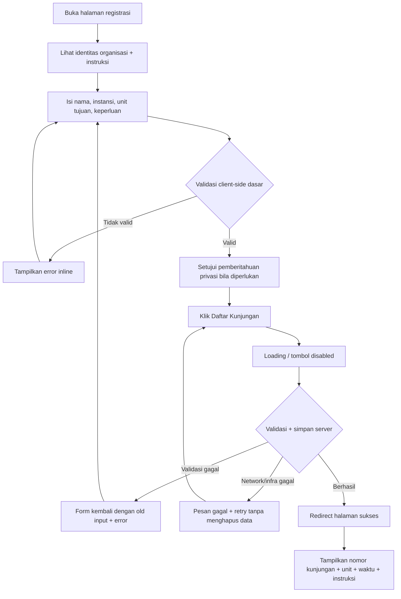
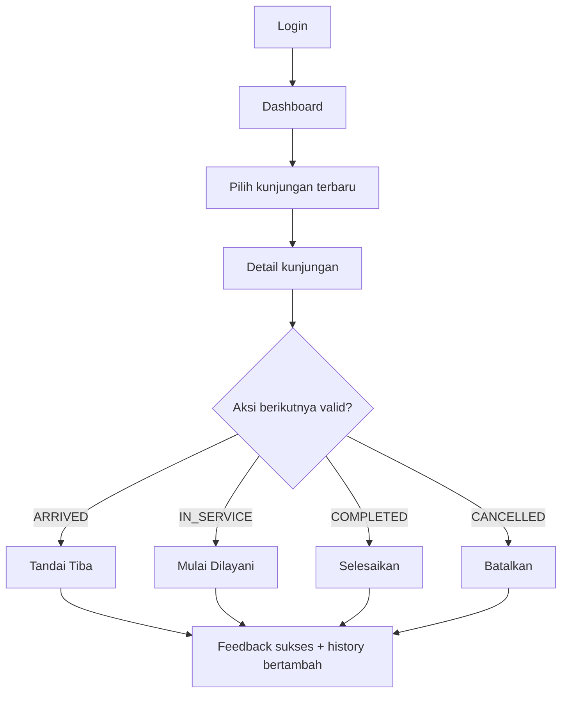
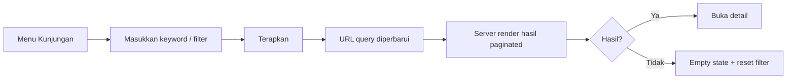
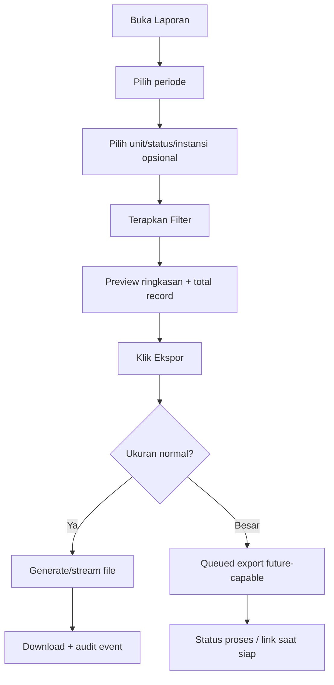

# Design.md — SI-TAMU

> **Product Design & UI/UX Specification**  
> **Produk:** SI-TAMU — Sistem Informasi Buku Tamu Digital Berbasis Web  
> **Versi dokumen:** 0.1  
> **Status:** Draft untuk review  
> **Sumber requirement utama:** `PRD.md` v0.1 dan `Architecture.md` v0.1  
> **Scope desain:** MVP single-organization, web responsif, dengan jalur evolusi Phase 2/3  
> **Dokumen berikutnya setelah desain disetujui:** `Schema.md`

---

## 1. Tujuan Dokumen

Dokumen ini menerjemahkan requirement produk dan keputusan arsitektur SI-TAMU menjadi spesifikasi desain yang dapat digunakan secara langsung oleh product designer, frontend developer, backend developer, QA, dan stakeholder saat melakukan review/UAT.

Fokus dokumen ini adalah:

1. mendefinisikan alur interaksi pengguna end-to-end;
2. menetapkan information architecture dan navigasi;
3. mendefinisikan struktur halaman untuk tamu, staff, dan administrator;
4. menetapkan design system: warna, typography, spacing, radius, elevation, iconography, dan data visualization;
5. mendefinisikan component hierarchy dan state setiap komponen;
6. menetapkan responsive behavior untuk smartphone, tablet/kiosk, laptop, dan desktop;
7. menetapkan aturan validasi, feedback, error, empty state, loading state, dan confirmation;
8. menetapkan keputusan teknis UI sesuai arsitektur Blade + Tailwind CSS + Alpine.js;
9. menjaga aksesibilitas, privasi, performa, dan kemudahan penggunaan oleh pengguna non-teknis;
10. mendefinisikan acceptance criteria desain sebelum implementasi dinyatakan siap.

Dokumen ini **tidak** menentukan struktur tabel database dan DDL final; hal tersebut akan ditetapkan pada `Schema.md`. Coding convention dan guardrails implementasi akan ditetapkan pada `Rules.md`.

---

## 2. Basis Desain dan Batas Interpretasi

Desain ini tidak menyalin tampilan visual dari jurnal sumber. Jurnal digunakan sebagai **basis kebutuhan domain**: registrasi digital, dashboard, pencarian, laporan, status kunjungan, notifikasi sebagai pengembangan, dan kebutuhan antarmuka yang sederhana bagi petugas/tamu.

Detail berikut merupakan **keputusan desain proyek SI-TAMU**, bukan klaim bahwa jurnal mewajibkannya:

- palette warna default;
- typography dan scale;
- grid dan spacing;
- side navigation untuk back-office;
- pola filter dengan URL query string;
- modal/drawer tertentu;
- status badge dan status stepper;
- standard breakpoint;
- struktur component library;
- microcopy default;
- penggunaan system font;
- aturan empty/loading/error state.

Semua keputusan visual harus dapat disesuaikan bila organisasi target memiliki brand guideline resmi. Namun perubahan branding tidak boleh mengurangi contrast, hierarchy, atau usability.

---

## 3. Design Objectives

### 3.1 Primary UX Objective

SI-TAMU harus membuat proses kunjungan terasa **lebih cepat daripada buku tamu manual**, bukan sekadar memindahkan formulir kertas ke layar.

Hal ini berarti:

- form tamu singkat;
- tidak mewajibkan akun tamu pada MVP;
- tidak memakai wizard multi-step jika satu halaman cukup;
- field opsional tidak mendominasi tampilan;
- konfirmasi berhasil langsung terlihat;
- petugas dapat memproses kunjungan dengan sedikit klik;
- pencarian dan filter tidak memerlukan pengetahuan teknis;
- laporan dapat dihasilkan tanpa menyusun ulang data secara manual.

### 3.2 Secondary UX Objectives

1. **Clarity** — pengguna selalu tahu sedang berada di halaman apa dan tindakan utama apa yang tersedia.
2. **Speed** — aksi rutin dapat dilakukan dengan jumlah interaksi minimum.
3. **Error prevention** — sistem mencegah input salah sebelum menjelaskan error setelah submit.
4. **Recoverability** — kegagalan jaringan/validasi tidak menghapus input pengguna.
5. **Traceability** — tindakan administratif sensitif selalu memiliki konteks, confirmation, dan feedback.
6. **Consistency** — pattern yang sama digunakan untuk tabel, form, status, dialog, filter, dan notifikasi.
7. **Accessibility** — penggunaan tidak bergantung hanya pada warna, mouse, atau ukuran layar besar.
8. **Privacy-aware UI** — data pribadi tidak ditampilkan lebih luas daripada kebutuhan operasional.

### 3.3 Design Success Signals

Desain dianggap efektif apabila pada usability/UAT:

- tamu baru dapat menyelesaikan registrasi tanpa instruksi verbal panjang;
- staff dapat menemukan kunjungan tertentu dengan cepat;
- staff memahami perbedaan status kunjungan;
- admin dapat membuat laporan tanpa meminta bantuan developer;
- pengguna tidak salah mengira aksi yang destructive/privileged sebagai aksi biasa;
- komponen utama tetap usable di ponsel dan tablet;
- error message dapat ditindaklanjuti oleh pengguna.

---

## 4. Persona dan Konteks Penggunaan

### 4.1 P1 — Tamu/Pengunjung

**Goal utama:** mendaftarkan kunjungan secepat mungkin dan mengetahui langkah selanjutnya.

**Konteks:**

- dapat menggunakan ponsel pribadi;
- dapat menggunakan tablet/kiosk organisasi;
- dapat dibantu petugas;
- kemampuan digital bervariasi;
- mungkin sedang berdiri di area front-office;
- tidak memiliki konteks internal mengenai nama unit/bidang.

**Konsekuensi desain:**

- halaman publik harus sangat sederhana;
- hindari jargon internal jika tidak diperlukan;
- unit tujuan perlu label/deskripsi singkat bila nama internal sulit dipahami;
- tombol submit harus mudah ditemukan;
- sukses registrasi tidak boleh berupa toast singkat saja;
- tidak mewajibkan sidebar atau navigasi kompleks.

### 4.2 P2 — Staff/Resepsionis

**Goal utama:** melihat tamu yang masuk, memproses status, membantu pencarian, dan mengurangi beban administrasi.

**Konteks:**

- digunakan berulang sepanjang jam operasional;
- mayoritas pada desktop/laptop, tetapi tablet tetap didukung;
- membutuhkan data hari ini lebih sering daripada histori lama;
- membutuhkan visual hierarchy tinggi untuk status dan aksi.

**Konsekuensi desain:**

- dashboard harus actionable, bukan hanya dekoratif;
- daftar kunjungan terbaru harus terlihat tanpa scroll berlebihan;
- filter umum harus mudah dijangkau;
- status dapat dikenali lewat label + warna + ikon/tanda, bukan warna saja;
- detail kunjungan harus memprioritaskan informasi operasional.

### 4.3 P3 — Administrator

**Goal utama:** mengelola user, unit, konfigurasi, audit, data kunjungan, dan laporan.

**Konteks:**

- aktivitas lebih jarang daripada staff tetapi lebih sensitif;
- membutuhkan form administratif yang jelas;
- perlu warning sebelum tindakan berisiko;
- perlu konteks audit.

**Konsekuensi desain:**

- halaman admin-only dibedakan lewat navigation permission, tetapi tetap menggunakan shell yang sama;
- aksi deactivate/reset/edit harus memiliki copy yang eksplisit;
- tidak menggunakan icon-only button untuk aksi sensitif tanpa accessible label/tooltip;
- destructive action tidak diletakkan bersebelahan dengan primary save tanpa spacing/pemisahan.

### 4.4 P4 — Pimpinan/Manajemen

**Goal utama:** memperoleh ringkasan dan laporan yang dapat dipertanggungjawabkan.

**Konsekuensi desain:**

- dashboard menggunakan angka dan label yang mudah dipahami;
- periode data selalu terlihat;
- grafik bukan satu-satunya representasi informasi;
- laporan menampilkan filter aktif dan total record.

---

## 5. UX Principles

### 5.1 One Primary Action per Context

Setiap halaman/form memiliki satu primary action dominan. Contoh:

- registrasi: **Daftar Kunjungan**;
- login: **Masuk**;
- edit unit: **Simpan Perubahan**;
- laporan: **Terapkan Filter** atau **Ekspor**, tergantung konteks.

Aksi sekunder menggunakan visual weight lebih rendah.

### 5.2 Recognition over Recall

Pengguna tidak dipaksa mengingat kode atau terminologi bila sistem dapat menampilkannya.

Contoh:

- dropdown unit menampilkan nama unit;
- status memakai label eksplisit;
- filter aktif ditampilkan sebagai chip/summary;
- detail kunjungan memperlihatkan nomor kunjungan yang dapat disalin.

### 5.3 Prevent Before Explain

Pencegahan lebih diutamakan daripada pesan error setelah kesalahan terjadi.

Contoh:

- unit nonaktif tidak muncul di form publik;
- tombol submit dapat disabled saat request sedang berlangsung;
- input memiliki max length;
- field wajib ditandai;
- opsi status hanya menampilkan transition yang valid.

### 5.4 Preserve User Work

Jika request gagal karena validasi atau jaringan:

- input tetap tersedia;
- field invalid diberi pesan spesifik;
- user dapat retry tanpa mengisi ulang seluruh form;
- duplicate protection tetap ditangani server-side.

### 5.5 Progressive Disclosure

Informasi jarang digunakan tidak harus tampil di permukaan.

Contoh:

- filter dasar terlihat; filter tambahan dapat dibuka melalui **Filter lainnya**;
- audit metadata detail berada di expandable section;
- optional profile/settings ditempatkan terpisah dari task utama.

---

## 6. Information Architecture

### 6.1 Public Area

```text
Public
├── Registrasi Kunjungan
├── Konfirmasi Registrasi
└── Error / bantuan konteks
```

MVP tidak membutuhkan public marketing website yang kompleks. Jika landing page tersedia, tujuan utamanya hanya:

- identitas organisasi;
- tombol **Daftar Kunjungan**;
- informasi singkat layanan;
- kontak/bantuan.

### 6.2 Back-Office Area

```text
Back Office
├── Dashboard
├── Kunjungan
│   ├── Daftar / Riwayat
│   └── Detail Kunjungan
├── Laporan
├── Master Data
│   └── Unit / Bidang
├── Pengguna                  [ADMIN]
├── Audit Log                 [ADMIN / permission khusus]
├── Pengaturan Organisasi     [ADMIN]
└── Akun
    ├── Profil ringkas
    └── Logout
```

### 6.3 Menu Visibility by Role

| Menu | STAFF | ADMIN |
|---|---:|---:|
| Dashboard | Ya | Ya |
| Kunjungan | Ya | Ya |
| Laporan | Sesuai permission | Ya |
| Unit/Bidang | View bila diperlukan | CRUD |
| Pengguna | Tidak | Ya |
| Audit Log | Tidak/default | Ya |
| Pengaturan | Tidak | Ya |
| Logout | Ya | Ya |

Authorization tetap ditegakkan di backend. Menyembunyikan menu bukan security control.

---

## 7. Global Navigation Design

### 7.1 Desktop Back-Office Shell

Gunakan pola **left sidebar + top bar + content area**.

```text
┌─────────────────────────────────────────────────────────────────────┐
│ Sidebar            │ Top Bar: Page title / actions / user menu     │
│                    ├────────────────────────────────────────────────┤
│ [Logo SI-TAMU]     │                                                │
│ Dashboard          │ Main Content                                   │
│ Kunjungan          │                                                │
│ Laporan            │                                                │
│ ─────────────      │                                                │
│ Unit/Bidang        │                                                │
│ Pengguna [Admin]   │                                                │
│ Audit [Admin]      │                                                │
│ Pengaturan [Admin] │                                                │
│                    │                                                │
│ [User / Logout]    │                                                │
└─────────────────────────────────────────────────────────────────────┘
```

**Sidebar behavior:**

- lebar default sekitar 240–264 px;
- active item memiliki background/indicator, icon, dan font weight berbeda;
- section administratif dipisahkan secara visual;
- icon selalu disertai label pada desktop;
- sidebar dapat collapsed hanya jika diperlukan setelah MVP, bukan requirement utama.

### 7.2 Tablet

- sidebar berubah menjadi off-canvas drawer;
- top bar memiliki tombol menu dengan accessible label;
- konten menggunakan full width;
- primary action tetap terlihat di bagian atas.

### 7.3 Mobile

Back-office mobile tetap usable, tetapi bukan target workflow paling efisien untuk pengelolaan data besar.

- sidebar menjadi drawer;
- table kompleks berubah menjadi card/list atau horizontal scroll terkendali;
- filter menggunakan drawer/bottom sheet;
- bulk action tidak diprioritaskan pada MVP;
- sticky action hanya digunakan jika tidak menutup konten/form.

---

## 8. User Flow Utama

### 8.1 Flow A — Registrasi Tamu Mandiri



### 8.2 Flow B — Staff Memproses Kunjungan



### 8.3 Flow C — Pencarian Histori



### 8.4 Flow D — Laporan dan Export



---

## 9. Public Registration Page Specification

### 9.1 Tujuan Halaman

Memungkinkan tamu menyelesaikan registrasi dalam satu halaman dengan usaha minimum.

### 9.2 Layout

Desktop/tablet:

```text
┌────────────────────────────────────────────────────┐
│                 [Logo Organisasi]                  │
│              Buku Tamu Digital                     │
│    Silakan isi data kunjungan dengan benar.        │
├────────────────────────────────────────────────────┤
│ Nama Lengkap *                                     │
│ [_______________________________________________]  │
│                                                    │
│ Asal Instansi / Organisasi *                       │
│ [_______________________________________________]  │
│                                                    │
│ Unit / Bidang Tujuan *                             │
│ [ Pilih unit                                  ▾ ]  │
│                                                    │
│ Keperluan Kunjungan *                              │
│ [_______________________________________________]  │
│ [_______________________________________________]  │
│                                                    │
│ Nomor Kontak (opsional/configurable)               │
│ [_______________________________________________]  │
│                                                    │
│ [i] Data digunakan untuk administrasi kunjungan.  │
│                                                    │
│                 [ Daftar Kunjungan ]               │
└────────────────────────────────────────────────────┘
```

Mobile:

- satu kolom;
- card tidak boleh terlalu sempit karena padding berlebihan;
- container menggunakan `max-width` di layar besar, tetapi hampir full width di ponsel;
- logo tidak mengambil lebih dari sekitar 72–96 px tinggi kecuali brand guideline menentukan lain;
- CTA full-width pada mobile.

### 9.3 Field Order

Urutan default:

1. Nama lengkap;
2. Asal instansi/organisasi;
3. Unit/bidang tujuan;
4. Keperluan;
5. Nomor kontak jika diaktifkan;
6. field configurable lain yang benar-benar diperlukan;
7. privacy notice;
8. submit.

Field harus disusun berdasarkan task, bukan berdasarkan struktur database.

### 9.4 Label dan Placeholder

Gunakan **label permanen**, bukan placeholder sebagai satu-satunya label.

Contoh:

- Label: `Nama lengkap`
- Placeholder: `Contoh: Budi Santoso`

Placeholder bersifat contoh, bukan instruksi wajib.

### 9.5 Required Indicator

- gunakan `*` plus keterangan `* Wajib diisi` di awal/akhir form;
- jangan mengandalkan warna merah saja;
- field opsional dapat diberi `(opsional)`.

### 9.6 Unit Selector

Untuk jumlah unit kecil (<20), native/select sederhana cukup.

Jika jumlah unit besar:

- gunakan searchable combobox;
- hasil menunjukkan `Nama Unit` dan optional deskripsi singkat;
- unit nonaktif tidak tampil;
- keyboard navigation harus didukung.

### 9.7 Privacy Notice

Privacy notice tampil ringkas dan terbaca sebelum submit. Minimum copy:

> Data yang Anda isi digunakan untuk administrasi kunjungan dan dikelola oleh [Nama Organisasi].

Jika kebijakan organisasi membutuhkan consent eksplisit, gunakan checkbox dengan label yang jelas. Jika dasar pemrosesan tidak membutuhkan consent checkbox, jangan membuat checkbox pura-pura hanya untuk formalitas; keputusan final harus mengikuti kebijakan organisasi.

### 9.8 Submit State

Normal:

`Daftar Kunjungan`

Saat request berlangsung:

`Mendaftarkan…`

Aturan:

- tombol disabled sementara;
- spinner kecil boleh digunakan;
- jangan mengubah seluruh page menjadi loading overlay;
- duplicate protection tetap server-side.

### 9.9 Validation State

Error field:

```text
Nomor kontak
[ abc________________________________ ]
⚠ Format nomor kontak tidak valid. Gunakan angka dan tanda + bila diperlukan.
```

Error summary di atas form digunakan bila terdapat banyak error atau setelah server-side validation:

> **Periksa kembali data Anda.** Ada 3 bagian yang perlu diperbaiki.

Summary berisi anchor ke field invalid jika memungkinkan.

### 9.10 Network Error

Jika request tidak mendapat response yang dapat dipastikan:

> **Registrasi belum dapat dikonfirmasi.** Periksa koneksi lalu coba lagi. Data yang sudah Anda isi tetap tersedia.

Tidak menampilkan pesan yang menyatakan "registrasi gagal" bila server mungkin sebenarnya telah menyimpan data. Idempotency token menangani retry.

---

## 10. Registration Success Page

### 10.1 Tujuan

Memberikan confirmation yang persisten dan jelas bahwa registrasi telah diterima.

### 10.2 Content Priority

1. icon/status sukses;
2. heading `Registrasi berhasil`;
3. nomor kunjungan;
4. nama tamu;
5. unit tujuan;
6. waktu registrasi lokal organisasi;
7. instruksi berikutnya;
8. CTA `Selesai` / `Daftar kunjungan lain` jika perangkat kiosk.

### 10.3 Wireframe

```text
┌───────────────────────────────────────────────┐
│                    ✓                          │
│          Registrasi berhasil                  │
│  Silakan lanjut ke petugas/front-office.      │
│                                               │
│  Nomor Kunjungan                              │
│  VIS-01HXYZ...              [Salin]            │
│                                               │
│  Nama               Budi Santoso              │
│  Unit Tujuan        Sekretariat                │
│  Waktu              09 Sep 2026, 10:24 WIB    │
│                                               │
│            [ Selesai ]                         │
└───────────────────────────────────────────────┘
```

### 10.4 Kiosk Reset

Jika perangkat dipakai bersama:

- setelah `Selesai`, kembali ke form kosong;
- jangan mempertahankan PII tamu sebelumnya;
- optional auto-reset setelah periode tertentu hanya jika telah diuji agar tidak membingungkan pengguna yang masih membaca confirmation.

---

## 11. Login Page

### 11.1 Tujuan

Akses khusus staff/admin, terpisah dari jalur publik.

### 11.2 Fields

- email/username;
- password;
- show/hide password;
- tombol `Masuk`.

### 11.3 Error Copy

Gunakan pesan generik:

> Email/username atau password tidak sesuai.

Jangan mengungkap apakah suatu akun ada.

### 11.4 Layout

- center card pada desktop;
- full-width comfortable padding pada mobile;
- branding ringan;
- tidak menampilkan link registrasi akun staff publik;
- password reset hanya tampil jika workflow telah diaktifkan.

---

## 12. Back-Office Dashboard

### 12.1 Tujuan

Dashboard adalah **operational starting point**, bukan halaman analytics penuh.

### 12.2 Information Priority

1. ringkasan hari ini;
2. kunjungan terbaru;
3. status yang membutuhkan tindakan;
4. shortcut ke daftar lengkap/laporan;
5. grafik tren sebagai P1.

### 12.3 Metric Cards

Minimum:

- Total hari ini;
- Terdaftar/menunggu;
- Sedang dilayani;
- Selesai.

Jika status disederhanakan organisasi, kartu mengikuti status aktif.

Setiap card harus:

- memiliki label eksplisit;
- menampilkan angka besar;
- memiliki context periode `Hari ini`;
- tidak hanya menggunakan icon sebagai label.

### 12.4 Latest Visits Table

Kolom desktop:

- Waktu;
- Nama;
- Instansi;
- Unit tujuan;
- Status;
- Aksi `Lihat`.

### 12.5 Dashboard Empty State

Jika belum ada kunjungan hari ini:

> **Belum ada kunjungan hari ini.** Kunjungan baru akan muncul di sini setelah tamu selesai mendaftar.

Jangan menampilkan tabel kosong dengan banyak garis tanpa penjelasan.

### 12.6 Auto Refresh

MVP tidak mengharuskan WebSocket.

Pilihan desain:

- tombol `Muat ulang`/refresh;
- optional polling ringan jika benar-benar dibutuhkan;
- tampilkan `Terakhir diperbarui 10:24` bila data tidak real-time.

UI tidak boleh memberi kesan real-time jika sebenarnya tidak.

---

## 13. Visits List / Riwayat Kunjungan

### 13.1 Page Header

```text
Kunjungan
Lihat, cari, dan kelola data kunjungan.
                              [Export / Laporan jika berizin]
```

### 13.2 Search

Search bar default mendukung keyword pada field yang masuk akal, misalnya nama, public visit ID, atau instansi.

Placeholder:

`Cari nama, instansi, atau nomor kunjungan…`

Search button eksplisit tetap tersedia pada server-rendered app; submit on Enter juga didukung.

### 13.3 Filter Bar

Filter utama:

- rentang tanggal;
- unit;
- status;
- keyword.

Pattern desktop:

```text
[Cari........................] [Tanggal ▾] [Unit ▾] [Status ▾] [Terapkan]
Filter aktif: Unit: Sekretariat ×   Status: Selesai ×     [Reset]
```

Filter state disimpan pada URL query sehingga:

- refresh tidak menghilangkan filter;
- link dapat dibagikan kepada user berizin;
- pagination mempertahankan filter.

### 13.4 Table Design

Kolom minimum:

| Kolom | Desktop | Tablet | Mobile |
|---|---|---|---|
| Waktu | Ya | Ya | Ringkas |
| Nomor kunjungan | Ya | Optional | Di detail card |
| Nama | Ya | Ya | Ya |
| Instansi | Ya | Ya | Ringkas/hidden jika sempit |
| Unit | Ya | Ya | Ya |
| Keperluan | Ringkas | Hidden/tooltip/detail | Detail |
| Status | Ya | Ya | Ya |
| Aksi | Ya | Ya | Ya |

### 13.5 Long Text

Keperluan panjang tidak diperlihatkan penuh di tabel. Gunakan truncate dua baris atau ringkasan, dengan detail penuh di halaman detail.

### 13.6 Pagination

- server-side pagination;
- tampilkan `Menampilkan 1–20 dari 327`;
- tombol Previous/Next;
- page number jika jumlah halaman masuk akal;
- filter dipertahankan.

### 13.7 No Result State

> **Tidak ada kunjungan yang cocok.** Ubah kata pencarian atau reset beberapa filter.

CTA: `Reset filter`.

---

## 14. Visit Detail Page

### 14.1 Tujuan

Menjadi single operational view untuk satu kunjungan.

### 14.2 Header

Tampilkan:

- nama tamu;
- public visit ID;
- current status;
- waktu registrasi;
- primary next action sesuai transition valid.

Contoh:

```text
Budi Santoso                             [REGISTERED]
VIS-01HXYZ... • 09 Sep 2026, 10:24 WIB

[Tandai Tiba]        [Aksi lainnya ▾]
```

### 14.3 Detail Sections

**A. Informasi Tamu**

- nama;
- instansi;
- nomor kontak bila role boleh melihat;
- field configured lain.

**B. Kunjungan**

- unit tujuan;
- keperluan;
- catatan;
- registered_at;
- current status.

**C. Status History**

Timeline:

```text
● REGISTERED     10:24     System/Public registration
│
● ARRIVED        10:27     Staff: Siti
│
○ IN_SERVICE     —
│
○ COMPLETED      —
```

Hanya status yang sudah terjadi ditampilkan sebagai history aktual. Future step indicator dapat digunakan terpisah bila membantu.

**D. Audit / Correction Metadata**

Hanya role berizin. Jangan membuat audit log penuh terlalu dominan bagi staff.

### 14.4 Status Actions

Primary action mengikuti next valid transition.

Contoh:

- `REGISTERED` → `Tandai Tiba`;
- `ARRIVED` → `Mulai Dilayani`;
- `IN_SERVICE` → `Selesaikan`.

`Batalkan Kunjungan` ditempatkan di secondary/destructive area.

### 14.5 Status Confirmation

Aksi rutin reversible/low-risk dapat langsung disubmit dengan feedback.

Aksi `CANCELLED` wajib confirmation:

> **Batalkan kunjungan ini?** Status akan tercatat pada histori dan hanya dapat dikoreksi oleh pengguna berizin sesuai aturan sistem.

Buttons:

- Secondary: `Kembali`
- Destructive: `Batalkan Kunjungan`

### 14.6 Data Correction

P1 feature untuk admin.

- tombol `Koreksi data`;
- form menampilkan field yang boleh diubah;
- alasan koreksi wajib;
- registered timestamp asli tidak editable;
- setelah save tampil feedback bahwa perubahan tercatat pada audit trail.

---

## 15. Reports Page

### 15.1 Tujuan

Menghasilkan dataset yang konsisten dengan halaman pencarian berdasarkan filter yang sama.

### 15.2 Filter

- periode start/end wajib untuk export besar;
- unit;
- status;
- instansi asal.

### 15.3 Preview

Tampilkan:

- filter aktif;
- total record;
- total kunjungan per status bila relevan;
- preview tabel terbatas/paginated;
- tombol export.

### 15.4 Export Button

Label eksplisit:

- `Ekspor CSV`;
- `Ekspor XLSX` jika tersedia.

Jangan menggunakan label generik `Download` jika format penting.

### 15.5 Large Export UX

Jika export diproses async pada implementasi selanjutnya:

- tampilkan status `Sedang menyiapkan file…`;
- user boleh meninggalkan halaman;
- tampilkan hasil pada area `Export terbaru` atau notifikasi internal;
- file expiry diinformasikan.

---

## 16. Department / Unit Management

### 16.1 List

Kolom:

- nama unit;
- status Aktif/Nonaktif;
- urutan tampil;
- terakhir diperbarui;
- aksi.

### 16.2 Create/Edit Form

Fields:

- Nama unit *;
- Deskripsi singkat opsional;
- Status aktif;
- Urutan tampilan.

### 16.3 Deactivate Instead of Delete

Jika unit sudah pernah digunakan, UI mengutamakan `Nonaktifkan`, bukan `Hapus`.

Confirmation:

> Unit yang dinonaktifkan tidak akan muncul untuk registrasi baru. Riwayat kunjungan lama tetap dipertahankan.

Ini harus dibedakan dari permanent deletion.

---

## 17. User Management

### 17.1 User List

Kolom:

- nama;
- email/username;
- role;
- status;
- last login bila tersedia;
- aksi.

### 17.2 Create User

Fields minimum:

- nama;
- email/username;
- role;
- activation state;
- password initial/reset flow sesuai implementasi.

### 17.3 Role Selection

Role menggunakan label manusia:

- `Administrator`;
- `Staff`.

Jangan menampilkan enum internal `ADMIN`/`STAFF` sebagai satu-satunya copy jika UI Bahasa Indonesia.

### 17.4 Deactivate User

Confirmation:

> Nonaktifkan akun ini? Pengguna tidak dapat login sampai akun diaktifkan kembali.

### 17.5 Self-Protection

UI sebaiknya mencegah admin secara tidak sengaja menonaktifkan dirinya sendiri jika hal tersebut akan mengunci akses sistem, atau setidaknya memberi warning kuat sesuai business rule final.

---

## 18. Audit Log UI

### 18.1 Tujuan

Menjawab siapa melakukan aksi apa, kapan, dan terhadap entity apa.

### 18.2 List Fields

- waktu;
- aktor;
- aksi;
- target;
- ringkasan;
- detail.

### 18.3 Filter

- periode;
- aktor;
- action type;
- entity type.

### 18.4 Detail

Before/after data hanya menampilkan field yang aman. Password, token, secret, raw session, dan data sensitif yang tidak diperlukan **tidak boleh** tampil.

### 18.5 Read-Only Semantics

Audit screen tidak memiliki edit/delete action normal.

---

## 19. Organization Settings UI

### 19.1 Sections

Gunakan section/tab yang jelas:

1. Identitas Organisasi;
2. Registrasi;
3. Zona Waktu;
4. Branding;
5. Fitur.

MVP tidak harus menerapkan semua sebagai tab bila jumlah field sedikit; section cards dalam satu halaman dapat lebih sederhana.

### 19.2 Organization Identity

- nama organisasi;
- alamat;
- kontak layanan;
- logo.

### 19.3 Registration Settings

- instruction text;
- field nomor kontak required/optional/off jika diizinkan;
- field configurable lain yang sudah disetujui produk.

Perubahan konfigurasi yang mengubah kebutuhan data harus diberi helper text mengenai dampaknya.

### 19.4 Timezone

Tampilkan contoh waktu lokal setelah pilihan timezone untuk menghindari salah konfigurasi.

---

# DESIGN SYSTEM

## 20. Design System Philosophy

Design system SI-TAMU harus terasa:

- resmi tetapi tidak kaku;
- bersih;
- mudah dipindai;
- minim dekorasi yang tidak memiliki fungsi;
- konsisten dengan layanan publik modern;
- dapat di-branding tanpa mengubah struktur interaksi.

Design system harus dipetakan ke Tailwind theme/token sehingga perubahan warna/spacing tidak tersebar sebagai magic value di banyak template.

---

## 21. Color Palette

Karena organisasi target belum ditetapkan, SI-TAMU menggunakan **default neutral-institutional palette**. Warna primary dapat diganti lewat branding layer, tetapi semantic colors harus tetap konsisten.

### 21.1 Primary — Default Institutional Blue

| Token | Hex | Penggunaan |
|---|---|---|
| `primary-50` | `#EFF6FF` | subtle background |
| `primary-100` | `#DBEAFE` | selected/hover soft |
| `primary-200` | `#BFDBFE` | borders ringan |
| `primary-300` | `#93C5FD` | decorative/disabled emphasis |
| `primary-400` | `#60A5FA` | icon/secondary emphasis |
| `primary-500` | `#3B82F6` | interactive accent |
| `primary-600` | `#2563EB` | primary button default |
| `primary-700` | `#1D4ED8` | primary hover/active |
| `primary-800` | `#1E40AF` | dark emphasis |
| `primary-900` | `#1E3A8A` | deep brand text/accent |

### 21.2 Neutral

| Token | Hex | Penggunaan |
|---|---|---|
| `neutral-0` | `#FFFFFF` | card/page surface |
| `neutral-50` | `#F8FAFC` | page background |
| `neutral-100` | `#F1F5F9` | subtle section background |
| `neutral-200` | `#E2E8F0` | border |
| `neutral-300` | `#CBD5E1` | disabled border |
| `neutral-400` | `#94A3B8` | placeholder |
| `neutral-500` | `#64748B` | secondary text |
| `neutral-600` | `#475569` | body muted |
| `neutral-700` | `#334155` | body strong |
| `neutral-800` | `#1E293B` | heading |
| `neutral-900` | `#0F172A` | high emphasis |

### 21.3 Semantic Colors

| Semantic | Main | Soft background | Text/strong |
|---|---|---|---|
| Success | `#16A34A` | `#F0FDF4` | `#166534` |
| Warning | `#D97706` | `#FFFBEB` | `#92400E` |
| Danger | `#DC2626` | `#FEF2F2` | `#991B1B` |
| Info | `#0284C7` | `#F0F9FF` | `#075985` |

### 21.4 Status Colors

Status tidak boleh bergantung pada warna saja.

| Status | Visual Token | Label UI |
|---|---|---|
| `REGISTERED` | Neutral/Info | Terdaftar |
| `ARRIVED` | Primary | Tiba |
| `IN_SERVICE` | Warning | Sedang dilayani |
| `COMPLETED` | Success | Selesai |
| `CANCELLED` | Danger/Muted danger | Dibatalkan |

Badge selalu memiliki text label.

### 21.5 Contrast Rule

- normal text target minimum WCAG AA contrast;
- body text tidak menggunakan neutral terlalu terang;
- primary button text harus memiliki contrast memadai;
- semantic background yang sangat soft harus menggunakan semantic text yang lebih gelap;
- placeholder tidak digunakan sebagai critical information.

---

## 22. Typography

### 22.1 Font Family

Default menggunakan system sans-serif untuk menghindari dependency font eksternal:

```css
font-family: ui-sans-serif, system-ui, -apple-system, BlinkMacSystemFont,
             "Segoe UI", sans-serif;
```

Jika organisasi kelak mewajibkan font khusus, font tersebut harus di-review dari sisi lisensi, loading, keterbacaan, dan deployment. UI tidak boleh bergantung pada CDN font untuk fungsi inti.

### 22.2 Type Scale

| Token | Size | Line Height | Weight | Penggunaan |
|---|---:|---:|---:|---|
| `display-sm` | 30px | 38px | 700 | success/hero terbatas |
| `heading-1` | 24px | 32px | 700 | page title |
| `heading-2` | 20px | 28px | 600/700 | section title |
| `heading-3` | 16px | 24px | 600 | card/subsection |
| `body-lg` | 16px | 26px | 400 | public instruction |
| `body-md` | 14px | 22px | 400 | default back-office body |
| `body-sm` | 13px | 20px | 400 | metadata/table secondary |
| `label` | 14px | 20px | 500/600 | form label/button |
| `caption` | 12px | 18px | 400/500 | helper text |

Pada public registration mobile, body 16px direkomendasikan untuk mencegah zoom otomatis pada beberapa browser dan meningkatkan keterbacaan.

### 22.3 Typography Rules

- heading menggunakan sentence case, bukan ALL CAPS;
- body width panjang dibatasi agar nyaman dibaca;
- jangan memakai weight 300 untuk body kecil;
- nomor metrik dapat menggunakan tabular numerals jika tersedia;
- public visit ID dapat menggunakan monospace hanya jika membantu scanning, tetapi tidak wajib.

---

## 23. Spacing System

Gunakan basis 4 px.

| Token | Value |
|---|---:|
| `space-1` | 4px |
| `space-2` | 8px |
| `space-3` | 12px |
| `space-4` | 16px |
| `space-5` | 20px |
| `space-6` | 24px |
| `space-8` | 32px |
| `space-10` | 40px |
| `space-12` | 48px |
| `space-16` | 64px |

Rules:

- form field vertical gap: 16–20 px;
- card padding: 20–24 px desktop, 16 px mobile;
- section gap: 24–32 px;
- page content padding: 24–32 px desktop, 16 px mobile;
- tombol dalam action group: 8–12 px.

---

## 24. Radius, Border, Shadow

### 24.1 Radius

| Token | Value | Usage |
|---|---:|---|
| `radius-sm` | 6px | badge/small control |
| `radius-md` | 8px | input/button |
| `radius-lg` | 12px | card/modal |
| `radius-xl` | 16px | public form card optional |
| `radius-full` | 9999px | pill badge/avatar |

### 24.2 Border

Default border: 1 px `neutral-200`.

Focus border/ring tidak mengganti border saja; gunakan focus ring yang terlihat.

### 24.3 Shadow

Gunakan minimal:

- card default dapat tanpa shadow, cukup border;
- dropdown/modal menggunakan shadow medium;
- hindari multiple decorative shadow besar pada dashboard administratif.

---

## 25. Layout Grid and Container

### 25.1 Public

- max content width form: sekitar 640–720 px;
- page outer container: max 960 px untuk area branding + form;
- single-column form default.

### 25.2 Back Office

- content max-width dapat luas (`~1440 px`) untuk tabel;
- gunakan 12-column mental model hanya bila diperlukan;
- dashboard card grid: 4 kolom desktop, 2 tablet, 1 mobile;
- form administratif umumnya max 720–840 px agar field tidak terlalu panjang.

---

## 26. Breakpoints

Gunakan breakpoint konsisten dengan Tailwind defaults atau mapping setara:

| Alias | Min width | Behavior utama |
|---|---:|---|
| Base | 0 | mobile-first |
| `sm` | 640px | form/action mulai inline bila cukup |
| `md` | 768px | tablet, dashboard 2 kolom |
| `lg` | 1024px | sidebar persistent |
| `xl` | 1280px | tabel/metric lebih lapang |
| `2xl` | 1536px | max content, bukan membesarkan semuanya |

Breakpoint tidak boleh dipakai hanya karena device name; gunakan ketika layout benar-benar membutuhkan perubahan.

---

## 27. Iconography

- gunakan SVG icon set konsisten;
- ukuran umum 16, 20, 24 px;
- icon dekoratif memakai `aria-hidden="true"`;
- icon-only interactive control wajib accessible name/tooltip;
- jangan menggunakan emoji sebagai icon sistem utama;
- semantic icon membantu tetapi tidak menggantikan label.

Recommended semantic mapping:

- Success: check circle;
- Warning: triangle/exclamation;
- Error: alert circle;
- Search: magnifier;
- Filter: funnel/sliders;
- Export: download/document arrow;
- Audit: history/list;
- User: person;
- Unit: building/organization.

---

## 28. Component Hierarchy

```text
Design Tokens
└── Primitives
    ├── Text
    ├── Icon
    ├── Surface
    └── Divider
        └── Form Controls
            ├── Input
            ├── Textarea
            ├── Select
            ├── Checkbox
            ├── Radio
            └── Toggle
                └── Components
                    ├── Button
                    ├── Badge
                    ├── Alert
                    ├── Toast
                    ├── Card
                    ├── Modal
                    ├── Drawer
                    ├── Dropdown
                    ├── Table
                    ├── Pagination
                    ├── FilterBar
                    ├── StatusStepper
                    └── EmptyState
                        └── Patterns
                            ├── PublicRegistrationForm
                            ├── BackOfficeShell
                            ├── VisitList
                            ├── VisitDetail
                            ├── ReportFilter
                            └── AdminCrudPage
```

---

## 29. Button Specification

### 29.1 Variants

**Primary** — satu aksi utama halaman/form.

**Secondary** — aksi pendamping.

**Tertiary/Ghost** — navigation/action ringan.

**Danger** — cancel/deactivate/destructive.

### 29.2 Sizes

- `sm`: height sekitar 36 px;
- `md`: 40–44 px;
- `lg`: 48 px untuk public registration.

Touch target minimum tetap cukup besar walau visual button kecil.

### 29.3 States

- default;
- hover;
- active;
- focus-visible;
- disabled;
- loading.

Loading mempertahankan lebar tombol agar layout tidak shift drastis.

### 29.4 Button Copy

Gunakan verb spesifik:

- `Daftar Kunjungan`;
- `Tandai Tiba`;
- `Simpan Perubahan`;
- `Ekspor CSV`;
- `Nonaktifkan Akun`.

Hindari `OK`, `Submit`, atau `Proses` jika aksi dapat disebut lebih jelas.

---

## 30. Form Control Specification

### 30.1 Input

Anatomy:

```text
Label *
[ Input value                               ]
Helper text / error text
```

State:

- default;
- hover;
- focus;
- filled;
- invalid;
- disabled;
- readonly.

### 30.2 Textarea

- minimum 3 rows untuk keperluan/catatan;
- auto-grow optional;
- character limit ditampilkan jika panjang dibatasi ketat.

### 30.3 Select

Native select boleh digunakan bila requirement sederhana. Custom combobox hanya jika dibutuhkan search.

### 30.4 Checkbox

Label dapat diklik; jangan gunakan checkbox tanpa label kecuali selection table dengan accessible label.

### 30.5 Error

Error berada dekat field dan di-associate dengan `aria-describedby`.

---

## 31. Badge and Status Component

### 31.1 Status Badge

Anatomy:

`[dot/icon optional] Label`

Contoh:

- `Terdaftar`;
- `Tiba`;
- `Sedang dilayani`;
- `Selesai`;
- `Dibatalkan`.

### 31.2 Role Badge

Role badge harus visually lebih netral daripada visit status agar tidak bersaing dengan status operasional.

---

## 32. Alert, Toast, and Inline Feedback

### 32.1 Inline Alert

Untuk informasi yang perlu tetap terlihat:

- validation summary;
- privacy notice;
- warning konfigurasi;
- system maintenance message.

### 32.2 Toast

Untuk feedback singkat setelah back-office action:

- `Status kunjungan diperbarui.`;
- `Unit berhasil disimpan.`

Toast **tidak** digunakan sebagai satu-satunya confirmation registrasi publik.

### 32.3 Error Persistence

Error penting tidak menghilang otomatis sebelum user sempat membacanya.

---

## 33. Modal, Drawer, Dropdown

### 33.1 Modal

Gunakan hanya untuk:

- confirmation destructive/sensitive;
- task pendek yang tidak membutuhkan page context luas.

Jangan menaruh form kompleks dengan banyak field dalam modal.

### 33.2 Drawer

Gunakan untuk:

- mobile navigation;
- mobile filter;
- optional quick detail jika implementasi terbukti membantu.

### 33.3 Dropdown

Gunakan untuk secondary action group. Primary next status action sebaiknya tidak disembunyikan dalam dropdown bila sering digunakan.

---

## 34. Table Pattern

### 34.1 Header

- header jelas;
- sticky header optional untuk tabel panjang desktop;
- sort indicator hanya tampil bila sorting benar-benar didukung.

### 34.2 Row Action

Aksi default:

- `Lihat` sebagai text/button;
- kebanyakan edit/status dilakukan di detail page untuk menghindari accidental action dari tabel.

### 34.3 Density

Default medium density. Tidak menggunakan ultra-dense enterprise table pada MVP karena pengguna non-teknis.

### 34.4 Responsive Alternative

Mobile dapat mengubah row menjadi card:

```text
Budi Santoso                     [Terdaftar]
Dinas XYZ
Tujuan: Sekretariat
09 Sep 2026 • 10:24
[Lihat detail]
```

---

## 35. Filter Pattern

### 35.1 Basic Filter

Selalu mudah diakses:

- keyword;
- tanggal;
- unit;
- status.

### 35.2 Filter Application

Untuk server-rendered app:

- filter disubmit sebagai GET;
- query state berada di URL;
- reset kembali ke URL canonical tanpa filter;
- pagination menyertakan query.

### 35.3 Active Filter Summary

Filter aktif tampil sebagai chip/text summary sehingga user tidak perlu membuka dropdown untuk mengetahui state.

---

## 36. Empty States

Empty state dibedakan berdasarkan sebab:

### 36.1 Truly Empty

> Belum ada data kunjungan.

### 36.2 Filtered Empty

> Tidak ada kunjungan yang cocok dengan filter saat ini.

CTA `Reset filter`.

### 36.3 Permission-Limited Empty

Jika user tidak memiliki data karena scope permission, jangan menyatakan sistem tidak memiliki data secara global. Copy harus sesuai scope.

---

## 37. Loading States

Karena server-rendered, loading utama terjadi pada submit/navigation.

Aturan:

- tombol action menunjukkan loading setelah submit;
- table page transition tidak membutuhkan skeleton kompleks jika response cepat;
- chart dapat menggunakan skeleton jika asynchronous;
- loading tidak boleh menghilangkan context terlalu lama;
- jangan menampilkan spinner tanpa label pada proses > beberapa detik.

---

## 38. Error Pages

### 38.1 403

> **Anda tidak memiliki akses ke halaman ini.** Jika Anda merasa seharusnya memiliki akses, hubungi administrator.

CTA: `Kembali ke Dashboard`.

### 38.2 404

> **Halaman tidak ditemukan.** Tautan mungkin sudah berubah atau data tidak tersedia.

### 38.3 Session Expired / CSRF

> **Sesi Anda telah berakhir.** Silakan masuk kembali untuk melanjutkan.

Untuk form public, jika CSRF/session issue terjadi, usahakan input tidak hilang apabila teknis memungkinkan.

### 38.4 500 / Generic Error

> **Terjadi kendala pada sistem.** Coba lagi beberapa saat. Jika masalah berlanjut, sampaikan kode referensi berikut kepada petugas: `REQ-…`.

Jangan menampilkan stack trace.

---

# TECHNICAL DESIGN DECISIONS

## 39. Rendering Strategy

MVP menggunakan **server-rendered Blade views**.

Implikasi desain:

- setiap route harus memiliki URL yang dapat dipahami;
- form menggunakan standard POST/PATCH flow;
- server response adalah source of truth;
- JavaScript tidak boleh menjadi requirement untuk operasi inti yang dapat dilakukan tanpa JS, kecuali komponen tertentu memang membutuhkan enhancement;
- navigation menggunakan full-page response secara normal.

---

## 40. State Management

### 40.1 Server State

Data bisnis selalu berasal dari server/database:

- visit;
- status;
- user;
- unit;
- report;
- settings.

Frontend tidak memelihara authoritative copy jangka panjang.

### 40.2 URL State

Gunakan query string untuk:

- search keyword;
- filter tanggal;
- filter unit;
- filter status;
- sort jika ditambahkan;
- pagination.

Contoh:

```text
/admin/visits?q=budi&department=sekretariat&status=completed&page=2
```

### 40.3 Ephemeral UI State

Alpine.js dapat mengelola:

- open/close dropdown;
- modal;
- mobile navigation drawer;
- show/hide password;
- temporary filter drawer state;
- simple tabs;
- submit loading flag sebagai enhancement.

Tidak dibuat global client-side store untuk visits/users/reports pada MVP.

### 40.4 Form State

- server validation menggunakan old input;
- browser-native/client validation membantu, bukan authoritative;
- sensitive password input tidak diisi ulang otomatis setelah error;
- public registration mempertahankan field non-sensitive setelah validation failure.

---

## 41. Progressive Enhancement

Baseline harus tetap berfungsi untuk alur inti dengan JavaScript minimum.

JS enhancement boleh menambahkan:

- searchable select;
- confirmation modal;
- copy-to-clipboard;
- char count;
- table quick interaction;
- chart;
- mobile drawer.

Jika JS gagal:

- form submit tetap dapat dilakukan;
- navigasi tetap tersedia;
- server-side validation tetap bekerja;
- critical action masih memiliki fallback page/confirmation jika diperlukan.

---

## 42. Tailwind Implementation Strategy

### 42.1 Tokenization

Mapping token ke Tailwind theme/plugin/config:

- `primary-*`;
- semantic colors;
- radius;
- container width;
- typography if custom utility needed.

### 42.2 Reusable Blade Components

Recommended baseline:

```text
resources/views/components/
├── ui/
│   ├── button.blade.php
│   ├── badge.blade.php
│   ├── alert.blade.php
│   ├── card.blade.php
│   ├── modal.blade.php
│   ├── empty-state.blade.php
│   ├── pagination.blade.php
│   └── spinner.blade.php
├── form/
│   ├── input.blade.php
│   ├── textarea.blade.php
│   ├── select.blade.php
│   ├── checkbox.blade.php
│   ├── field-error.blade.php
│   └── label.blade.php
├── visits/
│   ├── status-badge.blade.php
│   ├── visit-card.blade.php
│   └── status-timeline.blade.php
└── layout/
    ├── sidebar.blade.php
    ├── topbar.blade.php
    └── page-header.blade.php
```

Nama folder final harus mengikuti `Architecture.md` dan `Rules.md`, tetapi prinsip reuse ini dipertahankan.

### 42.3 Avoid Utility Explosion

Jangan copy-paste rangkaian class panjang yang sama di puluhan view. Jika pattern stabil dan berulang, ekstrak menjadi Blade component atau class abstraction yang wajar.

---

## 43. Responsive Behavior

### 43.1 Public Registration

**Mobile:**

- 1 kolom;
- 16 px horizontal padding;
- CTA full width;
- form control height nyaman sentuh;
- typography minimum body 16 px untuk field penting.

**Tablet:**

- tetap 1 kolom untuk mengurangi cognitive load;
- card sedikit lebih lebar;
- CTA dapat tetap full width atau intrinsic sesuai review.

**Desktop:**

- centered max-width form;
- field tidak dibuat multi-column hanya untuk mengisi ruang, kecuali pasangan field jelas seperti date/time pada fitur future.

### 43.2 Dashboard

- mobile: cards stacked;
- tablet: 2 columns;
- desktop: 4 columns;
- recent visits becomes card list on narrow screen.

### 43.3 Data Tables

Prioritas responsive:

1. sembunyikan kolom sekunder;
2. pertahankan nama/status/aksi;
3. ubah menjadi card list bila readability lebih baik;
4. horizontal scroll hanya sebagai fallback terkontrol.

### 43.4 Forms Back Office

- label di atas input, bukan left-aligned label column;
- form 1 kolom secara default;
- small paired controls dapat 2 kolom pada desktop;
- submit action tetap mudah ditemukan setelah scroll.

---

## 44. Accessibility Specification

### 44.1 Keyboard

Semua fungsi utama harus dapat dilakukan tanpa mouse:

- navigation;
- form;
- dropdown;
- modal;
- filter;
- pagination;
- status action.

### 44.2 Focus

- `:focus-visible` ring terlihat jelas;
- modal memindahkan fokus ke dialog;
- saat modal ditutup fokus kembali ke trigger;
- skip link ke main content direkomendasikan pada back-office shell.

### 44.3 Semantic HTML

Gunakan elemen native sebisa mungkin:

- `<button>` untuk action;
- `<a>` untuk navigation;
- `<label>` untuk field;
- `<table>` untuk data tabular desktop;
- heading hierarchy berurutan;
- `<nav>`, `<main>`, `<header>` sesuai konteks.

### 44.4 Error Announcement

- error summary dapat menggunakan live region yang tepat;
- field memiliki `aria-invalid` bila invalid;
- helper/error terhubung melalui `aria-describedby`.

### 44.5 Color

Status dan error tidak boleh hanya melalui warna. Gunakan text, icon, dan/atau shape.

### 44.6 Motion

- animasi pendek dan fungsional;
- hormati `prefers-reduced-motion`;
- tidak ada decorative motion berat.

---

## 45. Content Design and Language

### 45.1 Default Language

Bahasa Indonesia.

### 45.2 Tone

- ringkas;
- profesional;
- langsung;
- tidak teknis bagi tamu;
- tidak menyalahkan pengguna.

### 45.3 Terminology Mapping

| Internal/Code | UI Bahasa Indonesia |
|---|---|
| Visit | Kunjungan |
| Visitor | Tamu / Pengunjung |
| Department | Unit / Bidang |
| Registered | Terdaftar |
| Arrived | Tiba |
| In Service | Sedang dilayani |
| Completed | Selesai |
| Cancelled | Dibatalkan |
| Audit Log | Audit Log / Riwayat Aktivitas |
| Export | Ekspor |

Nama `Unit/Bidang` harus dapat dikonfigurasi jika organisasi menggunakan terminologi lain.

### 45.4 Date/Time Display

Gunakan format manusia pada UI:

`9 Sep 2026, 10:24 WIB`

Pada laporan/export, format dapat lebih konsisten/tabular. Timezone organisasi harus jelas bila relevan.

---

## 46. Validation Design

### 46.1 Client and Server

Client validation mempercepat feedback. Server validation tetap authoritative.

### 46.2 When to Validate

- jangan menampilkan error merah sebelum user sempat berinteraksi dengan field;
- validasi pada blur/change untuk field tertentu dapat digunakan;
- setelah submit gagal, tampilkan seluruh error yang relevan.

### 46.3 Error Copy Pattern

Gunakan:

`[Apa masalahnya] + [cara memperbaikinya bila perlu]`.

Contoh baik:

- `Nama lengkap wajib diisi.`
- `Keperluan terlalu panjang. Maksimum 500 karakter.`
- `Pilih unit tujuan yang masih aktif.`

Hindari:

- `Invalid input.`
- `Error 422.`
- `Data salah.`

---

## 47. Interaction Feedback

### 47.1 Success

Setelah state-changing action:

- redirect ke state terbaru;
- tampilkan success flash/toast;
- UI menunjukkan data baru dari server.

### 47.2 Failure

Jika business rule menolak status transition:

> Status tidak dapat diubah dari **Selesai** menjadi **Sedang dilayani**.

Jangan hanya menampilkan generic error jika rule dapat dijelaskan aman.

### 47.3 Optimistic UI

MVP **tidak** menggunakan optimistic update untuk status bisnis. UI menunggu server confirmation agar tidak menampilkan state palsu pada kondisi network error/concurrency.

---

## 48. Privacy-Aware UI

### 48.1 Minimize Visible PII

Tabel daftar tidak menampilkan semua field identitas. Detail sensitif berada di detail page dan mengikuti permission.

### 48.2 Shared Screen Consideration

Dashboard front-office dapat terlihat oleh orang sekitar. Karena itu:

- jangan menampilkan nomor identitas/alamat lengkap di dashboard;
- nomor kontak tidak perlu tampil di table;
- detail PII tidak muncul dalam notification toast;
- export tidak otomatis terbuka pada public/shared path.

### 48.3 Public Success Page

Jangan menampilkan data berlebihan yang dapat dilihat tamu berikutnya pada kiosk.

---

## 49. Performance-Aware UX

### 49.1 Keep Public Page Light

- tidak memuat chart;
- tidak memuat library JS besar tanpa kebutuhan;
- logo dioptimalkan;
- icon lokal;
- CSS/JS bundled;
- tidak bergantung pada third-party runtime untuk render utama.

### 49.2 Table Performance

- server-side pagination;
- jangan render ribuan row;
- filter dilakukan server;
- kolom secukupnya.

### 49.3 Perceived Performance

- primary content tampil sebelum enhancement sekunder;
- tombol memberi loading feedback segera;
- tidak menggunakan blocking animation panjang.

---

## 50. Kiosk / Shared Device Considerations

Kiosk bukan deployment wajib MVP, tetapi form publik harus kompatibel.

Jika digunakan sebagai kiosk:

- browser full-screen optional;
- halaman success memiliki tombol reset yang jelas;
- session publik tidak menyimpan PII antar tamu;
- autocomplete browser untuk data pribadi dapat dinonaktifkan secara selektif bila dibutuhkan kebijakan;
- perangkat harus memiliki timeout/screen reset policy operasional;
- jangan menyimpan data tamu di localStorage pada MVP.

---

## 51. Data Visualization

### 51.1 MVP Principles

Grafik hanya digunakan jika menjawab pertanyaan operasional.

Contoh P1:

- kunjungan per hari selama 7 hari;
- distribusi per unit.

### 51.2 Chart Rules

- selalu memiliki title;
- periode jelas;
- axis/label terbaca;
- tooltip bukan satu-satunya akses ke nilai penting;
- color palette terbatas;
- status colors konsisten dengan badge bila dipakai;
- jangan gunakan pie/donut untuk terlalu banyak kategori;
- tabel/angka alternatif tetap tersedia untuk data penting.

---

## 52. Notification Design — Phase 2

### 52.1 Internal Notification

Jika Phase 2 menambahkan notifikasi unit:

- bell icon boleh digunakan di back-office;
- unread count tidak boleh menjadi satu-satunya indikator;
- notification item berisi nama tamu, unit, waktu, dan link aman ke detail sesuai permission.

### 52.2 WhatsApp Notification

UI konfigurasi tidak menyimpan secret provider secara plain text atau menampilkan secret setelah tersimpan.

Admin perlu melihat:

- status integrasi;
- template aktif;
- destination rule;
- delivery state/log secara aman.

---

## 53. QR/Barcode Design — Phase 2

Jika QR/barcode ditambahkan:

- QR tidak menggantikan public visit ID manusia;
- scan screen memiliki fallback input kode manual;
- hasil scan menampilkan konfirmasi identitas minimum sebelum status diubah;
- error scan membedakan `kode tidak valid`, `kedaluwarsa`, atau `sudah diproses` bila rule mendukung;
- camera permission dijelaskan sebelum diminta jika browser membutuhkan.

---

## 54. Survey Design — Phase 2

Survey setelah kunjungan sebaiknya sangat singkat:

- rating 1–5 atau skala sederhana;
- komentar opsional;
- public token yang terkait visit;
- satu submit;
- success confirmation.

Jangan mencampurkan survey dengan registrasi awal karena menambah friction.

---

## 55. Offline/PWA Design — Phase 3

Offline mode membutuhkan review desain khusus. UI harus jelas membedakan:

- online;
- offline;
- data tersimpan lokal tetapi belum sinkron;
- sinkron berhasil;
- conflict/error.

Tidak boleh menampilkan `Berhasil` jika data baru tersimpan lokal namun belum sampai server tanpa label yang jelas.

---

## 56. Security-Sensitive Interaction Rules

### 56.1 Do Not Expose Internals

UI production tidak menampilkan:

- stack trace;
- SQL;
- file path;
- environment secret;
- internal exception detail.

### 56.2 Confirmation Matrix

| Action | Confirmation |
|---|---|
| Update status rutin | Tidak selalu |
| Cancel visit | Ya |
| Correct visit data | Ya / alasan wajib |
| Deactivate department | Ya |
| Create user | Tidak, review form cukup |
| Deactivate user | Ya |
| Change user role | Ya jika privilege meningkat/berubah signifikan |
| Export sensitive report | Tidak wajib modal, tetapi permission + audit wajib |
| Reset password | Ya |
| Change timezone | Ya bila berdampak pada display/report |

---

## 57. UX for Concurrency and Stale Data

Dua staff dapat membuka detail yang sama.

Jika status berubah sejak page dibuka:

- server menolak invalid/stale transition;
- UI menampilkan pesan:

> Kunjungan ini telah diperbarui oleh pengguna lain. Muat ulang halaman untuk melihat status terbaru.

- CTA `Muat ulang`;
- jangan overwrite diam-diam.

---

## 58. Browser and Device Behavior

Target browser mengikuti `PRD.md`/`Architecture.md`:

- Chrome modern;
- Edge modern;
- Chromium Android modern;
- Safari iOS modern bila public registration dipakai di iPhone.

UI tidak menggunakan fitur CSS/JS eksperimental sebagai requirement inti tanpa fallback.

---

## 59. Design QA Matrix

Minimum viewport untuk review visual/fungsional:

| Context | Example viewport | Fokus |
|---|---:|---|
| Small mobile | 360×800 | public form, nav drawer |
| Large mobile | 390×844 | form, cards |
| Tablet portrait | 768×1024 | kiosk/form, dashboard |
| Laptop | 1366×768 | sidebar + table |
| Desktop | 1440×900 | dashboard/report |

Tidak harus pixel-identical; yang dinilai adalah hierarchy, usability, overflow, wrapping, dan accessibility.

---

## 60. Usability Test Scenarios

### Scenario U1 — First-Time Guest

**Task:** daftar kunjungan ke unit tertentu tanpa bantuan.

Pass jika:

- user memahami field wajib;
- menemukan unit;
- submit berhasil;
- memahami confirmation.

### Scenario U2 — Staff Finds Today's Visitor

**Task:** temukan kunjungan berdasarkan nama dan ubah dari Terdaftar menjadi Tiba.

Pass jika:

- search ditemukan cepat;
- detail benar;
- next status action jelas;
- feedback sukses dipahami.

### Scenario U3 — Historical Search

**Task:** temukan kunjungan bulan lalu dari suatu instansi.

Pass jika:

- user memahami date filter;
- dapat reset filter;
- hasil tidak membingungkan.

### Scenario U4 — Admin Export

**Task:** export semua kunjungan unit tertentu pada rentang tanggal.

Pass jika:

- periode/filter jelas;
- preview sesuai;
- format export dapat dipilih/dipahami;
- user tahu export berhasil.

### Scenario U5 — Admin Deactivates Unit

Pass jika user memahami bahwa:

- unit hilang dari registrasi baru;
- histori lama tidak dihapus.

---

## 61. Design Acceptance Criteria

Desain MVP dianggap siap implementasi apabila:

### Public

- registration flow satu halaman telah disetujui;
- required/optional field memiliki visual rule konsisten;
- validation, network error, submitting, dan success state terdefinisi;
- privacy notice memiliki lokasi jelas;
- mobile 360 px tetap usable.

### Back Office

- shell/navigation role-aware terdefinisi;
- dashboard, visits list, detail, report, department, user, audit, settings memiliki hierarchy jelas;
- filter state dan pagination pattern konsisten;
- status transition memiliki copy dan confirmation rule;
- empty/loading/error state tidak dibiarkan implisit.

### Design System

- color tokens ditetapkan;
- typography ditetapkan;
- spacing/radius/border ditetapkan;
- component hierarchy ditetapkan;
- semantic state colors ditetapkan;
- accessibility rule ditetapkan.

### Technical

- desain kompatibel Blade/Tailwind/Alpine;
- tidak membutuhkan SPA state management;
- filter dapat direpresentasikan di URL;
- responsive behavior terdefinisi;
- progressive enhancement dipertahankan.

---

## 62. Traceability ke PRD dan Architecture

| Requirement / Decision | Design Response |
|---|---|
| Public registration tanpa akun | One-page public registration form |
| Timestamp otomatis | Tidak ada field waktu manual; waktu muncul di confirmation |
| Public visit ID | Confirmation + detail header + searchable identifier |
| Admin/staff authentication | Dedicated login page |
| RBAC | Role-aware nav + backend permission assumption |
| Dashboard operasional | Metric cards + recent visits |
| Visit status history | Status badge + detail timeline |
| Search/filter | URL-backed search/filter bar |
| Reporting/export | Report preview + explicit export action |
| Master department | CRUD list/form + deactivate pattern |
| User management | Admin-only list/form/deactivate |
| Audit log | Read-only searchable activity table |
| Organization configuration | Settings sections |
| Data minimization | Minimal public fields + PII hidden from tables |
| Responsive UI | Mobile-first form, drawer nav, responsive tables/cards |
| Accessibility | Keyboard, focus, semantic HTML, contrast, error semantics |
| Network resilience | Preserve input + retry copy + non-optimistic business updates |
| Blade + Alpine | Server state + ephemeral Alpine state only |
| Modular architecture | UI components/patterns grouped by concern |
| Future QR/WhatsApp/survey | Explicit Phase 2 design extension points |
| Future offline | Separate connectivity/sync states required |

---

## 63. Source-Informed Design vs Project Design Decisions

### 63.1 Source-Informed

Hal-hal berikut berasal dari requirement domain yang telah disintesis dalam PRD:

- registrasi kunjungan digital;
- dashboard;
- pencarian dan histori;
- laporan/export;
- unit tujuan;
- status/proses kunjungan;
- autentikasi admin/staff;
- kebutuhan UI responsif dan mudah digunakan;
- potensi QR/barcode;
- potensi notifikasi;
- potensi survey;
- kebutuhan menangani koneksi yang tidak selalu ideal.

### 63.2 Project Design Decisions

Hal-hal berikut dipilih khusus untuk SI-TAMU dan harus direview bila organisasi target sudah diketahui:

- default blue/neutral palette;
- system font;
- sidebar shell;
- 4 px spacing grid;
- default breakpoint;
- card/table composition;
- status visual mapping;
- URL-backed filters;
- modal confirmation matrix;
- mobile card representation;
- empty state copy;
- default microcopy Bahasa Indonesia.

---

## 64. Open Design Questions

Pertanyaan ini perlu diputuskan sebelum UI final/high-fidelity atau sebelum implementasi fitur terkait:

1. Apa nama dan brand guideline resmi organisasi target?
2. Apakah ada warna resmi yang wajib digunakan?
3. Apakah public registration memakai ponsel tamu, kiosk, atau keduanya?
4. Field publik final apa saja yang wajib?
5. Apakah nomor telepon wajib, opsional, atau dimatikan?
6. Apakah unit tujuan perlu deskripsi agar tamu dapat memilih dengan benar?
7. Apakah perlu memilih pegawai spesifik?
8. Apakah terdapat approval/appointment sebelum kunjungan?
9. Apakah status `ARRIVED` dan `IN_SERVICE` keduanya diperlukan?
10. Apakah staff boleh melihat nomor kontak penuh?
11. Apakah ada role pimpinan khusus read-only?
12. Apakah format export MVP CSV, XLSX, atau keduanya?
13. Apakah bukti registrasi perlu dicetak pada MVP?
14. Apakah kiosk perlu auto-reset setelah success?
15. Apakah dashboard perlu auto-refresh/polling?
16. Apakah staff sering mengoperasikan aplikasi dari tablet?
17. Apakah audit log perlu dapat diakses selain admin?
18. Apakah organisasi memiliki kebijakan accessibility internal?
19. Apakah Bahasa Indonesia satu-satunya bahasa?
20. Apakah UI harus menampilkan logo/branding pada file laporan/export?

---

## 65. Recommended Implementation Order for UI

Urutan implementasi UI untuk mengurangi rework:

1. design tokens dan layout primitives;
2. form components;
3. button, alert, badge, empty state;
4. public registration form;
5. registration success;
6. login;
7. back-office shell;
8. visits list + filters;
9. visit detail + status timeline/actions;
10. dashboard;
11. report page;
12. department management;
13. user management;
14. audit log;
15. settings;
16. error pages;
17. responsive/accessibility pass;
18. visual regression/manual design QA.

Alasan: alur registrasi + kunjungan adalah core product flow dan menghasilkan komponen yang kemudian dapat digunakan pada halaman lain.

---

## 66. Design Definition of Done

`Design.md` dinyatakan selesai untuk MVP ketika:

- seluruh screen utama memiliki tujuan, struktur, dan state;
- alur utama tamu/staff/admin terdokumentasi;
- navigation dan IA terdokumentasi;
- palette, typography, spacing, radius, border, dan breakpoint terdokumentasi;
- component hierarchy terdokumentasi;
- accessibility requirement terdokumentasi;
- responsive behavior terdokumentasi;
- state management frontend terdokumentasi;
- error/loading/empty/validation states terdokumentasi;
- security/privacy-sensitive interactions terdokumentasi;
- keputusan source-informed dan project-specific dibedakan;
- open questions dicatat dan tidak disembunyikan sebagai asumsi;
- desain konsisten dengan PRD dan Architecture;
- stakeholder menyetujui untuk masuk ke `Schema.md`.

---

## 67. Change Log

| Version | Status | Notes |
|---|---|---|
| 0.1 | Draft | Initial comprehensive design specification based on PRD.md and Architecture.md |

