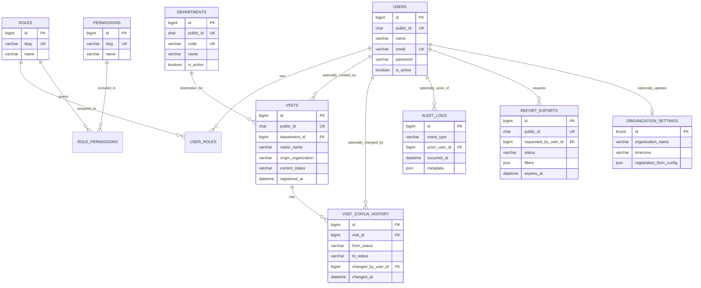
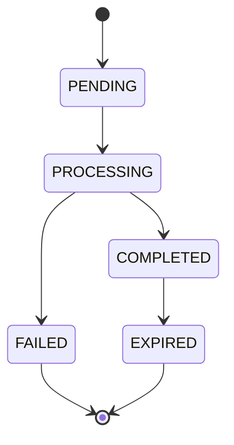

# Schema.md — SI-TAMU

> **Database Schema Specification**  
> **Produk:** SI-TAMU — Sistem Informasi Buku Tamu Digital Berbasis Web  
> **Versi dokumen:** 0.1 (Draft untuk review)  
> **Status:** Draft — mengikuti `PRD.md`, `Architecture.md`, dan `Design.md` yang telah disetujui untuk dilanjutkan  
> **RDBMS baseline:** MySQL 8.x-compatible; MySQL 8.4 LTS preferred  
> **Storage engine:** InnoDB  
> **Charset:** `utf8mb4`  
> **Persisted timezone:** UTC  
> **Dokumen berikutnya setelah Schema disetujui:** `Rules.md`

---

## 1. Tujuan Dokumen

Dokumen ini mendefinisikan **struktur basis data awal SI-TAMU** secara implementable. Fokusnya bukan hanya daftar tabel, tetapi juga alasan normalisasi, relasi, tipe data, constraint, indexing, foreign key, aturan historis, strategi audit, lifecycle export, data sensitif, serta urutan migration.

Schema ini harus memenuhi kebutuhan MVP berikut:

1. registrasi tamu publik tanpa akun;
2. penyimpanan identitas tamu sebagai snapshot pada setiap kunjungan;
3. ID kunjungan publik yang tidak mengekspos auto-increment database;
4. pengelolaan unit/bidang;
5. status kunjungan beserta histori perubahan;
6. login admin/staff;
7. role-based access control yang dapat tumbuh menjadi permission granular;
8. pencarian dan pelaporan berdasarkan waktu, nama, instansi asal, unit tujuan, status, dan nomor kunjungan;
9. koreksi data yang tetap dapat diaudit;
10. audit log append-oriented;
11. pencatatan lifecycle export laporan;
12. konfigurasi identitas organisasi dan formulir registrasi;
13. database-backed session, cache, dan queue sesuai baseline arsitektur;
14. jalur evolusi untuk QR/barcode, WhatsApp, survey kepuasan, offline mode, dan multi-location tanpa memaksa fitur tersebut ke MVP.

Schema ini **tidak** membuat master akun tamu pada MVP. Tamu adalah pengunjung publik dan data identitas yang relevan disimpan sebagai snapshot pada record `visits`.

---

## 2. Prinsip Desain Database

### 2.1 Relational Source of Truth

MySQL menjadi source of truth untuk state operasional yang harus konsisten, khususnya:

- akun back-office;
- role dan permission;
- unit/bidang;
- kunjungan;
- status kunjungan;
- histori perubahan status;
- konfigurasi organisasi;
- audit event;
- export metadata.

Cache, file export, browser state, atau queue worker tidak boleh menjadi source of truth untuk data kunjungan.

### 2.2 Normalized by Default

Schema menggunakan normalisasi relasional untuk entity stabil seperti:

- user;
- role;
- permission;
- department.

Denormalisasi hanya dilakukan jika ada alasan historis atau read-performance yang jelas.

### 2.3 Intentional Denormalization

Terdapat beberapa denormalisasi yang **disengaja**:

1. `visits.current_status` menyimpan status terbaru walaupun histori lengkap juga ada di `visit_status_history`;
2. `visits.department_name_snapshot` menyimpan nama unit pada saat kunjungan supaya laporan historis tetap dapat dipahami bila nama unit berubah;
3. filter export disimpan sebagai JSON pada `report_exports` karena sifatnya merupakan snapshot parameter request, bukan entity bisnis yang perlu dinormalisasi;
4. before/after metadata audit dapat disimpan sebagai JSON terkontrol pada `audit_logs`.

Denormalisasi di atas harus dijaga konsistensinya melalui application transaction.

### 2.4 Historical Integrity over Hard Delete

Untuk entity yang sudah dipakai oleh histori kunjungan:

- department **dinonaktifkan**, bukan dihapus;
- user **dinonaktifkan**, bukan dihapus melalui UI normal;
- visit tidak memiliki tombol hard-delete normal;
- audit log tidak diedit atau dihapus oleh pengguna aplikasi biasa.

### 2.5 Minimal Personal Data

Kolom personal yang bukan mandatory baseline dibuat nullable. Aplikasi hanya boleh mengaktifkan field tersebut jika kebutuhan operasional dan kebijakan organisasi telah ditetapkan.

### 2.6 UTC Persistence

Semua timestamp bisnis dan audit disimpan dalam UTC. Timezone organisasi digunakan hanya untuk:

- input boundary laporan;
- rendering tanggal/waktu;
- interpretasi hari operasional.

### 2.7 Application Layer Owns Business Rules

Database menjaga integritas struktural melalui PK, FK, unique constraint, nullability, dan check constraint. Business rule yang lebih kontekstual tetap berada di domain/application layer, misalnya:

- urutan transisi status yang diperbolehkan;
- siapa yang boleh mengoreksi data;
- field registrasi mana yang required berdasarkan konfigurasi organisasi;
- minimal satu ADMIN aktif;
- masking field sensitif berdasarkan role.

---

## 3. Scope Schema MVP

### 3.1 Core Business Tables

| Table | Purpose |
|---|---|
| `users` | Akun admin/staff back-office |
| `roles` | Role sistem seperti ADMIN dan STAFF |
| `permissions` | Permission granular |
| `user_roles` | Relasi N:M user ↔ role |
| `role_permissions` | Relasi N:M role ↔ permission |
| `departments` | Master unit/bidang tujuan |
| `organization_settings` | Konfigurasi single organization MVP |
| `visits` | Record utama kunjungan dan snapshot identitas tamu |
| `visit_status_history` | Histori append-only perubahan status |
| `audit_logs` | Audit event untuk aktivitas sensitif |
| `report_exports` | Metadata lifecycle pembuatan file export |

### 3.2 Framework / Infrastructure Tables

Karena baseline arsitektur menggunakan session, cache, dan queue database-backed, production schema juga dapat memuat:

| Table | Purpose |
|---|---|
| `password_reset_tokens` | Token reset password Laravel |
| `sessions` | Session back-office bila database session driver aktif |
| `cache` | Cache database bila database cache driver aktif |
| `cache_locks` | Distributed lock untuk database cache driver |
| `jobs` | Pending Laravel queue jobs |
| `job_batches` | Metadata batch queue |
| `failed_jobs` | Failed queue jobs |
| `migrations` | Version history Laravel migrations |

Table framework tidak boleh dipakai untuk menyimpan domain data SI-TAMU.

---

## 4. Entity Relationship Overview



---

## 5. Naming Convention Database

### 5.1 Table

Gunakan plural `snake_case`:

- `users`;
- `visit_status_history`;
- `report_exports`.

### 5.2 Column

Gunakan `snake_case`:

- `public_id`;
- `registered_at`;
- `department_name_snapshot`.

### 5.3 Primary Key

Default:

```text
id BIGINT UNSIGNED AUTO_INCREMENT
```

Exception hanya untuk singleton/config atau framework table yang memiliki contract sendiri.

### 5.4 Foreign Key

Nama column:

```text
<entity_singular>_id
```

Contoh:

- `department_id`;
- `actor_user_id`;
- `requested_by_user_id`.

### 5.5 Index

Naming pattern:

```text
idx_<table>_<columns>
uk_<table>_<columns>
fk_<table>_<referenced_table>
```

DDL di bawah menggunakan nama yang cukup eksplisit agar mudah ditemukan saat membaca query plan atau migration.

---

# 6. Core Table Specification

## 6.1 `users`

### Purpose

Menyimpan akun internal untuk ADMIN dan STAFF. Tamu publik **tidak** disimpan di table ini.

### Columns

| Column | Type | Null | Default | Constraint / Notes |
|---|---|---:|---|---|
| `id` | `BIGINT UNSIGNED` | No | auto | PK internal |
| `public_id` | `CHAR(26)` ASCII | No | — | ULID; unique; digunakan pada URL/admin reference |
| `name` | `VARCHAR(120)` | No | — | Nama display user |
| `email` | `VARCHAR(190)` | No | — | Login identifier; unique |
| `password` | `VARCHAR(255)` | No | — | Hash adaptif; tidak pernah plaintext |
| `is_active` | `TINYINT(1)` | No | `1` | Deactivation control |
| `last_login_at` | `DATETIME(6)` | Yes | `NULL` | Waktu login sukses terakhir |
| `password_changed_at` | `DATETIME(6)` | Yes | `NULL` | Untuk security lifecycle |
| `remember_token` | `VARCHAR(100)` | Yes | `NULL` | Laravel remember-me bila feature aktif |
| `created_at` | `DATETIME(6)` | No | app/DB | UTC |
| `updated_at` | `DATETIME(6)` | No | app/DB | UTC |

### Constraints

- `public_id` unique;
- `email` unique;
- email dinormalisasi aplikasi sebelum insert/update;
- user yang tidak aktif tidak dapat membuat session baru;
- hard delete user tidak tersedia melalui UI normal.

### Indexes

- PK `id`;
- unique `public_id`;
- unique `email`;
- index `is_active` untuk administration filtering.

### Security Notes

- password hanya boleh berasal dari Laravel hashing service;
- password, reset token, dan remember token tidak boleh masuk audit JSON;
- `last_login_at` hanya di-update setelah login sukses.

---

## 6.2 `roles`

### Purpose

Menyimpan role yang dapat diberikan kepada user.

MVP seed:

- `ADMIN`;
- `STAFF`.

### Columns

| Column | Type | Null | Notes |
|---|---|---:|---|
| `id` | `BIGINT UNSIGNED` | No | PK |
| `slug` | `VARCHAR(64)` | No | Machine-readable; unique; contoh `ADMIN` |
| `name` | `VARCHAR(100)` | No | Human-readable |
| `description` | `VARCHAR(500)` | Yes | Penjelasan role |
| `is_system` | `TINYINT(1)` | No | Role bawaan tidak boleh dihapus melalui UI |
| `created_at` | `DATETIME(6)` | No | UTC |
| `updated_at` | `DATETIME(6)` | No | UTC |

### Constraints

- `slug` unique;
- uppercase slug direkomendasikan untuk role system;
- role yang sedang digunakan tidak boleh dihapus secara langsung.

---

## 6.3 `permissions`

### Purpose

Permission granular agar authorization tidak bergantung pada `if role == ADMIN` yang tersebar di codebase.

MVP permission baseline:

```text
visits.view
visits.update_status
visits.correct
reports.view
reports.export
departments.manage
users.manage
audit.view
settings.manage
```

### Columns

| Column | Type | Null | Notes |
|---|---|---:|---|
| `id` | `BIGINT UNSIGNED` | No | PK |
| `slug` | `VARCHAR(100)` | No | Unique machine key |
| `name` | `VARCHAR(120)` | No | Display name |
| `description` | `VARCHAR(500)` | Yes | Description |
| `created_at` | `DATETIME(6)` | No | UTC |
| `updated_at` | `DATETIME(6)` | No | UTC |

### Constraints

- `slug` unique;
- permission system dikelola melalui migration/seeder, bukan bebas dibuat oleh staff.

---

## 6.4 `user_roles`

### Purpose

Pivot N:M antara user dan role.

Walaupun MVP biasanya memberi satu role utama kepada user, pivot N:M dipilih agar schema tidak mengunci sistem pada model satu-role selamanya.

### Columns

| Column | Type | Null | Notes |
|---|---|---:|---|
| `user_id` | `BIGINT UNSIGNED` | No | FK -> `users.id` |
| `role_id` | `BIGINT UNSIGNED` | No | FK -> `roles.id` |
| `assigned_at` | `DATETIME(6)` | No | UTC |
| `assigned_by_user_id` | `BIGINT UNSIGNED` | Yes | Actor assignment; null untuk bootstrap seeder |

### Primary Key

Composite:

```text
(user_id, role_id)
```

### Foreign Keys

- `user_id` → `users.id`, `ON DELETE CASCADE`;
- `role_id` → `roles.id`, `ON DELETE RESTRICT`;
- `assigned_by_user_id` → `users.id`, `ON DELETE SET NULL`.

### Business Invariant

Minimal satu user ADMIN aktif harus tetap ada. Invariant ini diperiksa application service/transaction, bukan hanya DB.

---

## 6.5 `role_permissions`

### Purpose

Pivot N:M role ↔ permission.

### Columns

| Column | Type | Null | Notes |
|---|---|---:|---|
| `role_id` | `BIGINT UNSIGNED` | No | FK |
| `permission_id` | `BIGINT UNSIGNED` | No | FK |

### Primary Key

```text
(role_id, permission_id)
```

### Foreign Keys

- role delete: `RESTRICT`;
- permission delete: `RESTRICT`.

Perubahan mapping permission adalah security-sensitive operation dan wajib masuk audit log.

---

## 6.6 `departments`

### Purpose

Master unit/bidang yang dapat dipilih sebagai tujuan kunjungan.

### Columns

| Column | Type | Null | Default | Notes |
|---|---|---:|---|---|
| `id` | `BIGINT UNSIGNED` | No | auto | PK |
| `public_id` | `CHAR(26)` ASCII | No | — | ULID; unique |
| `code` | `VARCHAR(50)` | Yes | `NULL` | Kode internal bila organisasi memilikinya |
| `name` | `VARCHAR(150)` | No | — | Nama unit |
| `description` | `VARCHAR(500)` | Yes | `NULL` | Deskripsi pendek |
| `sort_order` | `INT UNSIGNED` | No | `0` | Urutan selector UI |
| `is_active` | `TINYINT(1)` | No | `1` | Visibility registrasi baru |
| `created_at` | `DATETIME(6)` | No | — | UTC |
| `updated_at` | `DATETIME(6)` | No | — | UTC |

### Constraints

- `public_id` unique;
- `code` unique bila diisi;
- nama tidak boleh empty setelah trim;
- department yang pernah dipakai visit tidak di-hard-delete melalui normal workflow.

### Indexes

```text
UNIQUE(public_id)
UNIQUE(code)
INDEX(is_active, sort_order, name)
```

### Historical Rule

Ketika department berganti nama:

- FK visit tetap mengarah ke department yang sama;
- `department_name_snapshot` pada visit lama tidak diubah otomatis.

Ini memungkinkan laporan historis menampilkan nama yang berlaku ketika kunjungan dicatat.

---

## 6.7 `organization_settings`

### Purpose

Menyimpan konfigurasi organisasi untuk single-organization MVP.

Schema menggunakan **singleton row** agar tidak memperkenalkan multi-tenancy sebelum diperlukan.

### Columns

| Column | Type | Null | Notes |
|---|---|---:|---|
| `id` | `TINYINT UNSIGNED` | No | PK; harus `1` |
| `organization_name` | `VARCHAR(200)` | No | Nama instansi |
| `logo_path` | `VARCHAR(500)` | Yes | Path logical storage; bukan public arbitrary URL |
| `address` | `TEXT` | Yes | Alamat instansi |
| `contact_phone` | `VARCHAR(40)` | Yes | Kontak layanan |
| `contact_email` | `VARCHAR(190)` | Yes | Kontak layanan |
| `registration_instruction` | `TEXT` | Yes | Instruksi setelah/selama registrasi |
| `privacy_notice` | `TEXT` | Yes | Notice singkat data kunjungan |
| `timezone` | `VARCHAR(64)` | No | IANA timezone, default seed `Asia/Jakarta` bila sesuai |
| `registration_form_config` | `JSON` | No | Allowlisted field configuration |
| `updated_by_user_id` | `BIGINT UNSIGNED` | Yes | User terakhir yang mengubah |
| `created_at` | `DATETIME(6)` | No | UTC |
| `updated_at` | `DATETIME(6)` | No | UTC |

### Singleton Constraint

```text
CHECK (id = 1)
```

### `registration_form_config`

Contoh struktur:

```json
{
  "contact_phone": {"enabled": true, "required": false},
  "visitor_email": {"enabled": false, "required": false},
  "visitor_address": {"enabled": false, "required": false},
  "visitor_occupation": {"enabled": false, "required": false},
  "visitor_gender": {"enabled": false, "required": false},
  "visitor_identity": {"enabled": false, "required": false},
  "party_size": {"enabled": false, "required": false}
}
```

Rules:

- hanya key allowlisted yang boleh diproses;
- arbitrary field injection dari JSON tidak diperbolehkan;
- perubahan field menjadi required harus memengaruhi server-side validation;
- mengaktifkan data sensitif harus melalui review kebijakan organisasi.

### Future Migration

Jika Phase 3 membutuhkan multi-location atau multi-organization, singleton ini dapat diubah menjadi:

```text
organizations
locations
organization_settings / location_settings
```

MVP tidak perlu menambahkan `organization_id` ke seluruh table sebelum requirement tersebut nyata.

---

## 6.8 `visits`

### Purpose

Table utama untuk setiap kunjungan.

Satu row = satu event kunjungan. Identitas tamu disimpan sebagai **snapshot kunjungan**, bukan foreign key ke master visitor.

### Columns

| Column | Type | Null | Default | Notes |
|---|---|---:|---|---|
| `id` | `BIGINT UNSIGNED` | No | auto | PK internal |
| `public_id` | `CHAR(26)` ASCII | No | — | ULID unique; public/internal reference |
| `submission_token_hash` | `CHAR(64)` ASCII | Yes | `NULL` | SHA-256 idempotency token hash; unique |
| `visitor_name` | `VARCHAR(150)` | No | — | Nama tamu snapshot |
| `origin_organization` | `VARCHAR(200)` | No | — | Asal instansi atau `Pribadi/Umum` |
| `contact_phone` | `VARCHAR(40)` | Yes | `NULL` | Optional; future notification use |
| `visitor_email` | `VARCHAR(190)` | Yes | `NULL` | Optional |
| `visitor_address` | `VARCHAR(500)` | Yes | `NULL` | Optional, default disabled |
| `visitor_occupation` | `VARCHAR(150)` | Yes | `NULL` | Optional, default disabled |
| `visitor_gender` | `VARCHAR(32)` | Yes | `NULL` | Optional; application allowlist |
| `visitor_identity_type` | `VARCHAR(50)` | Yes | `NULL` | Optional, policy-controlled |
| `visitor_identity_encrypted` | `TEXT` | Yes | `NULL` | Optional encrypted value; never plaintext if enabled |
| `party_size` | `SMALLINT UNSIGNED` | No | `1` | Jumlah orang dalam kunjungan |
| `department_id` | `BIGINT UNSIGNED` | No | — | FK tujuan |
| `department_name_snapshot` | `VARCHAR(150)` | No | — | Historical display snapshot |
| `purpose` | `TEXT` | No | — | Keperluan kunjungan |
| `notes` | `TEXT` | Yes | `NULL` | Catatan tambahan tamu/petugas sesuai policy |
| `current_status` | `VARCHAR(32)` | No | `REGISTERED` | Denormalized latest status |
| `registration_source` | `VARCHAR(20)` | No | `PUBLIC` | `PUBLIC`, `STAFF`, future `IMPORT` |
| `created_by_user_id` | `BIGINT UNSIGNED` | Yes | `NULL` | Jika staff mendaftarkan atas nama tamu |
| `registered_at` | `DATETIME(6)` | No | — | Waktu authoritative dari server |
| `status_updated_at` | `DATETIME(6)` | No | — | Waktu status terakhir berubah |
| `created_at` | `DATETIME(6)` | No | — | UTC |
| `updated_at` | `DATETIME(6)` | No | — | UTC; correction/status sync |

### Mandatory Business Data

Baseline wajib pada MVP:

- `visitor_name`;
- `origin_organization`;
- `department_id`;
- `department_name_snapshot`;
- `purpose`;
- `registered_at`;
- `current_status`.

Field personal lainnya nullable dan default UI harus mengikuti prinsip data minimization.

### Public ID

`public_id`:

- ULID 26 karakter;
- generated di application layer;
- tidak menggunakan auto-increment ID sebagai public identifier;
- unique constraint tetap wajib walaupun collision probability sangat kecil.

### Idempotency

`submission_token_hash` digunakan untuk menghindari duplicate registration akibat:

- double-click;
- browser retry;
- network timeout lalu resubmit.

Flow:

1. server menyediakan token random pada form;
2. client mengirim token bersama submit;
3. application hash token menggunakan SHA-256;
4. hash disimpan pada `visits.submission_token_hash`;
5. unique constraint menjadi final defense terhadap duplicate insert;
6. bila constraint collision terjadi untuk token yang sama, aplikasi mengambil hasil registrasi yang sudah sukses dan tidak membuat visit kedua.

Token asli tidak perlu disimpan.

### Department Snapshot

Saat visit dibuat:

```text
visits.department_id = departments.id
visits.department_name_snapshot = departments.name saat registrasi
```

Jika nama department berubah di masa depan, snapshot lama tidak ikut diperbarui.

### Current Status

Allowed values MVP:

```text
REGISTERED
ARRIVED
IN_SERVICE
COMPLETED
CANCELLED
```

`current_status` adalah cache state relasional yang authoritative bersama status history dan hanya boleh diubah melalui `ChangeVisitStatusAction` dalam transaction.

### Registration Source

Allowed baseline:

- `PUBLIC` — registrasi mandiri tanpa login;
- `STAFF` — staff memasukkan data atas nama tamu;
- `IMPORT` — reserved untuk future controlled migration/import.

MVP UI tidak perlu mengekspos `IMPORT`.

### Foreign Keys

- `department_id` → `departments.id`, `ON DELETE RESTRICT`;
- `created_by_user_id` → `users.id`, `ON DELETE SET NULL`.

### Check Constraints

- `current_status` dalam allowed list;
- `registration_source` dalam allowed list;
- `party_size >= 1`.

### Indexes

Minimum:

```text
UNIQUE(public_id)
UNIQUE(submission_token_hash)
INDEX(registered_at)
INDEX(current_status, registered_at)
INDEX(department_id, registered_at)
INDEX(visitor_name, registered_at)
INDEX(origin_organization, registered_at)
```

Additional index hanya ditambahkan berdasarkan `EXPLAIN ANALYZE` dan pola query production.

### Search Behavior and Index Reality

B-tree index efektif untuk:

- exact match;
- prefix search seperti `visitor_name LIKE 'andi%'`;
- sort/filter tanggal;
- filter status dan department.

B-tree **tidak efektif** untuk arbitrary contains search seperti:

```sql
WHERE visitor_name LIKE '%andi%'
```

Jika requirement production mewajibkan contains search dengan dataset besar, opsi evaluasi:

1. MySQL `FULLTEXT` index;
2. normalized/search projection;
3. dedicated search engine hanya jika benar-benar dibutuhkan.

MVP tidak menambahkan search engine eksternal.

### Sensitive Identity Field

`visitor_identity_encrypted` hanya diaktifkan apabila organisasi benar-benar membutuhkan nomor identitas.

Rules:

- encrypt di application layer menggunakan encryption key yang tidak disimpan di database;
- jangan index ciphertext;
- jangan tampilkan pada list page;
- jangan tulis plaintext ke log/audit metadata;
- jangan menjadikan nomor identitas mandatory tanpa kebijakan yang jelas.

---

## 6.9 `visit_status_history`

### Purpose

Append-only history setiap perubahan status visit.

### Columns

| Column | Type | Null | Notes |
|---|---|---:|---|
| `id` | `BIGINT UNSIGNED` | No | PK |
| `visit_id` | `BIGINT UNSIGNED` | No | FK -> visits |
| `from_status` | `VARCHAR(32)` | Yes | Null hanya untuk initial transition |
| `to_status` | `VARCHAR(32)` | No | Status hasil |
| `changed_by_user_id` | `BIGINT UNSIGNED` | Yes | Null untuk public/system event |
| `source` | `VARCHAR(20)` | No | `PUBLIC`, `STAFF`, `SYSTEM` |
| `reason` | `VARCHAR(500)` | Yes | Alasan cancel/correction bila diperlukan |
| `request_id` | `VARCHAR(64)` | Yes | Correlation ID request |
| `changed_at` | `DATETIME(6)` | No | UTC authoritative event time |

### Initial Entry

Setiap visit baru harus langsung memiliki history:

```text
from_status = NULL
to_status   = REGISTERED
source      = PUBLIC atau STAFF
changed_at  = registered_at
```

Insert visit dan initial history harus berada dalam **transaction yang sama**.

### Status Transition Matrix

Baseline MVP:

| Current | Allowed Next |
|---|---|
| `REGISTERED` | `ARRIVED`, `CANCELLED` |
| `ARRIVED` | `IN_SERVICE`, `CANCELLED` |
| `IN_SERVICE` | `COMPLETED`, `CANCELLED` |
| `COMPLETED` | terminal |
| `CANCELLED` | terminal |

Reopen status tidak termasuk MVP. Jika organisasi membutuhkan reopen, rule harus ditambahkan secara eksplisit dan diaudit.

### Transaction Rule

Perubahan status harus melakukan:

```text
BEGIN
  SELECT visit FOR UPDATE
  validate allowed transition
  UPDATE visits.current_status
  UPDATE visits.status_updated_at
  INSERT visit_status_history
  INSERT audit_logs
COMMIT
```

Jika salah satu langkah gagal, seluruh perubahan rollback.

### Foreign Keys

- `visit_id` → `visits.id`, `ON DELETE RESTRICT`;
- `changed_by_user_id` → `users.id`, `ON DELETE SET NULL`.

### Indexes

```text
INDEX(visit_id, changed_at, id)
INDEX(to_status, changed_at)
INDEX(changed_by_user_id, changed_at)
```

Index kedua/ketiga dapat dikurangi bila query production tidak membutuhkannya.

---

## 6.10 `audit_logs`

### Purpose

Mencatat aktivitas sensitif yang harus dapat ditelusuri tanpa menjadikan application log sebagai audit source.

### Event Baseline

Contoh `event_type`:

```text
auth.login_succeeded
auth.login_failed
auth.logout
visit.registered
visit.status_changed
visit.corrected
report.export_requested
report.export_completed
report.export_downloaded
department.created
department.updated
department.deactivated
user.created
user.updated
user.deactivated
user.role_changed
settings.updated
```

### Columns

| Column | Type | Null | Notes |
|---|---|---:|---|
| `id` | `BIGINT UNSIGNED` | No | PK |
| `event_type` | `VARCHAR(100)` | No | Machine event key |
| `actor_type` | `VARCHAR(20)` | No | `USER`, `SYSTEM`, `PUBLIC` |
| `actor_user_id` | `BIGINT UNSIGNED` | Yes | FK apabila actor authenticated |
| `target_type` | `VARCHAR(64)` | Yes | Contoh `visit`, `department`, `user` |
| `target_id` | `BIGINT UNSIGNED` | Yes | Internal target ID bila applicable |
| `target_public_id` | `VARCHAR(64)` | Yes | Safe external reference bila useful |
| `request_id` | `VARCHAR(64)` | Yes | Correlation ID |
| `ip_hash` | `CHAR(64)` ASCII | Yes | Optional privacy-reduced client fingerprint |
| `metadata` | `JSON` | Yes | Safe context |
| `before_state` | `JSON` | Yes | Sanitized state/diff sebelum perubahan |
| `after_state` | `JSON` | Yes | Sanitized state/diff setelah perubahan |
| `occurred_at` | `DATETIME(6)` | No | UTC event time |

### Actor Rules

- `USER` → `actor_user_id` seharusnya terisi;
- `SYSTEM` → `actor_user_id` null;
- `PUBLIC` → `actor_user_id` null.

Constraint lintas kolom semacam ini dapat dijaga dengan application validation agar migration tetap portable.

### Audit Safety

**Dilarang** memasukkan:

- password;
- password hash;
- reset token;
- remember token;
- session ID;
- API key;
- raw authorization header;
- plaintext identity number;
- full queue payload yang dapat memuat secret.

### `before_state` / `after_state`

Untuk koreksi visit, simpan diff minimal, contoh:

```json
{
  "origin_organization": "Instansi Lama",
  "purpose": "Konsultasi awal"
}
```

bukan seluruh model beserta hidden field.

### Append-Oriented Rule

Application code normal:

- boleh `INSERT`;
- boleh `SELECT` untuk role berizin;
- **tidak** menyediakan update/delete audit row.

Database administrator tetap secara teknis dapat mengelola storage sesuai SOP, tetapi bukan melalui aplikasi.

### Indexes

```text
INDEX(event_type, occurred_at)
INDEX(actor_user_id, occurred_at)
INDEX(target_type, target_id, occurred_at)
INDEX(request_id)
INDEX(occurred_at)
```

Jangan membuat index pada JSON metadata sebelum query use-case terbukti.

---

## 6.11 `report_exports`

### Purpose

Mencatat lifecycle export CSV/XLSX, baik synchronous maupun queued.

Table ini bukan pengganti audit log. `report_exports` menyimpan operational state; audit log menyimpan security/business event.

### Columns

| Column | Type | Null | Default | Notes |
|---|---|---:|---|---|
| `id` | `BIGINT UNSIGNED` | No | auto | PK |
| `public_id` | `CHAR(26)` ASCII | No | — | ULID unique |
| `requested_by_user_id` | `BIGINT UNSIGNED` | Yes | — | Actor request |
| `format` | `VARCHAR(10)` | No | — | `CSV` atau `XLSX` |
| `status` | `VARCHAR(20)` | No | `PENDING` | Lifecycle state |
| `filters` | `JSON` | No | — | Snapshot validated filters |
| `row_count` | `BIGINT UNSIGNED` | Yes | `NULL` | Jumlah row final |
| `storage_disk` | `VARCHAR(50)` | Yes | `NULL` | Laravel private disk name |
| `storage_path` | `VARCHAR(1000)` | Yes | `NULL` | Private logical path |
| `file_name` | `VARCHAR(255)` | Yes | `NULL` | Safe download filename |
| `expires_at` | `DATETIME(6)` | Yes | `NULL` | File expiry |
| `completed_at` | `DATETIME(6)` | Yes | `NULL` | Success time |
| `failed_at` | `DATETIME(6)` | Yes | `NULL` | Failure time |
| `failure_code` | `VARCHAR(100)` | Yes | `NULL` | Safe non-secret error classification |
| `download_count` | `INT UNSIGNED` | No | `0` | Download counter |
| `last_downloaded_at` | `DATETIME(6)` | Yes | `NULL` | Last authenticated download |
| `created_at` | `DATETIME(6)` | No | — | UTC |
| `updated_at` | `DATETIME(6)` | No | — | UTC |

### Allowed Status

```text
PENDING
PROCESSING
COMPLETED
FAILED
EXPIRED
```

### Filter JSON Example

```json
{
  "date_from": "2026-09-01",
  "date_to": "2026-09-30",
  "department_public_id": "01J...",
  "status": "COMPLETED",
  "origin_organization": null,
  "timezone": "Asia/Jakarta"
}
```

Only validated filter keys are stored.

### Lifecycle



### Storage Rules

- file export disimpan private;
- download harus melewati authentication + authorization;
- `storage_path` bukan public URL;
- scheduler menghapus expired file;
- setelah file dihapus, metadata row dapat tetap disimpan sesuai retention policy;
- raw file tidak boleh dianggap audit record permanen.

### Foreign Key

`requested_by_user_id` → `users.id`, `ON DELETE SET NULL`.

### Indexes

```text
UNIQUE(public_id)
INDEX(requested_by_user_id, created_at)
INDEX(status, created_at)
INDEX(status, expires_at)
```

---

# 7. Framework and Infrastructure Tables

## 7.1 `password_reset_tokens`

Laravel-compatible baseline:

| Column | Type | Notes |
|---|---|---|
| `email` | `VARCHAR(190)` | PK or unique key |
| `token` | `VARCHAR(255)` | Hashed reset token |
| `created_at` | `DATETIME` | Expiration calculated by auth config |

Reset token tidak boleh dicopy ke audit log.

---

## 7.2 `sessions`

Digunakan bila `SESSION_DRIVER=database`.

Typical Laravel columns:

- `id VARCHAR(255)` PK;
- `user_id BIGINT UNSIGNED NULL` index;
- `ip_address VARCHAR(45) NULL`;
- `user_agent TEXT NULL`;
- `payload LONGTEXT NOT NULL`;
- `last_activity INT NOT NULL` index.

Session records adalah security-sensitive operational data dan harus mengikuti session lifetime, bukan retention kunjungan.

---

## 7.3 `cache` dan `cache_locks`

Digunakan bila cache driver database aktif.

Domain code tidak boleh bergantung pada struktur row cache.

Cache candidate:

- active departments;
- organization settings;
- permission map;
- short-lived dashboard aggregates.

Cache invalidation tetap dilakukan oleh application service setelah update domain terkait.

---

## 7.4 `jobs`

Database queue untuk:

- large export;
- cleanup;
- notification future phase;
- non-critical integration.

Payload queue dapat mengandung serialized job data sehingga akses DB ke table ini harus dibatasi.

---

## 7.5 `job_batches`

Dipakai Laravel bila batch processing aktif. Tidak ada business query langsung terhadap table ini.

---

## 7.6 `failed_jobs`

Menyimpan queue job yang gagal.

Rules:

- jangan mengirim secret di job payload;
- failure output tidak boleh memuat credential;
- operator dapat retry setelah root cause diperbaiki.

---

## 7.7 `migrations`

Dikelola Laravel. Digunakan untuk mencatat migration yang sudah diterapkan. Tidak boleh diedit manual sebagai cara “memaksa” migration dianggap sukses.

---

# 8. Relationship Details

## 8.1 User ↔ Role

**Cardinality:** N:M

```text
users
  1 ---- N user_roles N ---- 1 roles
```

MVP UI biasanya memilih satu role utama, tetapi schema mendukung lebih dari satu assignment.

## 8.2 Role ↔ Permission

**Cardinality:** N:M

```text
roles
  1 ---- N role_permissions N ---- 1 permissions
```

Permission efektif user adalah union permission dari role aktif yang dimilikinya.

## 8.3 Department → Visit

**Cardinality:** 1:N

```text
departments.id
    1
    |
    N
visits.department_id
```

Visit wajib memiliki department pada baseline MVP.

## 8.4 Visit → Visit Status History

**Cardinality:** 1:N

Setiap visit minimal memiliki satu history row initial `REGISTERED`.

## 8.5 User → Status History

**Cardinality:** 1:N optional

`changed_by_user_id` nullable karena registrasi publik/system event tidak memiliki user account.

## 8.6 User → Audit Log

**Cardinality:** 1:N optional

Login gagal, public registration, atau system task dapat menghasilkan audit event tanpa actor user.

## 8.7 User → Report Export

**Cardinality:** 1:N

Normal export membutuhkan authenticated user. FK nullable hanya untuk menjaga histori jika akun someday dihapus oleh DBA/migration khusus.

---

# 9. Referential Action Policy

## 9.1 `RESTRICT`

Gunakan `RESTRICT` ketika child adalah histori bisnis yang tidak boleh kehilangan parent secara diam-diam.

Contoh:

```text
departments -> visits
visits -> visit_status_history
roles -> role_permissions
permissions -> role_permissions
```

## 9.2 `SET NULL`

Gunakan `SET NULL` pada actor reference yang boleh hilang tetapi event/histori harus tetap ada.

Contoh:

```text
visit_status_history.changed_by_user_id
visits.created_by_user_id
audit_logs.actor_user_id
report_exports.requested_by_user_id
organization_settings.updated_by_user_id
```

## 9.3 `CASCADE`

Dipakai hanya pada pure pivot lifecycle:

```text
users -> user_roles
```

Walaupun cascade ada, normal application flow tetap melakukan user deactivation, bukan delete.

---

# 10. Indexing Strategy

## 10.1 Principles

Index dibuat berdasarkan:

1. unique lookup;
2. foreign key lookup;
3. filter dominan;
4. sort dominan;
5. dashboard aggregate;
6. report query.

Tidak semua column harus di-index.

Setiap index:

- menambah storage;
- menambah write cost;
- dapat menghambat insert bila berlebihan.

## 10.2 Visits Query Patterns

### Latest Visits

```sql
SELECT ...
FROM visits
ORDER BY registered_at DESC
LIMIT 20;
```

Index:

```text
registered_at
```

### Filter by Status + Date

```sql
WHERE current_status = ?
  AND registered_at >= ?
  AND registered_at < ?
ORDER BY registered_at DESC
```

Index:

```text
(current_status, registered_at)
```

### Filter by Department + Date

Index:

```text
(department_id, registered_at)
```

### Search Public ID

Unique index `public_id`.

### Search Visitor Name

Initial index:

```text
(visitor_name, registered_at)
```

UI/API sebaiknya prefer exact atau prefix search untuk dataset besar.

### Search Origin Organization

Initial index:

```text
(origin_organization, registered_at)
```

## 10.3 Audit Indexes

Audit list biasanya difilter berdasarkan:

- waktu;
- actor;
- event;
- target.

Karena itu index utama mengikuti pola tersebut dan bukan arbitrary JSON.

## 10.4 Composite Index Order

Rule umum:

- equality/filter column lebih dulu;
- range/sort time column setelahnya.

Contoh:

```text
(current_status, registered_at)
```

lebih berguna untuk `status = X AND date BETWEEN ...` dibanding urutan terbalik pada pola query itu.

## 10.5 Index Review

Sebelum production:

- seed dataset realistis;
- jalankan representative queries;
- gunakan `EXPLAIN ANALYZE`;
- hapus redundant index;
- tambahkan composite index hanya bila query plan menunjukkan manfaat.

---

# 11. Data Type Decisions

## 11.1 Internal IDs — `BIGINT UNSIGNED`

Alasan:

- kompatibel dengan Laravel default;
- efisien untuk FK/join;
- headroom besar;
- sederhana untuk database tooling.

## 11.2 Public IDs — ULID `CHAR(26)` ASCII

Alasan:

- non-sequential external identifier;
- sortable secara temporal;
- tidak mengekspos record count;
- fixed length;
- dapat dibuat aplikasi sebelum insert.

## 11.3 Text

Use-case:

- `VARCHAR` untuk field dengan bound jelas;
- `TEXT` untuk purpose, note, address setting;
- `LONGTEXT` hanya pada framework payload yang membutuhkannya.

## 11.4 Boolean

MySQL `BOOLEAN` adalah alias `TINYINT(1)`. DDL menggunakan `TINYINT(1)` secara eksplisit.

## 11.5 Timestamp

Gunakan `DATETIME(6)` untuk domain timestamps karena:

- tidak bergantung range/conversion semantics `TIMESTAMP`;
- microsecond precision tersedia;
- app secara eksplisit menyimpan UTC.

## 11.6 JSON

JSON hanya untuk data yang memang berbentuk document snapshot/configuration:

- `registration_form_config`;
- report filters;
- audit diff/metadata.

JSON **tidak** digunakan sebagai pengganti relation utama.

---

# 12. Data Validation Boundaries

## 12.1 Database-Enforced

DB wajib menjaga:

- PK uniqueness;
- FK integrity;
- public ID uniqueness;
- email uniqueness untuk user;
- allowed status basic check;
- idempotency token uniqueness;
- required/null constraints;
- party size >= 1.

## 12.2 Application-Enforced

Laravel Form Request/domain rule menjaga:

- trim/normalization nama;
- email format;
- phone format/length;
- max input length sebelum DB;
- department aktif saat registrasi baru;
- allowed status transition;
- authorization;
- field required sesuai `registration_form_config`;
- user role invariant;
- encrypted visitor identity handling;
- privacy-aware audit diff.

## 12.3 Why Not Put Everything in DB Checks

Business rules berubah lebih sering dan beberapa bergantung actor/context. Memaksa semua rule ke check constraint/triggers akan:

- menyulitkan testing;
- menggandakan logic application;
- membuat migration lebih kompleks;
- menurunkan portability.

Database tetap menjadi last line of defense untuk integritas struktural.

---

# 13. Status Consistency Invariant

Dua representasi status harus konsisten:

```text
visits.current_status
visit_status_history latest.to_status
```

Invariant:

```text
visits.current_status == latest visit_status_history.to_status
```

### Correct Write Pattern

```sql
BEGIN;

SELECT id, current_status
FROM visits
WHERE id = ?
FOR UPDATE;

-- application validates transition

UPDATE visits
SET current_status = ?,
    status_updated_at = ?,
    updated_at = ?
WHERE id = ?;

INSERT INTO visit_status_history (...)
VALUES (...);

INSERT INTO audit_logs (...)
VALUES (...);

COMMIT;
```

### Forbidden Pattern

Jangan:

1. update `visits.current_status` di controller;
2. commit;
3. baru insert history di request terpisah.

Failure di tengah akan membuat data tidak konsisten.

---

# 14. Visit Correction Strategy

Koreksi data kunjungan adalah P1 tetapi schema telah mendukungnya.

### Flow

1. user harus memiliki `visits.correct`;
2. UI meminta alasan koreksi;
3. service memuat original data;
4. hanya field allowlisted yang dapat diubah;
5. update visit dalam transaction;
6. audit event `visit.corrected` menyimpan sanitized before/after diff;
7. `registered_at` tidak boleh diubah oleh normal correction flow;
8. `public_id` tidak boleh diubah;
9. `submission_token_hash` tidak boleh diubah;
10. perubahan department memperbarui `department_id` dan snapshot sesuai unit yang dipilih saat koreksi, tetapi audit menyimpan nilai sebelumnya.

Jika kebijakan organisasi menuntut immutable original department label bahkan setelah correction, gunakan correction note dan approval process; requirement ini belum ditetapkan pada MVP.

---

# 15. Reporting Date Boundary

Database menyimpan UTC, sementara filter laporan di UI menggunakan timezone organisasi.

Contoh pengguna memilih:

```text
Tanggal: 2026-09-09
Timezone: Asia/Jakarta
```

Application harus mengubah boundary lokal menjadi UTC:

```text
2026-09-09 00:00:00 Asia/Jakarta
        -> UTC start

2026-09-10 00:00:00 Asia/Jakarta
        -> UTC exclusive end
```

Query menggunakan half-open range:

```sql
WHERE registered_at >= :utc_start
  AND registered_at <  :utc_end
```

Jangan menggunakan:

```sql
DATE(registered_at) = '2026-09-09'
```

pada query besar karena:

- dapat salah secara timezone;
- function pada indexed column dapat mengurangi pemanfaatan index.

---

# 16. Pagination and Query Constraints

### Visits List

Initial pagination:

- server-side;
- default 20–50 row;
- maximum page size dibatasi.

### Deep Pagination

Untuk puluhan/ratusan ribu row, offset pagination masih dapat dipakai untuk admin UI awal. Jika deep page menjadi masalah, future migration dapat menggunakan cursor/keyset:

```text
(registered_at, id)
```

### Export

Export tidak boleh:

```php
Visit::all()
```

untuk dataset besar.

Gunakan:

- chunking;
- cursor;
- stream;
- queue untuk file besar.

---

# 17. Privacy and Data Classification

## 17.1 Classification

### Public / Low Sensitivity

- department name;
- organization public identity;
- application display settings.

### Internal

- user display name;
- role/permission mapping;
- operational dashboard counts.

### Personal Data

- visitor name;
- contact phone;
- visitor email;
- address;
- occupation;
- visit purpose jika dapat mengungkap informasi personal;
- origin organization.

### Higher Sensitivity if Enabled

- identity number;
- detailed free-text notes.

## 17.2 Free-Text Risk

`purpose` dan `notes` dapat berisi data yang tidak diantisipasi. Karena itu:

- UI meminta pengguna menghindari informasi sensitif yang tidak diperlukan;
- max length diterapkan;
- tidak memasukkan free text ke application log;
- report menampilkan sesuai authorization.

## 17.3 Export Risk

File export dapat mengumpulkan banyak PII sekaligus. Karena itu:

- export hanya role berizin;
- private storage;
- expiration;
- authenticated download;
- audit event;
- jangan kirim file export melalui link public permanen.

---

# 18. Retention and Deletion

Retention period belum ditentukan oleh kebijakan instansi. Schema tidak melakukan automatic deletion tanpa keputusan eksplisit.

### MVP Rule

- `visits`: retained sampai policy ditetapkan;
- `visit_status_history`: mengikuti visit;
- `audit_logs`: retention terpisah dapat ditetapkan oleh security policy;
- `report_exports` file: short-lived/ephemeral;
- metadata `report_exports`: dapat bertahan lebih lama daripada file;
- sessions/cache/jobs: mengikuti operational lifecycle, bukan retention bisnis.

### Future Retention Job

Jika policy sudah ada, scheduler dapat melakukan:

1. select record eligible;
2. preview/count;
3. log retention operation;
4. delete/anonymize sesuai policy;
5. verify result.

Implementasi retention tidak boleh dibuat diam-diam hanya karena column `created_at` tersedia.

---

# 19. Backup Implications

Database backup mengandung PII, sehingga backup harus diperlakukan setara atau lebih sensitif daripada production DB.

Minimum:

- destination terpisah dari primary DB host;
- encrypted transport;
- access restricted;
- retention ditetapkan;
- restore test;
- backup tidak di-copy ke repository atau developer laptop sembarangan.

Schema migration harus diuji restore + migrate pada staging sebelum production rollout besar.

---

# 20. Initial DDL — MySQL 8.x

> DDL berikut adalah **reference schema**. Implementasi Laravel tetap dibuat melalui migration files agar versioning dan rollback terkontrol.  
> Production migration harus diuji pada exact MySQL/MariaDB target. MariaDB tidak dianggap identik dengan MySQL untuk JSON/check/index behavior.

```sql
SET NAMES utf8mb4;
SET time_zone = '+00:00';

-- ============================================================
-- 1. USERS
-- ============================================================
CREATE TABLE users (
    id BIGINT UNSIGNED NOT NULL AUTO_INCREMENT,
    public_id CHAR(26) CHARACTER SET ascii COLLATE ascii_bin NOT NULL,
    name VARCHAR(120) NOT NULL,
    email VARCHAR(190) NOT NULL,
    password VARCHAR(255) NOT NULL,
    is_active TINYINT(1) NOT NULL DEFAULT 1,
    last_login_at DATETIME(6) NULL,
    password_changed_at DATETIME(6) NULL,
    remember_token VARCHAR(100) NULL,
    created_at DATETIME(6) NOT NULL,
    updated_at DATETIME(6) NOT NULL,

    PRIMARY KEY (id),
    CONSTRAINT uk_users_public_id UNIQUE (public_id),
    CONSTRAINT uk_users_email UNIQUE (email),
    CONSTRAINT chk_users_is_active CHECK (is_active IN (0, 1)),
    INDEX idx_users_is_active (is_active)
) ENGINE=InnoDB
  DEFAULT CHARSET=utf8mb4
  COLLATE=utf8mb4_0900_ai_ci;

-- ============================================================
-- 2. ROLES
-- ============================================================
CREATE TABLE roles (
    id BIGINT UNSIGNED NOT NULL AUTO_INCREMENT,
    slug VARCHAR(64) NOT NULL,
    name VARCHAR(100) NOT NULL,
    description VARCHAR(500) NULL,
    is_system TINYINT(1) NOT NULL DEFAULT 0,
    created_at DATETIME(6) NOT NULL,
    updated_at DATETIME(6) NOT NULL,

    PRIMARY KEY (id),
    CONSTRAINT uk_roles_slug UNIQUE (slug),
    CONSTRAINT chk_roles_is_system CHECK (is_system IN (0, 1))
) ENGINE=InnoDB
  DEFAULT CHARSET=utf8mb4
  COLLATE=utf8mb4_0900_ai_ci;

-- ============================================================
-- 3. PERMISSIONS
-- ============================================================
CREATE TABLE permissions (
    id BIGINT UNSIGNED NOT NULL AUTO_INCREMENT,
    slug VARCHAR(100) NOT NULL,
    name VARCHAR(120) NOT NULL,
    description VARCHAR(500) NULL,
    created_at DATETIME(6) NOT NULL,
    updated_at DATETIME(6) NOT NULL,

    PRIMARY KEY (id),
    CONSTRAINT uk_permissions_slug UNIQUE (slug)
) ENGINE=InnoDB
  DEFAULT CHARSET=utf8mb4
  COLLATE=utf8mb4_0900_ai_ci;

-- ============================================================
-- 4. USER_ROLES
-- ============================================================
CREATE TABLE user_roles (
    user_id BIGINT UNSIGNED NOT NULL,
    role_id BIGINT UNSIGNED NOT NULL,
    assigned_at DATETIME(6) NOT NULL,
    assigned_by_user_id BIGINT UNSIGNED NULL,

    PRIMARY KEY (user_id, role_id),
    INDEX idx_user_roles_role_id (role_id),
    INDEX idx_user_roles_assigned_by (assigned_by_user_id),

    CONSTRAINT fk_user_roles_user
        FOREIGN KEY (user_id) REFERENCES users(id)
        ON UPDATE RESTRICT ON DELETE CASCADE,
    CONSTRAINT fk_user_roles_role
        FOREIGN KEY (role_id) REFERENCES roles(id)
        ON UPDATE RESTRICT ON DELETE RESTRICT,
    CONSTRAINT fk_user_roles_assigned_by
        FOREIGN KEY (assigned_by_user_id) REFERENCES users(id)
        ON UPDATE RESTRICT ON DELETE SET NULL
) ENGINE=InnoDB
  DEFAULT CHARSET=utf8mb4
  COLLATE=utf8mb4_0900_ai_ci;

-- ============================================================
-- 5. ROLE_PERMISSIONS
-- ============================================================
CREATE TABLE role_permissions (
    role_id BIGINT UNSIGNED NOT NULL,
    permission_id BIGINT UNSIGNED NOT NULL,

    PRIMARY KEY (role_id, permission_id),
    INDEX idx_role_permissions_permission_id (permission_id),

    CONSTRAINT fk_role_permissions_role
        FOREIGN KEY (role_id) REFERENCES roles(id)
        ON UPDATE RESTRICT ON DELETE RESTRICT,
    CONSTRAINT fk_role_permissions_permission
        FOREIGN KEY (permission_id) REFERENCES permissions(id)
        ON UPDATE RESTRICT ON DELETE RESTRICT
) ENGINE=InnoDB
  DEFAULT CHARSET=utf8mb4
  COLLATE=utf8mb4_0900_ai_ci;

-- ============================================================
-- 6. DEPARTMENTS
-- ============================================================
CREATE TABLE departments (
    id BIGINT UNSIGNED NOT NULL AUTO_INCREMENT,
    public_id CHAR(26) CHARACTER SET ascii COLLATE ascii_bin NOT NULL,
    code VARCHAR(50) NULL,
    name VARCHAR(150) NOT NULL,
    description VARCHAR(500) NULL,
    sort_order INT UNSIGNED NOT NULL DEFAULT 0,
    is_active TINYINT(1) NOT NULL DEFAULT 1,
    created_at DATETIME(6) NOT NULL,
    updated_at DATETIME(6) NOT NULL,

    PRIMARY KEY (id),
    CONSTRAINT uk_departments_public_id UNIQUE (public_id),
    CONSTRAINT uk_departments_code UNIQUE (code),
    CONSTRAINT chk_departments_is_active CHECK (is_active IN (0, 1)),
    INDEX idx_departments_active_sort_name (is_active, sort_order, name)
) ENGINE=InnoDB
  DEFAULT CHARSET=utf8mb4
  COLLATE=utf8mb4_0900_ai_ci;

-- ============================================================
-- 7. ORGANIZATION_SETTINGS
-- ============================================================
CREATE TABLE organization_settings (
    id TINYINT UNSIGNED NOT NULL,
    organization_name VARCHAR(200) NOT NULL,
    logo_path VARCHAR(500) NULL,
    address TEXT NULL,
    contact_phone VARCHAR(40) NULL,
    contact_email VARCHAR(190) NULL,
    registration_instruction TEXT NULL,
    privacy_notice TEXT NULL,
    timezone VARCHAR(64) NOT NULL,
    registration_form_config JSON NOT NULL,
    updated_by_user_id BIGINT UNSIGNED NULL,
    created_at DATETIME(6) NOT NULL,
    updated_at DATETIME(6) NOT NULL,

    PRIMARY KEY (id),
    CONSTRAINT chk_organization_settings_singleton CHECK (id = 1),
    CONSTRAINT chk_organization_form_config_object
        CHECK (JSON_TYPE(registration_form_config) = 'OBJECT'),
    CONSTRAINT fk_organization_settings_updated_by
        FOREIGN KEY (updated_by_user_id) REFERENCES users(id)
        ON UPDATE RESTRICT ON DELETE SET NULL
) ENGINE=InnoDB
  DEFAULT CHARSET=utf8mb4
  COLLATE=utf8mb4_0900_ai_ci;

-- ============================================================
-- 8. VISITS
-- ============================================================
CREATE TABLE visits (
    id BIGINT UNSIGNED NOT NULL AUTO_INCREMENT,
    public_id CHAR(26) CHARACTER SET ascii COLLATE ascii_bin NOT NULL,
    submission_token_hash CHAR(64) CHARACTER SET ascii COLLATE ascii_bin NULL,

    visitor_name VARCHAR(150) NOT NULL,
    origin_organization VARCHAR(200) NOT NULL,
    contact_phone VARCHAR(40) NULL,
    visitor_email VARCHAR(190) NULL,
    visitor_address VARCHAR(500) NULL,
    visitor_occupation VARCHAR(150) NULL,
    visitor_gender VARCHAR(32) NULL,
    visitor_identity_type VARCHAR(50) NULL,
    visitor_identity_encrypted TEXT NULL,
    party_size SMALLINT UNSIGNED NOT NULL DEFAULT 1,

    department_id BIGINT UNSIGNED NOT NULL,
    department_name_snapshot VARCHAR(150) NOT NULL,
    purpose TEXT NOT NULL,
    notes TEXT NULL,

    current_status VARCHAR(32) NOT NULL DEFAULT 'REGISTERED',
    registration_source VARCHAR(20) NOT NULL DEFAULT 'PUBLIC',
    created_by_user_id BIGINT UNSIGNED NULL,

    registered_at DATETIME(6) NOT NULL,
    status_updated_at DATETIME(6) NOT NULL,
    created_at DATETIME(6) NOT NULL,
    updated_at DATETIME(6) NOT NULL,

    PRIMARY KEY (id),
    CONSTRAINT uk_visits_public_id UNIQUE (public_id),
    CONSTRAINT uk_visits_submission_token_hash UNIQUE (submission_token_hash),

    CONSTRAINT chk_visits_status CHECK (
        current_status IN (
            'REGISTERED',
            'ARRIVED',
            'IN_SERVICE',
            'COMPLETED',
            'CANCELLED'
        )
    ),
    CONSTRAINT chk_visits_registration_source CHECK (
        registration_source IN ('PUBLIC', 'STAFF', 'IMPORT')
    ),
    CONSTRAINT chk_visits_party_size CHECK (party_size >= 1),

    CONSTRAINT fk_visits_department
        FOREIGN KEY (department_id) REFERENCES departments(id)
        ON UPDATE RESTRICT ON DELETE RESTRICT,
    CONSTRAINT fk_visits_created_by_user
        FOREIGN KEY (created_by_user_id) REFERENCES users(id)
        ON UPDATE RESTRICT ON DELETE SET NULL,

    INDEX idx_visits_registered_at (registered_at),
    INDEX idx_visits_status_registered (current_status, registered_at),
    INDEX idx_visits_department_registered (department_id, registered_at),
    INDEX idx_visits_name_registered (visitor_name, registered_at),
    INDEX idx_visits_origin_registered (origin_organization, registered_at),
    INDEX idx_visits_created_by (created_by_user_id, registered_at)
) ENGINE=InnoDB
  DEFAULT CHARSET=utf8mb4
  COLLATE=utf8mb4_0900_ai_ci;

-- ============================================================
-- 9. VISIT_STATUS_HISTORY
-- ============================================================
CREATE TABLE visit_status_history (
    id BIGINT UNSIGNED NOT NULL AUTO_INCREMENT,
    visit_id BIGINT UNSIGNED NOT NULL,
    from_status VARCHAR(32) NULL,
    to_status VARCHAR(32) NOT NULL,
    changed_by_user_id BIGINT UNSIGNED NULL,
    source VARCHAR(20) NOT NULL,
    reason VARCHAR(500) NULL,
    request_id VARCHAR(64) NULL,
    changed_at DATETIME(6) NOT NULL,

    PRIMARY KEY (id),

    CONSTRAINT chk_visit_history_from_status CHECK (
        from_status IS NULL OR from_status IN (
            'REGISTERED',
            'ARRIVED',
            'IN_SERVICE',
            'COMPLETED',
            'CANCELLED'
        )
    ),
    CONSTRAINT chk_visit_history_to_status CHECK (
        to_status IN (
            'REGISTERED',
            'ARRIVED',
            'IN_SERVICE',
            'COMPLETED',
            'CANCELLED'
        )
    ),
    CONSTRAINT chk_visit_history_source CHECK (
        source IN ('PUBLIC', 'STAFF', 'SYSTEM')
    ),

    CONSTRAINT fk_visit_history_visit
        FOREIGN KEY (visit_id) REFERENCES visits(id)
        ON UPDATE RESTRICT ON DELETE RESTRICT,
    CONSTRAINT fk_visit_history_user
        FOREIGN KEY (changed_by_user_id) REFERENCES users(id)
        ON UPDATE RESTRICT ON DELETE SET NULL,

    INDEX idx_visit_history_visit_changed (visit_id, changed_at, id),
    INDEX idx_visit_history_status_changed (to_status, changed_at),
    INDEX idx_visit_history_user_changed (changed_by_user_id, changed_at),
    INDEX idx_visit_history_request_id (request_id)
) ENGINE=InnoDB
  DEFAULT CHARSET=utf8mb4
  COLLATE=utf8mb4_0900_ai_ci;

-- ============================================================
-- 10. AUDIT_LOGS
-- ============================================================
CREATE TABLE audit_logs (
    id BIGINT UNSIGNED NOT NULL AUTO_INCREMENT,
    event_type VARCHAR(100) NOT NULL,
    actor_type VARCHAR(20) NOT NULL,
    actor_user_id BIGINT UNSIGNED NULL,
    target_type VARCHAR(64) NULL,
    target_id BIGINT UNSIGNED NULL,
    target_public_id VARCHAR(64) NULL,
    request_id VARCHAR(64) NULL,
    ip_hash CHAR(64) CHARACTER SET ascii COLLATE ascii_bin NULL,
    metadata JSON NULL,
    before_state JSON NULL,
    after_state JSON NULL,
    occurred_at DATETIME(6) NOT NULL,

    PRIMARY KEY (id),

    CONSTRAINT chk_audit_actor_type CHECK (
        actor_type IN ('USER', 'SYSTEM', 'PUBLIC')
    ),
    CONSTRAINT fk_audit_actor_user
        FOREIGN KEY (actor_user_id) REFERENCES users(id)
        ON UPDATE RESTRICT ON DELETE SET NULL,

    INDEX idx_audit_event_time (event_type, occurred_at),
    INDEX idx_audit_actor_time (actor_user_id, occurred_at),
    INDEX idx_audit_target_time (target_type, target_id, occurred_at),
    INDEX idx_audit_request_id (request_id),
    INDEX idx_audit_occurred_at (occurred_at)
) ENGINE=InnoDB
  DEFAULT CHARSET=utf8mb4
  COLLATE=utf8mb4_0900_ai_ci;

-- ============================================================
-- 11. REPORT_EXPORTS
-- ============================================================
CREATE TABLE report_exports (
    id BIGINT UNSIGNED NOT NULL AUTO_INCREMENT,
    public_id CHAR(26) CHARACTER SET ascii COLLATE ascii_bin NOT NULL,
    requested_by_user_id BIGINT UNSIGNED NULL,
    format VARCHAR(10) NOT NULL,
    status VARCHAR(20) NOT NULL DEFAULT 'PENDING',
    filters JSON NOT NULL,
    row_count BIGINT UNSIGNED NULL,
    storage_disk VARCHAR(50) NULL,
    storage_path VARCHAR(1000) NULL,
    file_name VARCHAR(255) NULL,
    expires_at DATETIME(6) NULL,
    completed_at DATETIME(6) NULL,
    failed_at DATETIME(6) NULL,
    failure_code VARCHAR(100) NULL,
    download_count INT UNSIGNED NOT NULL DEFAULT 0,
    last_downloaded_at DATETIME(6) NULL,
    created_at DATETIME(6) NOT NULL,
    updated_at DATETIME(6) NOT NULL,

    PRIMARY KEY (id),
    CONSTRAINT uk_report_exports_public_id UNIQUE (public_id),
    CONSTRAINT chk_report_exports_format CHECK (format IN ('CSV', 'XLSX')),
    CONSTRAINT chk_report_exports_status CHECK (
        status IN ('PENDING', 'PROCESSING', 'COMPLETED', 'FAILED', 'EXPIRED')
    ),
    CONSTRAINT chk_report_exports_filters_object
        CHECK (JSON_TYPE(filters) = 'OBJECT'),

    CONSTRAINT fk_report_exports_user
        FOREIGN KEY (requested_by_user_id) REFERENCES users(id)
        ON UPDATE RESTRICT ON DELETE SET NULL,

    INDEX idx_report_exports_user_created (requested_by_user_id, created_at),
    INDEX idx_report_exports_status_created (status, created_at),
    INDEX idx_report_exports_status_expiry (status, expires_at)
) ENGINE=InnoDB
  DEFAULT CHARSET=utf8mb4
  COLLATE=utf8mb4_0900_ai_ci;

-- ============================================================
-- 12. PASSWORD RESET TOKENS
-- ============================================================
CREATE TABLE password_reset_tokens (
    email VARCHAR(190) NOT NULL,
    token VARCHAR(255) NOT NULL,
    created_at DATETIME NULL,

    PRIMARY KEY (email)
) ENGINE=InnoDB
  DEFAULT CHARSET=utf8mb4
  COLLATE=utf8mb4_0900_ai_ci;

-- ============================================================
-- 13. SESSIONS
-- ============================================================
CREATE TABLE sessions (
    id VARCHAR(255) NOT NULL,
    user_id BIGINT UNSIGNED NULL,
    ip_address VARCHAR(45) NULL,
    user_agent TEXT NULL,
    payload LONGTEXT NOT NULL,
    last_activity INT NOT NULL,

    PRIMARY KEY (id),
    INDEX idx_sessions_user_id (user_id),
    INDEX idx_sessions_last_activity (last_activity),
    CONSTRAINT fk_sessions_user
        FOREIGN KEY (user_id) REFERENCES users(id)
        ON UPDATE RESTRICT ON DELETE SET NULL
) ENGINE=InnoDB
  DEFAULT CHARSET=utf8mb4
  COLLATE=utf8mb4_0900_ai_ci;

-- ============================================================
-- 14. CACHE
-- ============================================================
CREATE TABLE cache (
    `key` VARCHAR(255) NOT NULL,
    value MEDIUMTEXT NOT NULL,
    expiration INT NOT NULL,

    PRIMARY KEY (`key`)
) ENGINE=InnoDB
  DEFAULT CHARSET=utf8mb4
  COLLATE=utf8mb4_0900_ai_ci;

CREATE TABLE cache_locks (
    `key` VARCHAR(255) NOT NULL,
    owner VARCHAR(255) NOT NULL,
    expiration INT NOT NULL,

    PRIMARY KEY (`key`)
) ENGINE=InnoDB
  DEFAULT CHARSET=utf8mb4
  COLLATE=utf8mb4_0900_ai_ci;

-- ============================================================
-- 15. JOBS
-- ============================================================
CREATE TABLE jobs (
    id BIGINT UNSIGNED NOT NULL AUTO_INCREMENT,
    queue VARCHAR(255) NOT NULL,
    payload LONGTEXT NOT NULL,
    attempts TINYINT UNSIGNED NOT NULL,
    reserved_at INT UNSIGNED NULL,
    available_at INT UNSIGNED NOT NULL,
    created_at INT UNSIGNED NOT NULL,

    PRIMARY KEY (id),
    INDEX idx_jobs_queue (queue)
) ENGINE=InnoDB
  DEFAULT CHARSET=utf8mb4
  COLLATE=utf8mb4_0900_ai_ci;

CREATE TABLE job_batches (
    id VARCHAR(255) NOT NULL,
    name VARCHAR(255) NOT NULL,
    total_jobs INT NOT NULL,
    pending_jobs INT NOT NULL,
    failed_jobs INT NOT NULL,
    failed_job_ids LONGTEXT NOT NULL,
    options MEDIUMTEXT NULL,
    cancelled_at INT NULL,
    created_at INT NOT NULL,
    finished_at INT NULL,

    PRIMARY KEY (id)
) ENGINE=InnoDB
  DEFAULT CHARSET=utf8mb4
  COLLATE=utf8mb4_0900_ai_ci;

CREATE TABLE failed_jobs (
    id BIGINT UNSIGNED NOT NULL AUTO_INCREMENT,
    uuid VARCHAR(255) NOT NULL,
    connection TEXT NOT NULL,
    queue TEXT NOT NULL,
    payload LONGTEXT NOT NULL,
    exception LONGTEXT NOT NULL,
    failed_at TIMESTAMP NOT NULL DEFAULT CURRENT_TIMESTAMP,

    PRIMARY KEY (id),
    CONSTRAINT uk_failed_jobs_uuid UNIQUE (uuid)
) ENGINE=InnoDB
  DEFAULT CHARSET=utf8mb4
  COLLATE=utf8mb4_0900_ai_ci;

-- ============================================================
-- 16. MIGRATIONS
-- Laravel normally creates/manages this table automatically.
-- ============================================================
CREATE TABLE migrations (
    id INT UNSIGNED NOT NULL AUTO_INCREMENT,
    migration VARCHAR(255) NOT NULL,
    batch INT NOT NULL,

    PRIMARY KEY (id)
) ENGINE=InnoDB
  DEFAULT CHARSET=utf8mb4
  COLLATE=utf8mb4_0900_ai_ci;
```

---

# 21. Initial Seed Data

## 21.1 Roles

```sql
INSERT INTO roles
    (slug, name, description, is_system, created_at, updated_at)
VALUES
    ('ADMIN', 'Administrator', 'Full administrative access subject to permission policy.', 1, UTC_TIMESTAMP(6), UTC_TIMESTAMP(6)),
    ('STAFF', 'Staff', 'Operational front-office access.', 1, UTC_TIMESTAMP(6), UTC_TIMESTAMP(6));
```

## 21.2 Permissions

```sql
INSERT INTO permissions
    (slug, name, description, created_at, updated_at)
VALUES
    ('visits.view', 'View Visits', 'View visit list and detail.', UTC_TIMESTAMP(6), UTC_TIMESTAMP(6)),
    ('visits.update_status', 'Update Visit Status', 'Perform allowed visit status transitions.', UTC_TIMESTAMP(6), UTC_TIMESTAMP(6)),
    ('visits.correct', 'Correct Visit Data', 'Correct allowlisted visit data with audit trail.', UTC_TIMESTAMP(6), UTC_TIMESTAMP(6)),
    ('reports.view', 'View Reports', 'View report preview and aggregates.', UTC_TIMESTAMP(6), UTC_TIMESTAMP(6)),
    ('reports.export', 'Export Reports', 'Generate and download report exports.', UTC_TIMESTAMP(6), UTC_TIMESTAMP(6)),
    ('departments.manage', 'Manage Departments', 'Create, update, reorder, and deactivate departments.', UTC_TIMESTAMP(6), UTC_TIMESTAMP(6)),
    ('users.manage', 'Manage Users', 'Create, activate/deactivate users and manage roles.', UTC_TIMESTAMP(6), UTC_TIMESTAMP(6)),
    ('audit.view', 'View Audit Log', 'View authorized audit records.', UTC_TIMESTAMP(6), UTC_TIMESTAMP(6)),
    ('settings.manage', 'Manage Settings', 'Change organization and registration settings.', UTC_TIMESTAMP(6), UTC_TIMESTAMP(6));
```

## 21.3 Permission Assignment

### ADMIN

ADMIN menerima seluruh permission MVP.

### STAFF Default

Default minimal:

```text
visits.view
visits.update_status
reports.view
```

`reports.export` untuk STAFF harus diputuskan berdasarkan kebijakan organisasi, sehingga default sebaiknya tidak diberikan sampai disetujui.

### Seeder Pattern

Laravel seeder sebaiknya menggunakan slug, bukan hard-coded numeric ID.

Pseudo-code:

```php
$admin = Role::where('slug', 'ADMIN')->firstOrFail();
$admin->permissions()->sync(Permission::pluck('id'));

$staff = Role::where('slug', 'STAFF')->firstOrFail();
$staff->permissions()->sync(
    Permission::whereIn('slug', [
        'visits.view',
        'visits.update_status',
        'reports.view',
    ])->pluck('id')
);
```

---

# 22. Organization Settings Seed

Contoh development seed:

```sql
INSERT INTO organization_settings (
    id,
    organization_name,
    logo_path,
    address,
    contact_phone,
    contact_email,
    registration_instruction,
    privacy_notice,
    timezone,
    registration_form_config,
    updated_by_user_id,
    created_at,
    updated_at
) VALUES (
    1,
    'Nama Instansi',
    NULL,
    NULL,
    NULL,
    NULL,
    'Silakan mengisi data kunjungan dengan benar dan menunggu arahan petugas.',
    'Data yang Anda berikan digunakan untuk administrasi kunjungan sesuai kebijakan instansi.',
    'Asia/Jakarta',
    JSON_OBJECT(
        'contact_phone', JSON_OBJECT('enabled', TRUE, 'required', FALSE),
        'visitor_email', JSON_OBJECT('enabled', FALSE, 'required', FALSE),
        'visitor_address', JSON_OBJECT('enabled', FALSE, 'required', FALSE),
        'visitor_occupation', JSON_OBJECT('enabled', FALSE, 'required', FALSE),
        'visitor_gender', JSON_OBJECT('enabled', FALSE, 'required', FALSE),
        'visitor_identity', JSON_OBJECT('enabled', FALSE, 'required', FALSE),
        'party_size', JSON_OBJECT('enabled', FALSE, 'required', FALSE)
    ),
    NULL,
    UTC_TIMESTAMP(6),
    UTC_TIMESTAMP(6)
);
```

`organization_name` dan timezone harus diganti saat deployment nyata.

---

# 23. Bootstrap Admin

Jangan membuat password admin dengan plain SQL di dokumentasi/deployment script.

Gunakan application command yang:

1. menerima email/nama secara interactive atau environment-secure input;
2. membuat ULID;
3. hash password melalui Laravel Hash facade;
4. membuat user aktif;
5. assign role ADMIN;
6. menulis audit/bootstrap event bila audit subsystem sudah tersedia;
7. tidak mencetak password ke log.

Contoh command yang direkomendasikan:

```text
php artisan sitamu:admin:create
```

Command tersebut akan didefinisikan dalam implementasi, bukan dengan menyimpan credential default di repository.

---

# 24. Migration File Plan

Recommended ordering:

```text
database/migrations/
├── 0001_01_01_000000_create_users_table.php
├── 0001_01_01_000010_create_password_reset_tokens_table.php
├── 0001_01_01_000020_create_sessions_table.php
├── 2026_XX_XX_000100_create_roles_table.php
├── 2026_XX_XX_000110_create_permissions_table.php
├── 2026_XX_XX_000120_create_user_roles_table.php
├── 2026_XX_XX_000130_create_role_permissions_table.php
├── 2026_XX_XX_000200_create_departments_table.php
├── 2026_XX_XX_000300_create_organization_settings_table.php
├── 2026_XX_XX_000400_create_visits_table.php
├── 2026_XX_XX_000410_create_visit_status_history_table.php
├── 2026_XX_XX_000500_create_audit_logs_table.php
├── 2026_XX_XX_000600_create_report_exports_table.php
├── 0001_01_01_000001_create_cache_table.php
└── 0001_01_01_000002_create_jobs_table.php
```

Actual timestamps migration mengikuti waktu repository di-bootstrap. Dependency order harus tetap sama.

---

# 25. Laravel Model Mapping

Recommended model/relation map:

```text
User
├── belongsToMany(Role)
├── hasMany(Visit, created_by_user_id)
├── hasMany(VisitStatusHistory, changed_by_user_id)
├── hasMany(AuditLog, actor_user_id)
└── hasMany(ReportExport, requested_by_user_id)

Role
├── belongsToMany(User)
└── belongsToMany(Permission)

Permission
└── belongsToMany(Role)

Department
└── hasMany(Visit)

Visit
├── belongsTo(Department)
├── belongsTo(User, created_by_user_id)
└── hasMany(VisitStatusHistory)

VisitStatusHistory
├── belongsTo(Visit)
└── belongsTo(User, changed_by_user_id)

ReportExport
└── belongsTo(User, requested_by_user_id)

AuditLog
└── belongsTo(User, actor_user_id)

OrganizationSettings
└── belongsTo(User, updated_by_user_id)
```

### Recommended Casts

```php
Visit::casts()
- registered_at      => immutable_datetime
- status_updated_at  => immutable_datetime

OrganizationSettings::casts()
- registration_form_config => array

AuditLog::casts()
- metadata      => array
- before_state  => array
- after_state   => array
- occurred_at   => immutable_datetime

ReportExport::casts()
- filters             => array
- expires_at          => immutable_datetime
- completed_at        => immutable_datetime
- failed_at           => immutable_datetime
- last_downloaded_at  => immutable_datetime
```

Prefer PHP backed enums/value objects untuk status di application layer, walaupun database menyimpan `VARCHAR` + check constraint.

---

# 26. Domain Enum Mapping

## 26.1 Visit Status

Application enum:

```php
enum VisitStatus: string
{
    case REGISTERED = 'REGISTERED';
    case ARRIVED = 'ARRIVED';
    case IN_SERVICE = 'IN_SERVICE';
    case COMPLETED = 'COMPLETED';
    case CANCELLED = 'CANCELLED';
}
```

## 26.2 Registration Source

```php
enum RegistrationSource: string
{
    case PUBLIC = 'PUBLIC';
    case STAFF = 'STAFF';
    case IMPORT = 'IMPORT';
}
```

## 26.3 Export Status

```php
enum ExportStatus: string
{
    case PENDING = 'PENDING';
    case PROCESSING = 'PROCESSING';
    case COMPLETED = 'COMPLETED';
    case FAILED = 'FAILED';
    case EXPIRED = 'EXPIRED';
}
```

DB check constraint dan enum application harus diubah dalam migration/release yang terkoordinasi jika value baru ditambahkan.

---

# 27. Transaction Boundaries

## 27.1 Register Visit

Atomic operation:

```text
visits INSERT
+ initial visit_status_history INSERT
+ critical audit INSERT
```

All-or-nothing.

## 27.2 Change Visit Status

Atomic:

```text
lock visit
+ validate transition
+ update current status
+ insert status history
+ insert audit
```

## 27.3 Correct Visit

Atomic:

```text
load/lock visit
+ capture sanitized before state
+ update visit
+ capture after state
+ insert audit
```

## 27.4 Change User Role

Atomic:

```text
validate actor permission
+ validate not removing final active ADMIN
+ update pivot
+ invalidate permission cache
+ insert audit
```

Cache invalidation dapat dilakukan after-commit; database state tetap authoritative.

---

# 28. Concurrency Rules

## 28.1 Visit Status

Gunakan `SELECT ... FOR UPDATE` pada transition karena dua staff dapat memproses visit sama secara bersamaan.

Contoh race:

```text
Staff A membaca REGISTERED
Staff B membaca REGISTERED
A -> ARRIVED
B -> CANCELLED
```

Tanpa locking, urutan/riwayat dapat ambigu. Row lock membuat transition serial.

## 28.2 Data Correction

Untuk koreksi, optional optimistic check dapat memanfaatkan `updated_at`:

```text
client sends original updated_at
service verifies unchanged
```

Jika conflict terdeteksi, UI meminta reload dan review sebelum overwrite.

## 28.3 Report Export

Worker harus memastikan satu export ID tidak diproses paralel dua kali. Dapat menggunakan:

- atomic status transition `PENDING -> PROCESSING`;
- queue unique job middleware;
- DB lock bila perlu.

---

# 29. Query Examples

## 29.1 Latest Visits

```sql
SELECT
    v.public_id,
    v.registered_at,
    v.visitor_name,
    v.origin_organization,
    v.department_name_snapshot,
    v.current_status
FROM visits v
ORDER BY v.registered_at DESC
LIMIT 20;
```

## 29.2 Search by Date + Status + Department

```sql
SELECT
    v.id,
    v.public_id,
    v.registered_at,
    v.visitor_name,
    v.origin_organization,
    v.department_name_snapshot,
    v.purpose,
    v.current_status
FROM visits v
WHERE v.registered_at >= :utc_start
  AND v.registered_at < :utc_end
  AND v.current_status = :status
  AND v.department_id = :department_id
ORDER BY v.registered_at DESC, v.id DESC
LIMIT :limit OFFSET :offset;
```

## 29.3 Dashboard Count by Status

```sql
SELECT
    current_status,
    COUNT(*) AS total
FROM visits
WHERE registered_at >= :utc_day_start
  AND registered_at < :utc_day_end
GROUP BY current_status;
```

## 29.4 Department Summary

```sql
SELECT
    department_id,
    department_name_snapshot,
    COUNT(*) AS total
FROM visits
WHERE registered_at >= :utc_start
  AND registered_at < :utc_end
GROUP BY department_id, department_name_snapshot
ORDER BY total DESC;
```

Karena snapshot name dapat berbeda bila department pernah berganti nama, reporting UI harus menentukan apakah group berdasarkan current department ID atau historical label. Baseline recommendation:

- operational reporting → group by `department_id` dan tampilkan current name;
- historical export row → tampilkan `department_name_snapshot`.

## 29.5 Visit Status Timeline

```sql
SELECT
    h.from_status,
    h.to_status,
    h.source,
    h.reason,
    h.changed_at,
    u.name AS changed_by_name
FROM visit_status_history h
LEFT JOIN users u ON u.id = h.changed_by_user_id
WHERE h.visit_id = :visit_id
ORDER BY h.changed_at ASC, h.id ASC;
```

---

# 30. Dashboard Aggregate Strategy

MVP tidak membuat materialized aggregate table.

Rationale:

- expected data volume puluhan hingga ratusan ribu visits;
- indexed date/status queries masih cukup sederhana;
- menghindari consistency problem tambahan.

Jika dashboard aggregate menjadi mahal:

1. ukur query;
2. tambahkan short-lived cache;
3. jika tetap perlu, buat daily aggregate table melalui migration/ADR baru.

Jangan membuat aggregate table sejak awal tanpa evidence.

---

# 31. Audit versus Application Log

## Audit Log

Untuk pertanyaan:

- siapa mengubah status?;
- siapa mengekspor data?;
- role user berubah dari apa ke apa?;
- setting apa yang diubah?;
- kapan visit dikoreksi?

Persist di `audit_logs`.

## Application Log

Untuk:

- exception;
- timeout;
- SQL/database error summary;
- external provider failure;
- stack trace di environment yang sesuai.

Tidak digunakan sebagai histori bisnis.

Tidak boleh menyimpan full form payload secara default.

---

# 32. Soft Delete Decision

MVP **tidak** menggunakan `deleted_at` pada core entity secara default.

### Users

Gunakan `is_active`.

### Departments

Gunakan `is_active`.

### Visits

Tidak ada normal delete flow.

### Why

Soft delete sering terlihat sederhana tetapi menambah complexity:

- query scope;
- unique constraint;
- reporting;
- foreign key semantics;
- restore policy.

Requirement SI-TAMU lebih cocok dengan explicit deactivation dan controlled retention.

Jika legal/policy membutuhkan logical deletion pada visits, keputusan tersebut harus dibuat setelah retention model ditetapkan.

---

# 33. Trigger Decision

MVP tidak menggunakan DB trigger untuk business logic.

Tidak ada trigger untuk:

- otomatis membuat status history;
- otomatis audit;
- mengubah snapshot department;
- mengirim notification.

Alasan:

- logic tersembunyi dari application test;
- memperumit local/staging consistency;
- duplicate logic dengan Laravel service;
- lebih sulit direview oleh contributor.

Constraint dan FK tetap di database; orchestration ada di application layer.

---

# 34. Stored Procedure Decision

MVP tidak menggunakan stored procedure untuk business workflow.

Eloquent/query builder dipakai untuk normal CRUD dan reporting query. Raw SQL hanya digunakan secara terkontrol bila query plan/performance mengharuskannya.

---

# 35. Migration Safety Rules

Setiap perubahan schema production wajib:

1. dibuat melalui migration;
2. direview;
3. diuji pada snapshot/staging data;
4. memiliki backward/forward compatibility plan jika deploy dilakukan tanpa downtime penuh;
5. mempertimbangkan lock duration untuk table besar;
6. memiliki backup/restore path sebelum destructive migration;
7. tidak mengedit migration lama yang sudah pernah dipakai production.

### Additive First

Untuk perubahan besar:

```text
add nullable/new structure
-> deploy code compatible
-> backfill
-> validate
-> enforce constraint
-> remove legacy in later release
```

Jangan melakukan destructive rename/drop + code deploy dalam satu langkah tanpa rollback plan.

---

# 36. Schema Testing Requirements

## 36.1 Migration Tests

CI minimal menjalankan:

```text
fresh database
-> migrate
-> seed system roles/permissions
-> run feature tests
```

## 36.2 Constraint Tests

Harus ada test untuk:

- duplicate user email rejected;
- duplicate visit public ID rejected;
- duplicate submission token hash rejected;
- visit tidak dapat mereferensi department inexist;
- department tidak dapat dihapus bila direferensi visit;
- status invalid rejected;
- report format invalid rejected.

## 36.3 Transaction Tests

Simulasikan exception antara update visit dan insert history. Setelah rollback:

- current status tidak berubah;
- history baru tidak ada;
- audit partial tidak ada.

## 36.4 Query Performance Tests

Dengan synthetic data realistis:

- list latest;
- filter date/status;
- filter department/date;
- search public ID;
- dashboard counts;
- standard report.

Use `EXPLAIN ANALYZE` dan simpan regression baseline jika project sudah stabil.

---

# 37. Data Factory Requirements

Development/test factory harus menghasilkan data sintetis, bukan data produksi.

Recommended factories:

```text
UserFactory
DepartmentFactory
VisitFactory
VisitStatusHistoryFactory
ReportExportFactory
AuditLogFactory
```

VisitFactory harus dapat membuat variasi:

- setiap status;
- date range;
- department;
- personal/organization origin;
- optional phone/email null/non-null;
- party size;
- completed/cancelled history.

Jangan copy database production ke local development tanpa anonymization dan persetujuan.

---

# 38. Future Schema Evolution

## 38.1 Phase 2 — QR/Barcode

Tidak perlu mengubah primary identity model.

Possible additions:

```text
visits.check_in_code_hash
visits.pre_registered_at
```

atau dedicated table jika multi-token lifecycle dibutuhkan:

```text
visit_tokens
- id
- visit_id
- token_hash
- purpose
- expires_at
- used_at
```

Token raw tidak disimpan.

## 38.2 Phase 2 — Pre-Registration

Possible status extension:

```text
PRE_REGISTERED
```

Jangan menambahkan status ini sebelum flow bisnis final karena akan memengaruhi:

- CHECK constraint;
- state machine;
- reports;
- badges UI;
- tests.

## 38.3 Phase 2 — WhatsApp Notification

Add domain table bila delivery tracking dibutuhkan:

```text
notification_deliveries
- id
- visit_id
- channel
- recipient_reference
- template_key
- status
- provider_message_id
- attempts
- last_error_code
- sent_at
- delivered_at
- created_at
- updated_at
```

Jangan menaruh provider credentials dalam DB table tersebut.

## 38.4 Phase 2 — Survey Kepuasan

Possible tables:

```text
visit_feedback
- id
- visit_id UNIQUE
- rating
- comment
- submitted_at
```

Jika survey anonim terhadap visit, exposure public ID/token perlu security review.

## 38.5 Phase 3 — Multi-Location

Possible migration:

```text
organizations
locations
organization_settings
```

Lalu add `location_id` ke:

- departments;
- visits;
- users scope bila diperlukan;
- report exports.

Jangan menambahkan semua foreign key multi-tenant pada MVP sebelum requirement ada.

## 38.6 Phase 3 — SSO

Possible identity table:

```text
user_identities
- id
- user_id
- provider
- provider_subject
- metadata
```

Local `users.password` semantics dapat berubah menjadi nullable hanya setelah auth design direvisi.

## 38.7 Offline/PWA

Offline mode tidak sekadar schema change. Dibutuhkan:

- client-generated stable operation IDs;
- sync protocol;
- conflict policy;
- duplicate handling;
- local encrypted storage consideration.

`visits.public_id` dan idempotency model saat ini membantu jalur evolusi tetapi tidak otomatis menyelesaikan offline synchronization.

---

# 39. Schema Decisions Summary

| Decision | Chosen | Reason |
|---|---|---|
| DB | MySQL 8.x | Sesuai architecture baseline |
| Engine | InnoDB | FK + transactions |
| Charset | utf8mb4 | Bahasa Indonesia dan Unicode penuh |
| Internal PK | BIGINT UNSIGNED | Efficient relational key |
| Public visit ID | ULID CHAR(26) | Non-sequential, fixed length |
| Visitor master | Tidak pada MVP | Privacy + no-account registration |
| Visitor identity | Snapshot di `visits` | Historical correctness |
| Department delete | Deactivate / RESTRICT | Preserve history |
| User delete | Deactivate | Preserve audit/ownership context |
| Current status | Denormalized di `visits` | Fast operational query |
| Status history | Append-only table | Traceability |
| Corrections | Generic audit before/after | Tidak perlu revision table MVP |
| Permission model | Role + Permission N:M | Growth without hard-coded roles |
| Organization | Singleton settings | Single-org MVP, no premature tenancy |
| Session | DB-backed baseline | Minimal infrastructure dependency |
| Queue | DB-backed baseline | Enough for MVP |
| Report exports | Metadata table + private file | Lifecycle + auditability |
| DB trigger | Tidak | Business logic tetap testable di app |
| Stored procedure | Tidak | Keep application ownership |
| Soft deletes | Tidak default | Explicit lifecycle lebih jelas |
| Persisted timezone | UTC | Consistent reports/deployment |

---

# 40. Requirements Traceability

| Requirement | Schema Support |
|---|---|
| Registrasi tamu tanpa akun | `visits`, no visitor account FK |
| Timestamp otomatis | `visits.registered_at` |
| Public unique visit ID | `visits.public_id` unique ULID |
| Prevent duplicate submit | `visits.submission_token_hash` unique |
| Admin/staff auth | `users`, `sessions`, password reset |
| RBAC | `roles`, `permissions`, pivots |
| Dashboard | indexed `visits.current_status`, `registered_at` |
| Status changes | `visits.current_status` + `visit_status_history` |
| Search/filter | dedicated indexes on visit fields |
| Report | indexed visits + reusable filters |
| Export | `report_exports` + audit |
| Department management | `departments.is_active`, `sort_order` |
| Historical department label | `department_name_snapshot` |
| User management | users + role pivots |
| Audit | `audit_logs` |
| Visit correction | audit before/after state |
| Organization branding | `organization_settings` |
| Configurable form | `registration_form_config` + nullable optional fields |
| Backup/restore | relational schema + migrations; ops policy external |
| Future WhatsApp | queue baseline + future delivery table |
| Future QR | public ID/idempotency-compatible extension path |
| Future multi-location | documented migration path, not premature MVP columns |

---

# 41. Open Decisions Before Production Freeze

Schema dapat dipakai untuk development sekarang, tetapi poin berikut perlu diputuskan sebelum production freeze:

1. nama instansi resmi;
2. timezone organisasi;
3. daftar department/unit awal;
4. apakah `contact_phone` diaktifkan;
5. apakah nomor telepon required;
6. apakah email tamu diaktifkan;
7. apakah alamat, pekerjaan, gender, atau nomor identitas benar-benar diperlukan;
8. jika nomor identitas diperlukan, policy encryption/key management;
9. apakah STAFF boleh export;
10. apakah STAFF boleh mendaftarkan tamu atas nama pengunjung;
11. apakah `ARRIVED` diperlukan bila registrasi dilakukan langsung saat datang;
12. apakah `IN_SERVICE` diperlukan atau workflow cukup REGISTERED → COMPLETED;
13. retention kunjungan;
14. retention audit;
15. expiry file export;
16. session lifetime;
17. apakah password reset menggunakan email/SMTP atau admin reset flow;
18. exact MySQL target version;
19. apakah deployment memakai MySQL murni atau MariaDB;
20. expected visit volume harian/bulanan untuk final index verification.

Jika jawaban workflow status menyederhanakan state machine, schema CHECK status dan UI badge dapat disederhanakan sebelum migration production pertama dibuat.

---

# 42. Definition of Done — Schema

Schema dianggap siap untuk implementasi MVP ketika:

- [ ] seluruh migration dapat dijalankan pada database kosong;
- [ ] `migrate:fresh --seed` berhasil di CI;
- [ ] role ADMIN dan STAFF terbuat;
- [ ] permission mapping sesuai policy;
- [ ] bootstrap admin tidak menggunakan password default repository;
- [ ] department dapat dibuat/dinonaktifkan;
- [ ] registrasi membuat visit + initial status history atomically;
- [ ] duplicate submission token tidak membuat visit kedua;
- [ ] status transition membuat history + audit secara atomik;
- [ ] koreksi visit menghasilkan sanitized before/after audit;
- [ ] user nonaktif tidak dapat login;
- [ ] department yang sudah digunakan tidak dapat di-hard-delete;
- [ ] search/filter utama memakai index yang masuk akal pada `EXPLAIN ANALYZE`;
- [ ] export menghormati filter dan menghasilkan metadata lifecycle;
- [ ] export file private dan expiry job berfungsi;
- [ ] audit viewer tidak dapat mengubah row audit;
- [ ] timestamp disimpan UTC dan report boundary diuji dengan timezone organisasi;
- [ ] schema/factory test tidak menggunakan PII produksi;
- [ ] backup/restore smoke test berjalan pada staging;
- [ ] exact migration SQL kompatibel dengan target MySQL production.

---

# 43. Final Schema Baseline

Untuk MVP, entity bisnis yang dianggap **final baseline** adalah:

```text
users
roles
permissions
user_roles
role_permissions
departments
organization_settings
visits
visit_status_history
audit_logs
report_exports
```

Plus framework tables yang dibutuhkan oleh Laravel session/cache/queue.

Keputusan terpenting dalam schema ini adalah:

1. **tamu tidak wajib memiliki akun atau master visitor**;
2. **visit menyimpan snapshot identitas tamu**;
3. **department memiliki FK sekaligus name snapshot untuk historical integrity**;
4. **current status disimpan pada visit, tetapi setiap transition memiliki append-only history**;
5. **status + history + audit diperbarui dalam satu transaction**;
6. **RBAC menggunakan role/permission relation, bukan hard-coded role check**;
7. **audit dan report export merupakan first-class data concern**;
8. **PII tambahan default-nya nullable/nonaktif**;
9. **schema tidak memasukkan multi-tenancy, WhatsApp, QR, dan offline complexity sebelum fase terkait**;
10. **setiap perubahan schema production harus melalui migration ter-versioning, bukan edit manual database**.

Dokumen ini menjadi kontrak database untuk implementasi Laravel dan menjadi referensi langsung bagi `Rules.md` terkait naming, migration discipline, guardrail perubahan schema, keamanan data, dan batas perubahan oleh AI/kontributor.
